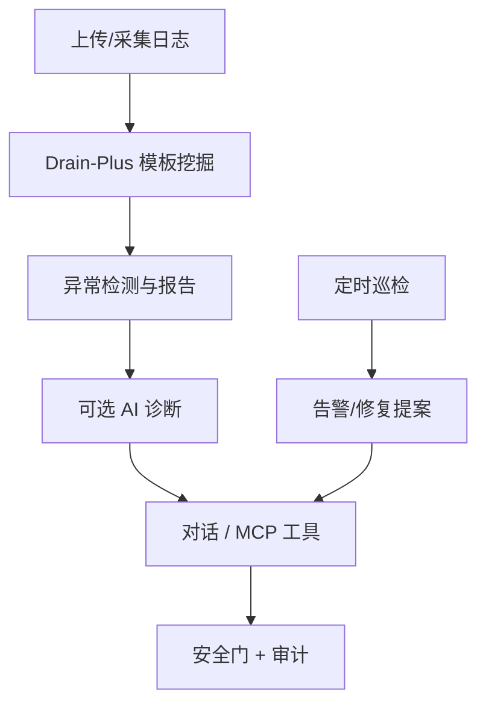
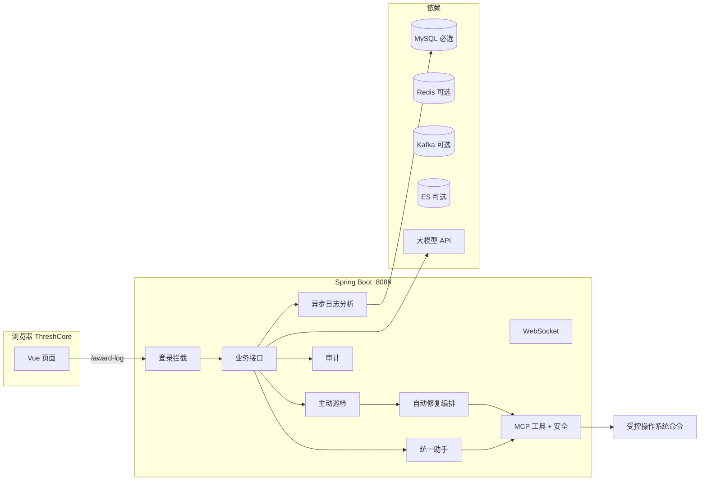

# ThreshCore（award-log）开发者文档

| 项 | 说明 |
|----|------|
| **文档类型** | 工程说明（**全员可读**：产品/运维/测试/研发/部署） |
| **系统名称** | ThreshCore 控制台 + award-log 后端服务 |
| **Context Path** | `/award-log`（所有后端接口前的统一前缀） |
| **默认端口** | `8088`（后端）；前端开发常见 `3000`（Vite） |
| **版本** | 与当前工程实现同步（2026） |

**版权声明**：Apache License 2.0，见 `LICENSE` 与 `NOTICE`。

---

## 谁该读哪一节？

| 你是… | 建议阅读 |
|--------|----------|
| **产品经理 / 评委 / 业务** | [阅读地图](#阅读地图)、[系统是做什么的](#系统是做什么的白话)、[控制台 8 个 Tab](#控制台-8-个-tab-说明)、[赛题对照](#赛题对照)、[答辩演示](#答辩演示建议) |
| **运维 / 值班** | 上文 + [用户角色](#用户角色与典型一天)、[安全护栏（白话）](#安全护栏白话)、[有界自动修复](#有界自动修复白话)、[监控与排障](#监控与排障) |
| **测试** | [功能全景](#功能全景)、[F1–F8](#功能需求索引-f1f8)、[API 分组](#后端-api-分组)、[测试](#测试) |
| **前端 / 后端开发** | 全文；接口细节以 **Knife4j**（`/award-log/doc.html`）为准 |
| **部署工程师** | [快速开始](#快速开始)、[配置说明](#配置说明)、[构建与部署](#构建与部署)、`docs/deployment/prod-config-example.yml`、[初赛检查清单](docs/deployment/初赛提交与演示检查清单.md) |

**文档体系**（避免重复劳动）：

| 文档 | 路径 | 适合谁 |
|------|------|--------|
| **本文 README** | 根目录 | 所有人：入门、Tab、赛题、技术索引 |
| 功能设计（初稿） | `docs/功能设计文档.md` | 产品：每模块「目的/为何/效果/边界」 |
| 需求与设计规格书 | `docs/项目需求与设计规格说明书.md` | 评审/验收：SRS、业务场景、安全边界 |
| 功能设计（详细版） | `docs/ThreshCore功能设计文档-详细版.md` | 研发深挖 MCP/配置对照 |
| 初赛检查清单 | `docs/deployment/初赛提交与演示检查清单.md` | 提交前 48h、答辩前 24h 自检 |
| 答辩演示脚本 | `docs/deployment/答辩演示脚本.md` | 3 分钟逐步话术 |
| 接口契约 | Knife4j 在线文档 | 联调：请求体、字段、示例 |

---

## 系统是做什么的（白话）

**一句话**：ThreshCore 是一个在浏览器里用的运维与日志平台——既能**上传分析海量日志**，也能用**中文对话**让系统帮你看磁盘、进程、日志，但所有「动机器」的操作都经过**白名单、风险评分、二次确认和审计**，避免 AI 或误操作把生产搞挂。

**三大能力（可分开理解）**：

| 主线 | 通俗说法 | 典型用户动作 |
|------|----------|--------------|
| **可观测与根因** | 把几 GB 日志归纳成「模板 + 异常 + 图表」，再让 AI 帮忙解读 | 上传日志 → 看报告 → 点 AI 诊断 |
| **受控智能运维** | 像和同事聊天一样问「磁盘满了吗」，系统只能调用**登记过的工具**（看磁盘、清日志、重启白名单服务等） | 工作台对话 / 工具控制台 |
| **主动闭环** | 系统定时自己看磁盘、告警、僵尸进程等，发现问题可**自动清临时文件**或**生成待你点确认的方案** | 看顶栏告警 → 确认修复 |

**不是什么**：不是「给 AI 一个 root 终端随便执行」；不是必须装齐 Kafka/Redis 才能用核心功能（它们默认关闭）。

---

## 阅读地图

设想夜班运维**小张**的一天（与 `docs/功能设计文档.md` 故事线一致）：

1. **早上**：打开 **仪表盘（Tab 7）** 看昨天任务汇总。  
2. **十点业务报慢**：在 **日志分析（Tab 5）** 上传 access/error 日志，看**进度条**；报告出来后某一模板暴增。  
3. **深挖**：点 **AI 全盘诊断**，再对某一行 **单行诊断**。  
4. **看机器**：在 **工作台对话（Tab 1）** 问「这台机磁盘是不是要满」；助手建议打开 **工具控制台（Tab 2）** 跑磁盘排行。  
5. **安全执行**：界面弹出 **风险分**，小张输入 **「确认执行」** 后才真正删文件或重启服务。  
6. **交班**：科长问「谁干的」——小张在 **运维链路审计（Tab 4）** 用 **traceId** 拉出「接收→感知→推理→校验」四步；必要时在 **执行审计（Tab 3）** 查 AI/MCP 记录。

键盘快捷键：焦点不在输入框时按 **数字键 1–8** 可切换 Tab（见 [控制台说明](#控制台-8-个-tab-说明)）。

---

## 快速开始

### 给非开发者（只体验界面）

1. 请同事或部署同学按下面「给开发者」步骤把服务跑起来。  
2. 浏览器打开前端地址（开发多为 `http://localhost:3000`）。  
3. **注册/登录** → 从 **日志分析** 上传一个小日志文件 → 等进度完成 → 看报告。  
4. 再试 **工作台对话** 问一句「查看系统负载」（需配置大模型 Key 才有智能回复）。

### 给开发者（本地一条龙）

**环境**：JDK 17、Maven 3.8+、MySQL 8、Node 18+。

```bash
# 1. 创建数据库并建表（库名以你为准，需与配置一致）
mysql -u root -p -e "CREATE DATABASE IF NOT EXISTS log_analysis DEFAULT CHARSET utf8mb4;"
mysql -u root -p log_analysis < src/main/resources/schema.sql

# 2. 密钥（二选一，勿提交 Git）
#    A) 复制 src/main/resources/application-local.example.yml
#       → application-local.yml，填写 password 与 api-key
#    B) 复制 .env.example → .env，导出 DB_PASSWORD、AI_API_KEY

# 3. 启动后端（默认 dev profile，端口 8088）
mvn spring-boot:run

# 4. 启动前端
cd frontend
cp .env.example .env.development   # 可选
# .env.development 推荐：VITE_AWARD_LOG_BASE_URL=http://localhost:3000/award-log
npm install && npm run dev
```

- **接口文档**：`http://localhost:8088/award-log/doc.html`（Knife4j，需后端已启动）。  
- **生产**：`spring.profiles.active=prod`，密钥用环境变量，见 [构建与部署](#构建与部署)。

---

## 名词解释

每个术语提供 **通俗说法** 与 **技术说明**，方便不同读者对照。

| 术语 | 通俗说法 | 技术说明 |
|------|----------|----------|
| **后端 / API** | 跑在服务器上的程序，浏览器通过「网址」把文件、指令发给它 | Spring Boot 应用，统一前缀 `/award-log` |
| **前端 / 控制台** | 你在浏览器里点的 ThreshCore 界面 | Vue 3 + Vite，目录 `frontend/` |
| **Context Path** | 地址里固定多一段 `/award-log` | 例：`http://主机:8088/award-log/api/assistant/context` |
| **MySQL** | 存用户、任务、告警、审计等「表格数据」的数据库 | **必选**；未安装则无法登录与存任务 |
| **Redis / Kafka / ES / Qdrant** | 可选的加速、队列、搜索、向量库 | 默认**不加载**；没装也不影响核心日志分析 + MCP |
| **Drain / 模板** | 把成千上万行相似日志归纳成「一条模板 + 出现次数」 | Drain-Plus 算法，配置在 `log.pipeline.analyzer.drain` |
| **MCP / 工具** | 允许助手或按钮去做的「登记过的主机操作」 | Spring Bean + `McpToolRegistry`；非独立 MCP 守护进程 |
| **风险分** | 0–10 分，越高越危险，高分要确认或拒绝 | `AgenticRiskScoreEngine` + `agent.security.risk-score-*` |
| **二次确认** | 真正删文件/重启前要你输入 **「确认执行」** | HTTP 工具台与巡检修复共用口令 |
| **traceId** | 一次操作的「流水号」，用来查审计 | `ops_audit_trace.trace_id` |
| **CoT / 思维链** | 审计里看到的四步摘要：收到指令→感知环境→推理→安检 | `ops_audit_trace.steps_json` |
| **SSE** | 工作台打字时字一个个出来 | `POST /api/assistant/chat/stream` |
| **最小权限** | 命令尽量不用 root，而用专用账号 `award-agent` | `MinPrivilegeExecutor`；Windows 开发可关闭 |
| **有界自动修复** | 巡检后只敢做「清临时目录、裁日志」等预定动作 | `OpsAutoRemediationService`，不是任意 Shell |

---

## 系统概要

| 项 | 说明 |
|----|------|
| 架构形态 | B/S：浏览器 + 单机 Spring Boot（可前后端分离部署） |
| 后端 | Java 17、Spring Boot 3.5、MyBatis、Spring AI 1.1.0 |
| 前端 | Vue 3、Element Plus、ECharts、Vite 4 |
| 必选 | MySQL 8 |
| 大模型 | OpenAI **兼容**协议（DeepSeek、通义等网关均可），需 `AI_API_KEY` |
| 目标平台（赛题） | LoongArch + 麒麟 V11：**代码通用**，交付需附实测报告 |

**端到端流水线（逻辑）**：



---

## 赛题对照

面向「智能运维 Agent / MCP / 安全护栏」类赛题的自检表（验收细节见 `docs/项目需求与设计规格说明书.md`）。

### 五项基本功能

| 赛题要求 | 状态 | 实现位置（给开发查代码） |
|----------|------|-------------------------|
| OS 深度感知 | ✅ | `OsInsightTool`（journalctl、ss、lsof）、`ProcessTool`、`NetworkTool`、`DiskTool` 等 |
| MCP 插件化 | ✅ | `McpToolRegistry`、`mcp/tools/*`、`McpExecuteController` |
| 安全意图校验 | ✅ | `IntentRiskFilter`、`PromptInjectionGuard`、`HighRiskCommandDetector` |
| 最小权限执行 | ✅（需配置） | `MinPrivilegeExecutor`、`agent.run-as-user` |
| 推理链路溯源 | ✅ | `ops_audit_trace`、Tab「运维链路审计」 |

### 非功能与平台

| 赛题要求 | 状态 | 说明 |
|----------|------|------|
| 严禁乱改关键配置 | ⚠️ 路径级 | 白名单路径 + 只读 `ConfigCheckTool`；无配置文件哈希监控 |
| 抗 Prompt 注入 | ✅ 规则为主 | `PromptInjectionGuard`；可选 ML：`agent.security.intent-use-ml` |
| B/S | ✅ | Vue + Spring Boot |
| 龙芯 + 麒麟 | 📋 交付证明 | README 不能代替实测，需团队附构建/运行截图 |

### 典型场景：「帮我清理系统垃圾」

| 步骤 | 系统做什么 | 相关组件 |
|------|------------|----------|
| 1. 理解诉求 | 对话或工具台接收自然语言 | 工作台 / `/api/mcp` |
| 2. 感知 | 查磁盘占用、大日志、目录排行 | `DiskTool`、`LogAnalysisTool` |
| 3. 推理 | 判断是日志占满而非别的 | 助手 + 工具返回 |
| 4. 安全校验 | 是否 DB 日志、路径是否白名单、风险分 | `LogSafetyClassifier`、`OpsPathPolicy` |
| 5. 预览 | **dry-run** 展示将执行的命令 | `LogCleanupTool` |
| 6. 确认 | 用户确认或输入「确认执行」 | 前端 + `confirmExecute` |
| 7. 执行 | 专用低权限用户执行 | `MinPrivilegeExecutor` |
| 8. 审计 | 保存 traceId 与 CoT 四步 | `ops_audit_trace` |

**与「最小赛题包」关系**：本仓库还包含完整 **日志分析生产线**（Drain、告警、ML 等），答辩叙事建议：**赛题 Agent 主线 + 企业可观测扩展**。

### 能力边界（答辩建议如实说）

| 主题 | 说明 |
|------|------|
| MCP 实现形态 | 进程内 Java 工具 + HTTP，便于与审计一体；非 stdio 独立 MCP Server |
| 安全双入口 | HTTP `/api/mcp` 与对话 `@Tool` 均经 `McpInvocationSecurityGate`；`McpToolSecurityAspect` 为切面委托（CHAT 面不弹 NEED_CONFIRM，写操作仍靠 dry-run/confirm 参数） |
| 自愈范围 | 仅巡检后 playbook，**不能**让模型随便执行任意 shell |

---

## 答辩演示建议

分步话术见 **`docs/deployment/答辩演示脚本.md`**；提交前自检见 **`docs/deployment/初赛提交与演示检查清单.md`**。

约 **3 分钟**，建议提前登录并配置好 `AI_API_KEY`。

| 顺序 | 演示内容 | 操作入口 | 期望现象 |
|------|----------|----------|----------|
| 1 | 安全拒绝 | 工作台或工具台输入含 `rm -rf`、忽略安全规则等 | 拦截提示 + 运维链路审计可见拒绝原因 |
| 2 | 感知 + 预览 | 问「磁盘/日志是否占满」→ 跑磁盘/日志工具 → 日志清理 **仅预览** | 返回 riskScore、预览命令，未真删 |
| 3 | 审计闭环 | Tab「运维链路审计」搜索 traceId | 四步 CoT：接收→感知→推理→校验 |

生产演示环境：`agent.min-privilege.enabled=true`，`app.security.ai-audit-relaxed-read=false`。

---

## 功能需求索引（F1–F8）

| 编号 | 需求（验收用语） | 主要代码/接口 |
|------|------------------|---------------|
| F1 | 登录、用户、角色、权限 | `/admin/user`、`/admin/role`、`/admin/permission` |
| F2 | 日志上传、异步分析、报告下载 | `/log/**`、`LogAnalysisServiceImpl` |
| F3 | 告警配置、历史、生命周期 | `/api/alarm*`、`/api/v1/alarm/lifecycle` |
| F4 | AI 全盘/单行诊断、聊天分析 | `/log/diagnose`、`/api/chat/analyze*` |
| F5 | 统一助手、MCP 工具台 | `/api/assistant`、`/api/mcp` |
| F6 | 主动巡检、有界自动修复 | `/api/ops/patrol/*`、`OpsAutoRemediationService` |
| F7 | 延时运维任务 | `/api/ops-schedule` |
| F8 | 性能、Runbook、知识库、模型评估等 | `/api/performance`、`/api/runbook`、`/api/v1/*` |

---

## 用户角色与典型一天

| 角色 | 关心什么 | 常用界面/接口 |
|------|----------|---------------|
| **运维管理员** | 分析日志、对话排障、执行工具、看巡检 | Tab 1–2、5–8；`/log`、`/api/assistant`、`/api/mcp` |
| **系统管理员** | 账号权限、告警策略、生产密钥 | 用户管理接口；`application.yml` / 环境变量 |
| **审计员** | 谁何时执行了什么、是否二次确认 | Tab 3–4；`/admin/audit/ai`、`/api/ops-trace` |

未登录访问业务接口会 **401**：前端请求需带 Cookie（`credentials: 'include'`），且 API 地址含 `/award-log` 前缀。

---

## 功能全景

| 能力 | 用户可见 | 技术位置 |
|------|----------|----------|
| 单/多文件日志上传 | Tab 5 日志分析 | `LogAnalysisController` |
| 任务进度、取消、历史 | Tab 5–6 | `AnalysisTaskManager` |
| 报告、图表、CSV/HTML 导出 | Tab 5、7 | `target/output/<taskId>/` |
| AI 全盘/单行诊断 | 分析页按钮 | `AiDiagnosisController` |
| 聊天式日志分析 | 对话分析入口 | `ChatAnalysisController` |
| 工作台自然语言 | Tab 1 | `UnifiedAssistantController` |
| MCP 工具台 | Tab 2 | `McpExecuteController` |
| 执行审计 | Tab 3 | `AiAuditController` |
| 运维链路审计（CoT） | Tab 4 | `OpsTraceController` |
| 告警配置与历史 | Tab 8、顶栏 | `AlarmConfigController` 等 |
| 顶栏性能与巡检推送 | 顶栏 | `TopPerformanceBar.vue`、`/ws/performance` |
| 巡检后自动/待确认修复 | 巡检 API + 助手 | `OpsAutoRemediationService` |
| 用户服务协议 | 登录页 | `UserServiceAgreement.vue` |
| RBAC、Runbook、知识库、ML 反馈等 | 管理/API | 见 [API 分组](#后端-api-分组) |

---

## 控制台 8 个 Tab 说明

入口：`frontend/src/App.vue`。左侧两组菜单：**工作台 · 工具 · 审计** | **日志与分析**。

| 快捷键 | Tab 名称 | 给谁用 | 做什么 | 注意事项 |
|--------|----------|--------|--------|----------|
| **1** | 工作台对话 | 运维 | 中文问问题，流式回答；可自动调 MCP 工具 | 需配置 `AI_API_KEY`；写操作仍要确认 |
| **2** | 工具控制台 | 运维 | 像表单一样选工具（看磁盘、清日志等） | 会显示风险分；高危需二次确认 |
| **3** | 执行审计 | 审计/管理员 | 查 AI/MCP 执行记录列表 | 生产应限制普通用户可见 |
| **4** | 运维链路审计 | 审计/运维 | 按 traceId 看四步思维链 | 答辩「可追溯」重点页 |
| **5** | 日志分析 | 运维/分析 | 上传日志、看进度、报告、点诊断 | 大文件耗时长，可调超时 |
| **6** | 任务记录 | 运维 | 历史任务分页、状态 | 可取消进行中的任务 |
| **7** | 日志分析仪表盘 | 运维/管理 | 多任务汇总图表 | 依赖已有完成任务 |
| **8** | 告警历史分析 | 运维 | 告警列表与趋势 | 依赖告警配置与数据源 |

**顶栏**：`TopPerformanceBar.vue` 显示本机 CPU/内存/磁盘等；WebSocket 推送巡检告警（`patrol_alert`）。也可 `GET /api/ops/patrol/*` 轮询。

**前端与后端地址**：构建变量 `VITE_AWARD_LOG_BASE_URL` 必须包含 `/award-log`，且无尾斜杠。开发推荐 `http://localhost:3000/award-log` 走 Vite 代理到 8088。

**相关前端文件**：

| 文件 | 作用 |
|------|------|
| `frontend/src/utils/mcpToolsMeta.js` | 工具说明与 `/api/mcp/tools` 合并 |
| `frontend/src/utils/mcpRiskConfirm.js` | 二次确认弹窗文案 |
| `frontend/src/utils/mcpToolResult.js` | 解析返回（含 riskScore） |
| `frontend/src/components/OpsChatInterface.vue` | 工作台对话 UI |
| `frontend/src/components/McpToolsDemo.vue` | 工具控制台 UI |
| `frontend/src/components/OpsTraceCenter.vue` | 链路审计详情 |

---

## 安全护栏（白话）

**问题**：大模型可能「说错就做错」——误删库、执行危险命令、被对话注入诱导。

**本系统做法（多层，不是单一开关）**：

| 层 | 通俗解释 | 技术组件 |
|----|----------|----------|
| 登录与权限 | 未登录不能调业务接口 | `AuthInterceptor`、RBAC |
| 工具白名单 | 只能调用登记过的工具名 | `McpInvocationSecurityGate` |
| 路径白名单 | 只能读/删配置允许的目录 | `OpsPathPolicy` |
| 日志删除保护 | 清理前识别像数据库日志的路径 | `LogSafetyClassifier` |
| 注入与意图 | 识别「忽略规则」「删根目录」等话术 | `PromptInjectionGuard`、`IntentRiskFilter` |
| 高危命令 | 拦截命令串里的 rm -rf 等 | `HighRiskCommandDetector` |
| 风险评分 | 0–10 分决定自动/确认/拒绝 | `AgenticRiskScoreEngine` |
| 预览与确认 | 先 dry-run 看命令，再输入「确认执行」 | 工具参数 + 前端 |
| 最小权限 | 用 `award-agent` 跑命令，而非 root | `MinPrivilegeExecutor` |
| 审计 | 每次留 traceId 和四步摘要 | `ops_audit_trace` |

**两条执行入口（开发需知）**：

- **工具控制台 / HTTP**：`McpInvocationSecurityGate`（含 NEED_CONFIRM 二次确认流）。  
- **工作台里模型自动调工具**：`McpToolSecurityAspect` → 同一 `evaluateChatToolInvocation`（注入/意图/Agentic 分/只读面；中等风险在对话侧不弹确认，写工具默认预览）。

生产检查清单：`app.security.ai-audit-relaxed-read=false`，`agent.min-privilege.enabled=true`，限制 Knife4j/Actuator 外网访问。

---

## 有界自动修复（白话）

**是什么**：巡检（定时看磁盘、告警、僵尸进程等）发现问题后，系统可以**自动清临时目录**或**生成一份待你确认的方案**，而不是让 AI 随便执行命令。

**模式**（`ops.auto-remediation.run-mode`）：

| 模式 | 含义 |
|------|------|
| `HYBRID`（默认） | 风险分低的步骤自动做；高的进入「待确认」 |
| `CONFIRM_FIRST` | 全部只生成方案，等你确认 |
| `IMMEDIATE` | 满足条件时全部自动（演示慎用） |

确认口令：**「确认执行」**（与 MCP 二次确认同源）。关闭开关：`ops.auto-remediation.enabled=false`。

---

## 架构与技术栈

### 逻辑架构



### 技术栈清单

| 层级 | 技术 | 备注 |
|------|------|------|
| 前端 | Vue 3、Vite 4、Element Plus、ECharts | 仅维护 `frontend/` |
| 后端 | Spring Boot 3.5、Spring MVC、WebSocket | Java 17 |
| AI | Spring AI 1.1.0 | OpenAI 兼容协议 |
| 数据 | MyBatis、MySQL 8 | `schema.sql` 建表 |
| 文档 | Knife4j、Springdoc | `/award-log/doc.html` |
| 观测 | Actuator、Prometheus | 生产需收敛暴露 |

---

## 仓库与代码结构

```
项目根目录/
├── pom.xml                         # Maven 依赖与版本
├── docker-compose.yml              # 可选：MySQL、Qdrant（profile vector）
├── .env.example                    # 环境变量模板（勿提交 .env）
├── docs/                           # 产品/规格/部署文档
├── frontend/                       # ★ Vue 控制台（唯一前端主线）
│   ├── src/App.vue                 # Tab 与快捷键
│   ├── src/api/index.js            # Axios 基址
│   └── .env.example                # VITE_* 变量
├── src/main/java/com/award/log/
│   ├── AwardWinningLogApplication.java
│   ├── controller/                 # REST 入口（见 API 表）
│   ├── service/ / impl/            # 业务逻辑
│   ├── agent/                      # 助手编排、审计记录、上下文拼装
│   ├── mcp/                        # 工具注册、执行器、tools/*
│   ├── security/                   # 安全门、路径策略、注入/意图
│   ├── analyzer/ / analysis/       # Drain、日志解析、异常启发式
│   ├── scheduling/                 # OpsPatrolScheduler
│   ├── config/                     # WebMvc、生产校验、启动诊断
│   └── handler/                    # WebSocket 性能推送
├── src/main/resources/
│   ├── application.yml             # 主配置（密钥勿写死）
│   ├── application-dev.yml         # 开发放宽项
│   ├── application-local.example.yml
│   └── schema.sql                  # ★ 部署必执行
├── scripts/deploy/                 # deploy.sh、nginx.sample.conf
└── src/test/java/                  # 单元测试
```

---

## 后端 API 分组

**约定**：

- 完整 URL = `http(s)://主机:端口/award-log` + 下表路径。  
- 除登录注册、Swagger 外，需已登录（Cookie 会话）。  
- **最准的接口列表**：启动后打开 Knife4j。

### 对话类入口（易混淆）

| 接口 | 用途 | 与其他的区别 |
|------|------|--------------|
| `POST /api/assistant/chat/stream` | 工作台 SSE 对话，默认带 MCP 工具 | 主机运维主入口 |
| `POST /api/chat` | 兼容旧路径的运维对话 | 与助手共用工具注册 |
| `POST /api/chat/analyze` 等 | 针对**已选日志内容**的问答分析 | **不是**执行 rm、重启等主机写操作 |

### 核心业务前缀

| 前缀 | 控制器（代表） | 用途摘要 |
|------|----------------|----------|
| `/log` | `LogAnalysisController` | 上传、任务状态、报告、下载、取消 |
| `/log/diagnose` | `AiDiagnosisController` | AI 全盘/单行诊断 |
| `/admin/user` | `SysUserController` | 注册、登录、用户维护 |
| `/admin/role` | `SysRoleController` | 角色 |
| `/admin/permission` | `SysPermissionController` | 权限点 |
| `/admin/statistics` | `StatisticsController` | 统计摘要 |
| `/admin/audit/ai` | `AiAuditController` | 执行审计列表 |
| `/api/assistant` | `UnifiedAssistantController` | `GET /context`、`POST /chat/stream` |
| `/api/mcp` | `McpExecuteController` | 工具列表、执行、确认执行 |
| `/api/agent/path-policy` | `AgentPathPolicyController` | GET/PUT 路径与服务白名单（顶栏「路径白名单」） |
| `/api/ops/patrol` | `OpsPatrolController` | 巡检告警、关联快照、修复摘要/确认 |
| `/api/ops-trace` | `OpsTraceController` | 运维链路列表、`/detail?traceId=` |
| `/api/ops-schedule` | `OpsScheduleController` | 延时任务 |
| `/api/alarm` | `AlarmConfigController` | 告警配置 |
| `/api/alarm/history` | `AlarmHistoryController` | 告警历史 |
| `/api/v1/alarm/lifecycle` | `AlarmLifecycleController` | 告警生命周期 |
| `/api/performance` | `PerformanceAnalysisController` | 性能 REST |
| `/api/runbook` | `RunbookApprovalController` | Runbook 审批 |
| `/decision-feedback` | `DecisionFeedbackController` | 决策反馈与训练触发 |
| `/api/v1/knowledge` | `KnowledgeController` | 知识库 |
| `/api/v1/templates` | `TemplateManagementController` | 模板管理 |
| `/api/v1/rules` | `RuleManagementController` | 规则管理 |
| `/api/v1/model` | `ModelEvaluationController` 等 | 模型评估与健康 |
| `/api/log/clean` | `LogCleanController` | 清洗规则 |
| `/api/platform` | `PlatformReadinessController` | 平台就绪检查 |

### WebSocket

| 路径 | 处理器 | 说明 |
|------|--------|------|
| `/ws/performance` | `PerformanceWebSocketHandler` | 约 5s 推送性能 JSON；含 `patrol_alert` |
| `/ws/logs` | `LogWebSocketHandler` | 日志流（可选演示） |

握手鉴权：`WebSocketAuthHandshakeInterceptor`；生产应收紧 `AllowedOrigins`。

---

## 日志分析流水线

实现类：`LogAnalysisServiceImpl#startAnalysisAsync`。

| 阶段 | 做什么 | 说明 |
|------|--------|------|
| 1 | 任务初始化 | `AnalysisTaskManager` 记录状态，可防重复分析同路径 |
| 2 | 分片读取 | 大文件按 `shardSize` 切块，降低内存 |
| 3 | Drain-Plus | 模板树，`log.pipeline.analyzer.drain` 可调 |
| 4 | 并行处理 | 线程池 `logAnalysisExecutor`，按序合并 |
| 5 | 异常检测 | 时序/关键词/频次启发式；可接决策融合 |
| 6 | 导出 | CSV/HTML → `{user.dir}/target/output/{taskId}/` |
| 7 | 收尾 | 汇总写入数据库 |

**解析诚实原则**：`LinuxLogParseSupport`、`ServerLogParseSupport` 等解析失败时**不伪造时间**（用占位符）。

**取消**：`cancelAnalysis` 可中断进行中的任务。

---

## 决策与机器学习

| 组件 | 说明 |
|------|------|
| 规则引擎 | `decision` 包、`RuleRegistryServiceImpl` |
| 随机森林 ONNX | 默认 `resources/models/random-forest-v2.onnx`，路径 `log.pipeline.decision.rf.model-path` |
| LLM 决策 | `LlmChatController` 等 |
| 再训练 | `DecisionFeedbackController` + `scripts/ml/train_model.py`（需本机 Python） |

未部署模型文件时相关路径会**降级**为启发式，属预期行为。

---

## MCP 工具链

### 工具清单

HTTP 调用时 `toolName` 须与下表 **Bean 名**一致。Spring AI `@Tool` 方法名见各类源码注解。

| toolName | 源文件 | 能力 | 写操作？ |
|----------|--------|------|--------|
| `LogAnalysisTool` | `mcp/tools/LogAnalysisTool.java` | 读主机日志并分析 | 否 |
| `DiskTool` | `mcp/tools/DiskTool.java` | 磁盘占用 df | 否 |
| `DiskInsightTool` | `DiskTool` 排行接口 | 目录热点 du（白名单路径） | 否 |
| `DiskAnalyzeTool` | `mcp/tools/DiskAnalyzeTool.java` | 磁盘压力综合诊断 | 否 |
| `ProcessTool` | `mcp/tools/ProcessTool.java` | 进程列表 | 否 |
| `SystemLoadTool` | `mcp/tools/SystemLoadTool.java` | 负载 | 否 |
| `NetworkTool` | `mcp/tools/NetworkTool.java` | ping / traceroute | 否 |
| `OsInsightTool` | `mcp/tools/OsInsightTool.java` | journalctl / ss / lsof | 否 |
| `ConfigCheckTool` | `mcp/tools/ConfigCheckTool.java` | 配置语法只读检查 | 否 |
| `PrivilegeTool` | `mcp/tools/PrivilegeTool.java` | 权限探测 | 否 |
| `CleanTempTool` | `mcp/tools/CleanTempTool.java` | 清临时目录 | **是**（dry-run + 确认） |
| `LogCleanupTool` | `mcp/tools/LogCleanupTool.java` | 清陈旧日志 | **是** |
| `ServiceRestartTool` | `mcp/tools/ServiceRestartTool.java` | 重启白名单服务 | **是** |
| `FirstMcpTools` | `mcp/FirstMcpTools.java` | 示例 | HTTP 允许列表以 Gate 为准 |

### 写操作参数（必读）

| 工具 | 仅预览（默认） | 真实执行 |
|------|----------------|----------|
| `CleanTempTool` / `LogCleanupTool` | `dryRun` 省略或为 `true` | **同时** `dryRun=false` 且 `confirmDelete=true` |
| `ServiceRestartTool` | 同上 | **同时** `dryRun=false` 且 `confirmRestart=true` |

只设 `dryRun=false` 而不带确认位会返回安全策略错误。界面点「确认执行」后，`/api/mcp/confirmExecute` 与前端会自动补上上述确认参数（无需手填）。

**API 示例（日志真实删除）**：

```json
{
  "toolName": "LogCleanupTool",
  "parameters": {
    "path": "/var/log",
    "days": 30,
    "dryRun": false,
    "confirmDelete": true
  }
}
```

### 执行与安全（开发）

- **列表/执行/确认**：`McpExecuteController` → `/api/mcp/tools`、`/execute`、`/confirmExecute`。  
- **CoT 审计**：成功/拦截/待确认均写入 `ops_audit_trace.steps_json`（四步）。  
- **风险分**：`AgenticRiskScoreEngine` 0–10；`agent.security.risk-score-auto-max`（倾向自动）、`risk-score-confirm-max`（超过拒绝，区间需确认）。  
- **信任边界**：`McpSecurityProfile` 区分首次请求 / 已确认 / 延时任务。  
- **只读工具面**：`ToolSurfaceResolver` 为 READ_ONLY 时，写类 Bean 不注入模型。  
- **输出截断**：`AbstractCommandExecutor` 限制 stdout/stderr 长度。

**路径与重启**：

| 方式 | 说明 |
|------|------|
| **控制台（推荐运维）** | 顶栏 **「路径白名单」** → 编辑可读路径、临时清理根、日志清理根、可重启服务 → 保存后立即生效 |
| **配置文件** | `application.yml` 的 `agent.paths.*`、`agent.service-restart.allowlist` |
| **覆盖文件** | 控制台保存后生成 `agent-path-policy-overrides.json`（工作目录，已 gitignore） |

禁止片段（如 `/root`、`/.ssh`）**不能**在前端放宽，仅能在 `agent.paths.denied-substrings` 调整。Linux 生产仍建议配置 `award-agent` + sudoers。

深入设计见 `docs/ThreshCore功能设计文档-详细版.md` §8–9。

---

## 安全与审计（技术索引）

| 机制 | 位置 | 作用 |
|------|------|------|
| 登录拦截 | `AuthInterceptor`、`WebMvcConfig` | 保护 `/admin`、`/log`、`/api` |
| HTTP 工具门控 | `McpInvocationSecurityGate` | 白名单、参数上限、注入/意图/风险分/确认流 |
| 对话工具切面 | `McpToolSecurityAspect` | `@Tool` 调用前委托 `McpInvocationSecurityGate.evaluateChatToolInvocation` |
| 风险评分 | `AgenticRiskScoreEngine` | 与阈值、巡检修复联动 |
| 路径策略 | `OpsPathPolicy` | 读/清/禁止路径 |
| 日志删除 | `LogSafetyClassifier` | DB/中间件路径识别 |
| 注入/意图 | `PromptInjectionGuard`、`IntentRiskFilter` | 自然语言过滤 |
| 高危命令 | `HighRiskCommandDetector` | 命令模式 |
| 最小权限 | `MinPrivilegeExecutor` | `sudo -u award-agent` 等 |
| 生产启动校验 | `ProductionProfileValidator` | prod 空数据库密码则退出 |
| 执行审计 | `AiAuditController` | `/admin/audit/ai` |
| 运维链路 | `OpsAuditTraceService`、`AssistantAuditRecorder` | `ops_audit_trace` |
| 有界修复 | `OpsAutoRemediationService` | 巡检后 playbook |

`app.security.ai-audit-relaxed-read=true` 仅建议**开发**使用；生产必须为 `false`。

---

## 数据持久化

- **建表**：`src/main/resources/schema.sql`（部署必备）。  
- **增量**：根目录 `migrate_decision_feedback.sql`、`update_schema.sql`、`add_permission_columns.sql` 等按环境执行。  
- **重要表**：`sys_user`、`sys_role`、`sys_permission`、`log_analysis_task`、`log_analysis_detail`、`ops_audit_trace`、`log_alarm` 等。  
- **Mapper**：`src/main/resources/mapper/*.xml` ↔ `com.award.log.mapper`。

---

## 中间件（可选）

| 组件 | 配置 | 未安装时 |
|------|------|----------|
| **MySQL** | `spring.datasource.*` | **无法运行** |
| Redis | `award.middleware.redis=false`（默认） | 不加载 Redis 自动配置 |
| Kafka | `award.middleware.kafka=false`（默认） | 不连 Kafka |
| Elasticsearch | `ELASTIC_ENABLED=false` | 跳过 ES 功能 |
| Qdrant | `qdrant.*` | 向量检索不可用 |
| 邮件 / 企业微信 | `spring.mail.*`、`wechat.*` | 缺省则不推送 |

---

## 配置说明

### 环境变量（常用）

复制 `.env.example` → `.env`，或 `application-local.example.yml` → `application-local.yml`（均在 `.gitignore`）。

| 变量 | 必填？ | 含义 |
|------|--------|------|
| `DB_PASSWORD` | **是** | MySQL 密码（仓库无默认值） |
| `AI_API_KEY` | 助手/诊断需要 | 大模型密钥 |
| `AI_BASE_URL` | 否 | 兼容网关地址 |
| `AGENT_MIN_PRIVILEGE` | 否 | 是否最小权限（生产 true） |
| `AGENT_RUN_AS_USER` | 否 | 运行用户，默认 `award-agent` |
| `AGENT_ASSISTANT_USE_TOOLS` | 否 | 助手默认是否调 MCP |
| `AGENT_INTENT_USE_ML` | 否 | 意图 ML，默认 false |
| `OPS_AUTO_REMEDIATION_ENABLED` | 否 | 巡检自动修复总开关 |
| `APP_AI_AUDIT_RELAXED_READ` | 否 | 开发放宽审计；**生产 false** |
| `VITE_AWARD_LOG_BASE_URL` | 前端构建 | 须含 `/award-log` |
| `VITE_AWARD_LOG_WS_URL` | 否 | 跨域时指定 wss 地址 |
| `VITE_API_TIMEOUT_MS` | 否 | 默认 600000，大上传可调大 |
| `AWARD_MIDDLEWARE_KAFKA` / `REDIS` | 否 | 默认 false |
| `MAIL_HOST` | 邮件告警需要 | SMTP 主机，默认 `smtp.qq.com` |
| `MAIL_PORT` | 否 | 默认 `465`（QQ 隐式 SSL） |
| `MAIL_USERNAME` | 邮件告警需要 | 发件邮箱账号 |
| `MAIL_PASSWORD` | 邮件告警需要 | SMTP 授权码（非邮箱登录密码） |
| `MAIL_STARTTLS_ENABLE` | 否 | 465 端口保持 `false`；587 可改 `true` |
| `WECHAT_CORP_ID` | 企微告警需要 | 企业 ID |
| `WECHAT_APP_SECRET` | 企微告警需要 | 应用 Secret |
| `WECHAT_AGENT_ID` | 否 | 应用 AgentId，默认 `1000002` |

### 日志分析告警推送（两层配置）

告警要能发到邮箱/企业微信，需要 **同时** 配好下面两层，只配其一仍会 `SKIPPED` 或 `FAILED`：

| 层级 | 配置位置 | 作用 |
|------|----------|------|
| **通道账号** | `.env` / 环境变量 → `spring.mail.*`、`wechat.*`（见 `application.yml`） | 服务器用什么账号连 SMTP / 企微 API |
| **推送策略** | 控制台 **告警策略**（顶栏或日志分析内）→ 保存后写入项目根目录 `alarm-config.json` | 推给谁、渠道、最低级别、错误阈值、是否启用 |

**控制台必填项（保存前自检）**：

1. 启用告警 = 开  
2. 至少勾选 **邮箱** 或 **企业微信** 之一  
3. 勾选了就要填对应 **邮箱地址** 或 **企业微信用户 ID**  
4. 点击 **保存配置**（不要只关弹窗）  
5. 上传含异常的日志并完成分析后，到 **告警历史分析** 看 `pushStatus`

**`application.yml` 里 `alarm.error.threshold` / `alarm.min.severity` 说明**：当前代码**不读取**这两项决定推送；阈值与级别以控制台保存的 `alarm-config.json` 为准。`alarm.aggregation.*` 仍生效（同类告警 5 分钟内聚合去重）。

**常见 `pushStatus` 含义**：

| 状态 | 含义 | 处理 |
|------|------|------|
| `SUCCESS` | 已发出 | — |
| `SKIPPED:NO_CHANNELS` | 未勾选渠道或未填收件人 | 补全控制台告警配置 |
| `SKIPPED:ERROR_THRESHOLD_NOT_REACHED` | 告警正文里含 error/fatal/exception 的行数 &lt; 阈值 | 阈值改为 `1` 或换英文 ERROR 样例日志 |
| `SKIPPED:LEVEL_BELOW_THRESHOLD` | 级别低于配置的 ERROR | 降低级别或提高日志严重度 |
| `SKIPPED:COOLDOWN_ACTIVE` | 5 分钟内同类告警已推过 | 等待冷却或改 `cooldownMs` |
| `FAILED` | SMTP/企微调用失败 | 检查 `MAIL_*` / `WECHAT_*` 与授权码 |

**与顶栏巡检的区别**：顶栏「巡检待处理」来自 `ops.patrol` 主动巡检，不是本节的日志分析邮件告警。

### application.yml 业务块（节选）

| YAML 路径 | 含义 |
|-----------|------|
| `server.servlet.context-path` | `/award-log` |
| `log.pipeline.analyzer.drain` | Drain-Plus 参数 |
| `log.pipeline.decision.rf` | ONNX 模型路径与阈值 |
| `agent.security.risk-score-auto-max` | 自动执行上限分 |
| `agent.security.risk-score-confirm-max` | 拒绝上限分 |
| `agent.paths.log-cleanup-roots` | 日志清理白名单根 |
| `agent.service-restart.allowlist` | 可重启服务名 |
| `ops.patrol.*` | 巡检 Cron、阈值、预热 |
| `ops.auto-remediation.*` | 修复模式、磁盘阈值、`risk-patrol-auto-max` |
| `alarm.aggregation.*` | 日志告警聚合窗口（**推送阈值以控制台为准**） |
| `spring.mail.*` / `wechat.*` | 告警 SMTP / 企业微信（值来自 `MAIL_*`、`WECHAT_*` 环境变量） |

生产结构示例：`docs/deployment/prod-config-example.yml` → 复制为未入库的 `application-prod.yml`。

---

## 本地开发（分步）

1. 安装 JDK 17、Maven、MySQL、Node 18+。  
2. 建库并执行 `schema.sql`（及需要的增量 SQL）。  
3. 配置密钥（见 [快速开始](#快速开始)）。  
4. `mvn spring-boot:run` — 默认 `dev` profile（`application-dev.yml` 可关最小权限）。  
5. `cd frontend && npm install && npm run dev`。  
6. 浏览器登录 → 上传小日志验证 → 打开 Knife4j 查接口。  

**微信小程序**（若维护）：在微信开发者工具对 `frontend` 构建 npm，生成 `miniprogram_npm/`（已 gitignore）。

---

## 构建与部署

### 后端 Fat Jar

```bash
mvn -DskipTests package
java -jar target/award-log-*.jar --spring.profiles.active=prod
```

生产通过环境变量或 **未提交** 的 `application-prod.yml` 注入 `DB_PASSWORD` 等。

### 前端静态资源

```bash
cd frontend && npm ci && npm run build
```

将 `frontend/dist/` 放到 Nginx（或其它 Web 服务器）：

- 静态页面：`/`  
- 反向代理：浏览器访问的 `/award-log` → 后端 `http://127.0.0.1:8088/award-log`  
- 构建时设置 `VITE_AWARD_LOG_BASE_URL` 为用户浏览器实际访问的 API 根（HTTPS 场景不要用硬编码 `:8088`）

示例参考：`scripts/deploy/nginx.sample.conf`、`deploy.sh`、`deploy.ps1`。

### 运维注意

| 项 | 说明 |
|----|------|
| 分析报告目录 | `{进程工作目录}/target/output/<taskId>/`，需定期清理磁盘 |
| MCP 与宿主机 | JAR 建议本机或 systemd 直跑，以便读真实日志路径与 sudo 模型 |
| Docker Compose | 仅 MySQL/Qdrant 依赖；应用本身仍可宿主机运行 |
| LoongArch + 麒麟 | 交付附：JDK 版本、`mvn package`、前端 build、journalctl/systemctl 样例截图 |

### Docker Compose（可选）

```bash
# .env 中设置 MYSQL_ROOT_PASSWORD
docker compose up -d mysql
# 首次需手动对容器执行 schema.sql
docker compose --profile vector up -d   # 可选 Qdrant
```

---

## 监控与排障

### Actuator

`health`、`metrics`、`prometheus` 等（见 `management.endpoints`）。**生产勿对公网裸暴露**。

### 常见问题

| 现象 | 可能原因 | 处理 |
|------|----------|------|
| prod 启动立刻退出 | 数据库密码为空 | 设置 `DB_PASSWORD` |
| 前端 401 | 未登录、Cookie、API 前缀错误 | 检查登录、`VITE_AWARD_LOG_BASE_URL`、credentials |
| 上传/分析超时 | 文件过大 | 调 `VITE_API_TIMEOUT_MS`、Tomcat 超时 |
| AI 无回复 | 未配 Key 或网络 | `AI_API_KEY`、`AI_BASE_URL` |
| 助手不调工具 | `useToolAgent` 关闭或模型不支持 | 请求体与配置 |
| WebSocket 连不上 | HTTPS 未用 wss、反代未 Upgrade | 检查 Nginx 配置 |
| Kafka/Redis 报错 | 误开启中间件开关 | `award.middleware.*=false` 或部署实例 |
| Windows 下 MCP 权限错误 | 开发无 sudo | `application-dev.yml` 可 `agent.min-privilege.enabled=false` |

---

## 测试

| 类型 | 位置 |
|------|------|
| 单元测试 | `src/test/java/`：`LinuxLogParseSupportTest`、`ServerLogParseSupportTest`、`LogSafetyClassifierTest` 等 |
| 性能 | `tests/performance/*.jmx`（如有） |
| ML 脚本 | `scripts/ml/`（需 Python 环境） |

建议补充：工具 × 风险档 × 只读面 → BLOCK / CONFIRM / ALLOW 矩阵测试（赛题安检回归）。

---

## Git 与发布

- 分支：`main` 稳定，功能在 `feature/*` 开发。  
- 发版：`git tag -a v1.0.0 -m "release"` 后推送。  
- **切勿提交**：`.env`、`application-local.yml`、`application-prod.yml`、`alarm-config.json`（真实密钥）。

---

## `.gitignore`

忽略构建产物（`target/`、`frontend/dist/`）、`node_modules/`、密钥与本地配置、IDE 目录、日志目录、`frontend/miniprogram_npm/` 等。详见仓库 `.gitignore` 注释。

---

## 许可协议

本项目采用 **Apache License, Version 2.0**，全文见 `LICENSE`。

**版权**：Copyright 2026 zhaowenkai（见 `LICENSE` 与 `NOTICE`）。在遵守协议前提下欢迎 Issue 与 Pull Request。
