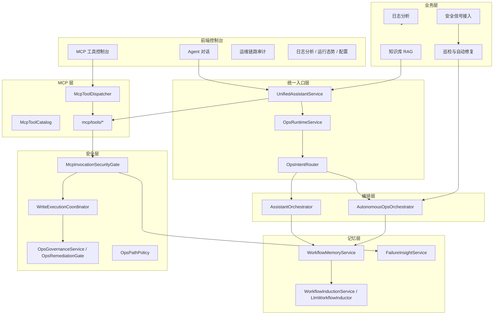

# ThreshCore（award-log）项目说明文档

| 项 | 说明 |
|----|------|
| 项目名称 | `ThreshCore` 控制台 + `award-log` 后端服务 |
| 项目定位 | 面向日志分析、智能运维、巡检审计与可控 Agent 执行的 B/S 平台 |
| 后端技术栈 | Java 17、Spring Boot 3.5、MyBatis、Spring AI 1.1.0、WebSocket |
| 前端技术栈 | Vue 3、Vite 4、Element Plus、ECharts、markdown-it |
| 默认端口 | 业务 **8088**（Context Path `/award-log`）；可选管理端口 **8089**（默认关闭）；前端开发 **3000** |
| Context Path | `/award-log` |
| 数据库 | MariaDB 10.11+ / MySQL 8 双驱动；主配置默认 MariaDB，本地模板默认 MySQL 8 |
| 当前规模 | 后端 **398** 个 Java 主代码文件、**44** 个 Controller、约 **191** 个 REST 映射；**26** 个 MCP 工具；**171** 个测试类、**646** 个 `@Test` |
| 代码量（口径见下） | 仓库文本合计约 **14.5 万行**；自研业务代码约 **8.2 万行**（不含 `miniprogram_npm` 打包 JS） |
| 质量门禁 | `mvn verify` 全绿；JaCoCo 指令覆盖率 **≥60%**（`pom.xml` 门禁 `0.60`）；分支覆盖率约 **39%**（无门禁） |
| 文档版本 | **2026-07-09** |
| 当前状态 | 已具备日志分析、MCP 工具执行、Agent 编排、巡检闭环、AWM 记忆、安全审计、知识库 RAG、HIDS/NIDS/PIDS 信号接入能力；**dev / prod-kylin 默认单端口 8088** |

**版权声明**：本软件为陕西机电职业技术学院 ThreshCore 团队竞赛参赛作品，版权归项目团队所有。未经授权，不得公开发布、开源或用于竞赛以外的商业用途。详见根目录 [`版权声明与使用限制声明.md`](./版权声明与使用限制声明.md)。

---

## 目录

- [项目概览](#项目概览)
- [谁应该先看哪一节](#谁应该先看哪一节)
- [文档体系](#文档体系)
- [系统能力总览](#系统能力总览)
- [项目规模与代码量](#项目规模与代码量)
- [端口与管理面必读](#端口与管理面必读)
- [快速开始](#快速开始)
- [维护与上手（不看长文档也能改）](#维护与上手不看长文档也能改)
- [本地开发与联调](#本地开发与联调)
- [系统架构](#系统架构)
- [Agent 运行时与编排](#agent-运行时与编排)
- [AWM 与 Reflexion 记忆层](#awm-与-reflexion-记忆层)
- [MCP 工具链](#mcp-工具链)
- [Markdown 输出规范](#markdown-输出规范)
- [安全与审计](#安全与审计)
- [生产治理路线](#生产治理路线)
- [日志分析流水线](#日志分析流水线)
- [知识库 RAG](#知识库-rag)
- [后端 API 索引](#后端-api-索引)
- [前端说明](#前端说明)
- [配置参考](#配置参考)
- [构建与部署](#构建与部署)
- [麒麟 V11 + LoongArch](#麒麟-v11--loongarch)
- [实际使用与演示模式](#实际使用与演示模式)
- [仓库结构](#仓库结构)
- [测试与质量保障](#测试与质量保障)
- [近期更新与当前边界](#近期更新与当前边界)
- [验收与回归建议](#验收与回归建议)
- [监控与排障](#监控与排障)
- [答辩与演示建议](#答辩与演示建议)
- [报表导出](#报表导出)
- [常见问题](#常见问题)
- [Git 与发布注意事项](#git-与发布注意事项)

---

## 项目概览

### 一句话介绍

`ThreshCore` 是一个把“日志分析”“智能运维对话”“可控工具执行”“安全风控”“审计留痕”“经验沉淀”整合到同一控制台里的平台。  
它不是给模型一个无约束终端，而是通过白名单工具、风险评分、路径策略、二次确认、审计记录，把 Agent 的执行收敛到一个可控边界内。

### 适用场景

- 上传应用或系统日志，做异常检测、模板提取、诊断建议、报告导出
- 通过中文对话触发磁盘清理、CPU 压力排查、服务检查、巡检续办等运维流程
- 用内置 MCP 工具执行只读探测或受控写操作
- 基于巡检结果进行自动处置提案、确认执行与效果评估
- 将成功处置链路沉淀为 AWM，可被后续流程复用
- 将被安全门拦截的危险轨迹沉淀为 Reflexion 教训
- 接入 Suricata / Wazuh / Sysmon / NetFlow 风格的安全信号，参与巡检与自动化诊断

### 项目边界

- 不是“开放 root shell 给 AI”
- 不是独立的完整商用 IDS / PIDS / HIDS 产品
- 不是必须依赖 Kafka / Redis / Elasticsearch 才能运行的系统，这些中间件默认可关闭
- Runbook 审批与执行记录已落库到 `ops_runbook_approval`，服务重启后可恢复

---

## 谁应该先看哪一节

| 角色 | 建议先看 |
|------|----------|
| 产品 / 评审 / 答辩 | [系统能力总览](#系统能力总览)、[答辩与演示建议](#答辩与演示建议)、[系统架构](#系统架构)、[安全与审计](#安全与审计) |
| 新开发同学 | [端口与管理面必读](#端口与管理面必读)、[快速开始](#快速开始)、[维护与上手（不看长文档也能改）](#维护与上手不看长文档也能改)、[常见问题](#常见问题) |
| 后端开发 | [系统架构](#系统架构)、[Agent 运行时与编排](#agent-运行时与编排)、[MCP 工具链](#mcp-工具链)、[安全与审计](#安全与审计) |
| 前端开发 | [前端说明](#前端说明)、[后端 API 索引](#后端-api-索引)、[配置参考](#配置参考) |
| 运维 / 部署 | [构建与部署](#构建与部署)、[麒麟 V11 + LoongArch](#麒麟-v11--loongarch)、[安全与审计](#安全与审计) |
| 测试 / QA | [测试与质量保障](#测试与质量保障)、[验收与回归建议](#验收与回归建议)、[安全与审计](#安全与审计) |

---

## 文档体系

| 文档 | 路径 | 说明 |
|------|------|------|
| 本文 README | 根目录 | 项目总说明、架构、运行、部署、开发与边界 |
| 部署文档 | [`docs/deployment/部署文档.md`](./docs/deployment/部署文档.md) | 更细的部署流程与上线步骤 |
| 新机 Jar+Dist 速查 | [`部署指南.md`](./部署指南.md) | 麒麟目标机只部署预构建产物（2026-07 实测） |
| 麒麟 Jar+Dist 速查 | [`docs/deployment/麒麟Jar+Dist部署速查.md`](./docs/deployment/麒麟Jar+Dist部署速查.md) | 与根目录部署指南互补的速查版 |
| 麒麟上线检查清单 | [`docs/deployment/麒麟V11-LoongArch生产上线检查清单.md`](./docs/deployment/麒麟V11-LoongArch生产上线检查清单.md) | 麒麟 / LoongArch 生产验收 |
| 交付 API 白名单 | [`docs/deployment/交付API白名单.md`](./docs/deployment/交付API白名单.md) | 演示必须接通 vs 仅 API / 扩展面 |
| 远程运维 SSH | [`docs/deployment/ssh-remote-ops.md`](./docs/deployment/ssh-remote-ops.md) | 生产环境 SSH 运维说明 |
| 生产配置示例 | `docs/deployment/prod-config-example.yml` | 生产配置模板参考 |
| Agent UI 改版说明 | [`frontend/AGENT_UI_REDESIGN.md`](./frontend/AGENT_UI_REDESIGN.md) | Agent 页面改版说明 |
| PPT / 答辩修订建议 | [`docs/deployment/慧鉴日志-PPT内容建议-按项目现状修订.md`](./docs/deployment/慧鉴日志-PPT内容建议-按项目现状修订.md) | 按当前代码现状整理的答辩要点 |
| 历史答辩材料 | `docs/archive/competition/` | 归档材料，不参与运行与构建 |
| 竞赛 Word 定稿 | `docs/competition/word-supplements/` | 功能设计 V1.4、需求 V2.6、说明书 V1.2、部署 V2.2 |
| 文档对照审计 | [`docs/review/文档与项目对照审计-2026-06-20.md`](./docs/review/文档与项目对照审计-2026-06-20.md) | 代码与交付文档逐项核对 |

在线接口文档默认位于：

- `http://localhost:8088/award-log/doc.html`

---

## 系统能力总览

### 控制台主能力

| 能力 | 说明 | 入口 |
|------|------|------|
| Agent 对话 | 中文自然语言运维结论，Playbook、工具调用、RAG | 快捷键 **1** / `ops-chat` |
| MCP 工具控制台 | 26 个白名单工具，搜索、参数表单、确认执行 | 快捷键 **2** / `mcp-tools` |
| 执行审计 | HTTP 访问轨迹、AI/MCP 执行记录、原始工具结果 | 快捷键 **3** / `audit` |
| 运维链路审计 | 六步 CoT、traceId、执行证据、AWM / Reflexion | 快捷键 **4** / `ops-audit-trace` |
| 日志分析 | 上传、Drain 模板、AI 诊断 | 快捷键 **5** / `analysis` |
| 任务记录 | 历史诊断任务 | 快捷键 **6** / `history` |
| 日志分析仪表盘 | 统计趋势 | 快捷键 **7** / `dashboard` |
| 运维效果评分 | 处置效果五维评分 | 快捷键 **8** / `ops-effect` |
| 系统配置与效果 | 运行配置、路径策略等 | 快捷键 **9** / `system-config` |
| MCP 技能 | 工具说明与技能页 | `agent-skills`（Agent 侧栏） |
| 环境状态 / 运行态势 | 组件就绪、本机大屏 | 顶栏 / 侧栏（无数字快捷键） |
| 知识库 RAG | 文档上传与检索 | 「日志与分析」分组 / `knowledge` |
| 个人中心 | 资料、API Key、RBAC | 顶栏用户菜单 / `profile-center` |

### 关键设计点

- Agent 走的是“可控执行”而不是“自由生成 shell”
- 写操作默认预览，风险达阈值需要显式确认口令 `确认执行`
- MCP 工具通过统一调度器、统一审计、统一风险分流
- Agent 页面面向运维人员直接给自然语言结论、影响和处置结果；traceId、工具原始返回、执行参数保留在审计页
- 巡检、自动修复和 LLM 对话是并存能力；自动化主链路已收敛为巡检 + 自动修复，历史自主运维命名仅作兼容入口
- AWM 只沉淀成功套路，Reflexion 只沉淀安全拦截教训
- Windows 本地开发与麒麟 / LoongArch 生产场景都有专门兼容配置

### 开发者 30 秒速览

| 动作 | 说明 |
|------|------|
| 启动后端 | `mvn spring-boot:run` |
| 启动前端 | `cd frontend && npm run dev` |
| 初始化数据库 | 手工执行 `src/main/resources/schema.sql` |
| 查看接口文档 | `http://localhost:8088/award-log/doc.html` |
| 执行 MCP 工具 | `GET /api/mcp/tools`、`POST /api/mcp/execute` |
| 触发 Agent 编排 | `POST /api/assistant/chat/stream` 或前端 `Tab1` |
| 触发巡检自动化 | `POST /api/ops/autonomous/run`（兼容入口） |
| 查看 AWM | `GET /api/ops/workflow/memory` |
| 查看安全自检 | `GET /api/security/self-check` |
| 查看安全信号摘要 | `GET /api/security/signals/summary` |
| 跑全量测试与覆盖率 | `mvn verify`，报告见 `target/site/jacoco/index.html` |
| 确认端口 | dev / prod-kylin 默认**仅 8088**；日志出现 `http-nio-8088` 即可（见 [端口与管理面](#端口与管理面必读)） |

---

## 项目规模与代码量

统计口径：物理行数（含空行与注释），不含 `node_modules`、`target`、`dist`、`.git`（2026-07 本仓库实测）。

| 类别 | 行数 | 说明 |
|------|------|------|
| Java（主 + 测） | 69,366 | `src/main/java` + `src/test/java` |
| Vue + JS + CSS（`frontend/src`） | 23,908 | 自研前端 |
| JS（`frontend/miniprogram_npm`） | ~48,000 | 小程序/npm **预打包依赖**，非手写业务 |
| XML / YAML / SQL | ~4,100 | Mapper、配置、建表脚本 |
| Markdown / Shell / Python 等 | ~9,500 | 文档与脚本 |
| **仓库文本合计** | **~145,000** | 各类源码与文档加总 |
| **自研产品代码（推荐对外口径）** | **~82,500** | Java + `frontend/src` + XML/YML/SQL/脚本，**不含** `miniprogram_npm` 与 Markdown |

答辩或申报材料建议写：**自研约 8.2 万行 + 646 个自动化测试 + 26 个 MCP 工具**，避免把 `miniprogram_npm` 或 `node_modules` 算进自研量。

---

## 端口与管理面必读

**当前默认：单端口 8088**（`dev` 与 `prod-kylin` 一致）。登录、Agent、MCP、统计、巡检等管理类接口与业务接口**同走 8088**，前端 Vite 代理默认也只指向 `http://127.0.0.1:8088`。

| 场景 | `app.management.enabled` | 监听端口 | 说明 |
|------|--------------------------|----------|------|
| **本地 dev（默认）** | `false`（`application-dev.yml`） | 仅 **8088** | 推荐；`npm run dev` 即可联调 |
| **prod-kylin 生产** | `false`（`APP_MANAGEMENT_ENABLED=false`） | 仅 **8088** | Nginx 反代；不对外暴露 8089 |
| **可选双端口联调** | `true` + `port: 8089` | **8088 + 8089** | 高级场景；需设 `VITE_DEV_MANAGEMENT_PROXY_TARGET=http://127.0.0.1:8089` |

启用双端口时的机制：

- `ManagementPortFilter`：管理路径**只能**走 8089，业务路径**不能**走 8089。
- `ManagementAccessPaths` / `AdminAccessPaths` 决定哪些 URL 属于管理面。

启动成功标志（默认单端口）：

```text
Starting ProtocolHandler ["http-nio-8088"]
```

若显式开启管理端口，日志中还应出现 `http-nio-8089`。

**8088 已被占用**：说明后端已在跑，无需重复 `mvn spring-boot:run`；要重启先结束占用进程（Windows：`netstat -ano | findstr :8088` → `taskkill /PID <pid> /F`）。

---

## 快速开始

### 环境要求

| 组件 | 版本建议 |
|------|----------|
| JDK | 17 |
| Maven | 3.8+ |
| Node.js | 18+ |
| npm | 随 Node.js |
| MariaDB | 10.11+（主配置默认、生产推荐） |
| MySQL | 8.0+（本地模板默认，Windows 联调可直接使用） |
| 可选 Qdrant | 本地 Docker 或 Cloud |

### 1. 准备数据库

创建数据库后，执行：

```sql
CREATE DATABASE IF NOT EXISTS log_analysis
  DEFAULT CHARACTER SET utf8mb4
  COLLATE utf8mb4_unicode_ci;
```

然后导入（MariaDB / MySQL 均可）：

```bash
mariadb -u root -p log_analysis < src/main/resources/schema.sql
```

**旧库升级**：若表是早期版本缺少 `user_id` 等列，可重新导入 `schema.sql` 到新库，或依赖启动时 `LogAnalysisTaskSchemaService` 等 `*SchemaService` 自动 `ALTER` 补列（需 DDL 权限）。否则访问 `/log/history` 可能报 500（`Unknown column 'user_id'`）。

#### Windows 本地使用 MySQL 8（本地模板默认）

在 `application-local.yml` 中覆盖（示例）：

```yaml
spring:
  datasource:
    driver-class-name: com.mysql.cj.jdbc.Driver
    url: jdbc:mysql://localhost:3306/log_analysis?useUnicode=true&characterEncoding=utf-8&useSSL=false&serverTimezone=Asia/Shanghai&allowPublicKeyRetrieval=true
    username: root
    password: "你的密码"
```

主配置 `application.yml` 保持 MariaDB 默认；`application-local.example.yml` 已给出 MySQL 8 覆盖。现场可按数据库实际情况在 `application-local.yml` 或环境变量中切换 `DB_DRIVER`、`DB_URL`，不要把本地账号密码或模型密钥提交到仓库。

### 2. 配置本地敏感参数

复制示例文件：

```bash
copy src\main\resources\application-local.example.yml src\main\resources\application-local.yml
```

或使用环境变量方式：

```powershell
$env:DB_PASSWORD="你的数据库密码"
$env:AI_API_KEY="你的模型密钥"
```

可参考根目录 [`.env.example`](./.env.example)。

### 3. 启动后端

```bash
mvn spring-boot:run
```

默认地址（单端口 dev）：

- 业务 + 登录 + MCP + Agent：`http://localhost:8088/award-log/`
- OpenAPI / Knife4j：`http://localhost:8088/award-log/doc.html`

浏览器开发时访问 `http://localhost:3000`，由 Vite 代理到 8088，**无需直连 8089**。

可选依赖（按需 Docker 启动）：

```bash
docker compose up -d mariadb qdrant
```

需在根目录 `.env` 中设置 `MARIADB_ROOT_PASSWORD`（见 [`.env.example`](./.env.example)）。

### 4. 启动前端

```bash
cd frontend
npm install
npm run dev
```

前端开发默认通过 `Vite` 代理访问后端，常见地址为：

- `http://localhost:3000`

### 5. 首次验证建议

1. 打开前端登录页，注册一个普通用户
2. 如需管理员能力，在数据库中把该用户 `role` 改为 `1`
3. 打开环境状态页面确认 DB、AI、MCP、组件快照正常
4. 在工具控制台执行只读工具，如磁盘/进程/负载探测
5. 在 Agent 页面输入 `磁盘满了`、`CPU占用过高`、`查高占用进程` 或 `一键巡检`
6. 确认 Agent 回复直接给自然语言结果，不把后端原始 JSON、工具 payload 或 trace 块原样贴到对话区
7. 查看 `运维链路审计` 与 `AWM` 是否有 traceId、执行证据和结果写入
8. 发布或答辩前执行 `mvn verify`，确认 JaCoCo 门禁与集成测试通过

---

## 维护与上手（不看长文档也能改）

### 5 分钟本地跑通

```bash
# 1. 数据库
mariadb -u root -p -e "CREATE DATABASE IF NOT EXISTS log_analysis DEFAULT CHARSET utf8mb4;"
mariadb -u root -p log_analysis < src/main/resources/schema.sql

# 2. 本地密钥（勿提交 Git）
copy src\main\resources\application-local.example.yml src\main\resources\application-local.yml
# 编辑 application-local.yml：DB 密码、AI_API_KEY

# 3. 后端（确认 8088 已监听）
mvn spring-boot:run

# 4. 前端
cd frontend && npm install && npm run dev
# 浏览器 http://localhost:3000
```

### 改功能时怎么找代码

| 要改什么 | 从哪里进 |
|----------|----------|
| REST 接口 | `src/main/java/com/award/log/controller/*`，或 Swagger `doc.html` |
| MCP 工具 | `src/main/java/com/award/log/mcp/tools/*` + `McpToolCatalog` |
| Agent 对话 / Playbook | `UnifiedAssistantService`、`OpsRuntimeService`、`AssistantOrchestrator` |
| 安全拦截 / 权限 | `security/*`（`AuthInterceptor`、`McpInvocationSecurityGate`、`AdminAccessPaths`） |
| 端口路由 | `ManagementPortFilter`、`ManagementAccessPaths`（双端口模式时生效） |
| 前端页面 | `frontend/src/components/*` |
| 前端 API | `frontend/src/api/index.js`（默认单端口 8088；可选双端口代理） |
| 数据库表 | `src/main/resources/schema.sql` + `mapper/*.xml` |

### Agent 请求主链路（改编排时必看）

```text
用户消息 → UnifiedAssistantService / ChatClient
         → OpsIntentRouter（意图 → Playbook 或 LLM）
         → AssistantOrchestrator / OpsRuntimeService
         → McpToolDispatcher → McpInvocationSecurityGate → 具体 Tool
         → AssistantAuditRecorder / OpsAuditTraceService（审计）
```

### 改完建议跑的测试

```bash
# 快速回归
mvn test -Dtest=MainFlowIntegrationTest,SecurityMcpIntegrationTest,McpDispatchIntegrationTest

# 发布前全量
mvn verify
```

### 不读 README 也容易踩的坑

| 现象 | 原因 | 处理 |
|------|------|------|
| 前端连不上 / 登录失败 | 后端未起或 DB 密码未配 | 确认 `8088` 在监听；复制 `application-local.example.yml` 并填写 `DB_PASSWORD` |
| 8088 端口被占用 | 后端已在跑 | 直接用现有实例，或 `taskkill` 后再启 |
| `/log/history` 500 | 旧库缺 `user_id` 列 | 执行最新 `schema.sql` 或重启让 SchemaService 补列 |
| 仪表盘部分 403 | 曾要求管理员访问 `/admin/statistics/*` | 当前已放宽为**登录即可**读统计；用户管理仍要管理员 |
| clone 后启动 JDBC 失败 | 缺少 `application-local.yml` | 从 `application-local.example.yml` 复制并填密码 |

---

## 本地开发与联调

### 本地开发默认行为

当前 `dev` 配置强调“便于在 Windows 本机开发”：

- **`app.management.enabled: false`**（默认单端口 **8088**，见 [端口与管理面必读](#端口与管理面必读)）
- `agent.min-privilege.enabled=false`
- `ops.auto-remediation.enabled=false`
- `ops.patrol.inspect-roots` 默认指向本地 `logs`、用户临时目录、Windows 临时目录
- `knowledge.seed-on-startup=false`（无 Qdrant 时不阻塞启动）
- `app.security.ai-audit-relaxed-read=true`

也就是说，开发环境默认更关注“能跑通链路”，而不是完全复刻生产权限边界。

### Docker Compose 可选依赖

根目录提供 `docker-compose.yml`，可快速拉起：

- `mariadb`（需 `.env` 中 `MARIADB_ROOT_PASSWORD`）
- `qdrant`（知识库可选）

示例：

```bash
docker compose up -d mariadb qdrant
```

### Windows / 本地 MariaDB 或 MySQL 联调建议

1. 启动 MariaDB 或 MySQL 8，执行 `schema.sql`（见 [快速开始](#快速开始)）
2. 配置 `application-local.yml`（MariaDB 默认无需改驱动；MySQL 用户再手工切到 `driver-class-name` + `jdbc:mysql://…`）
3. 启动后端 `mvn spring-boot:run`，**确认 8088 已在监听**
4. 启动前端 `npm run dev`，访问 `http://localhost:3000`（不要只用 8088 当页面）
5. 登录后优先验证：
   - `环境状态`
   - `工具控制台`
   - `Agent 对话`
   - `日志分析`
6. 改代码后跑 `mvn verify` 或 `mvn test -Dtest=MainFlowIntegrationTest,SecurityMcpIntegrationTest` 做快速回归

### 麒麟 / MariaDB 联调配置

项目内已提供：

- [`src/main/resources/application-kylin.yml`](./src/main/resources/application-kylin.yml)
- [`src/main/resources/application-test-kylin.yml`](./src/main/resources/application-test-kylin.yml)
- [`scripts/deploy/env.kylin.prod.example`](./scripts/deploy/env.kylin.prod.example)

联调时可使用：

```bash
-Dspring.profiles.active=test-kylin
```

---

## 系统架构

### 总体分层



### 端口与管理面约束（可选双端口）

默认 **单端口 8088**：登录、Agent、MCP、统计、运维与日志分析等同进程同端口。

启用 `app.management.enabled=true` 时，同一进程内 **8088 / 8089 物理隔离**：

- `ManagementPortFilter` + `ManagementAccessPaths`：管理路径**仅** 8089；业务路径**仅** 8088。
- 前端 `api/index.js` 封装 `request` 与 `managementRequest`；Vite 可通过 `VITE_DEV_MANAGEMENT_PROXY_TARGET` 指向 8089。
- **prod-kylin** 生产默认关闭第二端口，由 Nginx 统一反代 8088（见 [配置参考](#配置参考)）。

### 三条主要执行路径

| 路径 | 入口 | 特点 |
|------|------|------|
| HTTP MCP | `McpExecuteController` | 直接执行单个工具，统一走安全门与确认逻辑 |
| 对话 Playbook | `UnifiedAssistantService` -> `OpsRuntimeService` | 命中特定意图后，走规则编排，不依赖模型自由推理 |
| 对话 LLM | `ChatClient` / `Spring AI` | 在意图未命中特定 Playbook 时，走自然语言对话与工具调用 |

### 后端关键包

| 包 | 作用 |
|----|------|
| `controller` | 所有对外 REST / SSE 接口 |
| `agent` | Agent 编排、意图识别、运行时、报告格式 |
| `agent.awm` | AWM、Reflexion、Workflow 诱导与执行 |
| `mcp` | 工具注册、调度、返回包装、缓存与工具元数据 |
| `mcp.tools` | 实际 MCP 工具实现 |
| `security` | 认证、鉴权、路径策略、管理端口控制、写操作协调 |
| `service` | 巡检、知识库、日志分析、AI 审计等业务服务 |
| `service.*SchemaService` | 启动时旧库补列（如 `log_analysis_task.user_id`） |
| `collector` | 文件、网络等日志采集器 |
| `decision` | 规则引擎、随机森林、决策解释 |
| `rule.dsl` | 告警规则 DSL 解析与执行 |

---

## Agent 运行时与编排

### 核心入口

- `UnifiedAssistantService`
- `OpsRuntimeService`
- `OpsIntentRouter`
- `AssistantOrchestrator`
- `AutonomousOpsOrchestrator`
- `OpsReportFormat`

### 意图到 Playbook 的分流

当前核心短路由意图包括：

| Playbook | 典型话术 |
|----------|----------|
| `DISK_CLEANUP` | `磁盘满了`、`清理临时文件`、`预览清理` |
| `CPU_PRESSURE` | `CPU占用过高`、`系统负载过高` |
| `PATROL_CONTINUATION` | `继续处理巡检待办` |
| `PATROL_AUTOMATION` | `一键巡检`、`自动运维`、`服务挂了` |
| `NONE` | 其他开放对话 |

### 路由优先级

项目当前策略是：

1. 巡检续办优先
2. 磁盘 / CPU 专项 Playbook 优先
3. 服务异常与巡检自动化次之
4. 剩余请求才走更开放的 LLM 路径

这样做的目标是：把高价值、可预期、可控的运维场景尽量固定在规则编排里，不把它们交给自由生成。

### `OpsRuntimeService`

这个类提供统一的运行时调度入口：

- `shouldOrchestrate(msg)`：判断是否应该进入编排路径
- `run(msg, surface, risk)`：根据意图调用对应编排器
- `runScheduledAutonomous(surface, force)`：兼容命名，实际执行巡检自动化闭环

### 两条自动化路径

| 路径 | 说明 |
|------|------|
| 巡检自动修复 | `OpsPatrolService` -> `OpsAutoRemediationService` |
| 兼容自主运维入口 | `AutonomousOpsOrchestrator` 保留旧命名，实际收敛到巡检自动化/感知 |

当前实现已收敛为巡检自动修复主路径，历史“全栈自主运维”仅保留兼容命名。

### `AutonomousOpsOrchestrator`

这个类当前主要承担兼容编排与感知聚合职责，保留旧的 `autonomous` 命名用于老接口、老测试和历史调用方；运行时主路径已经收敛到巡检自动化。

巡检自动化闭环仍然包含四个阶段：

1. 感知：磁盘、CPU、进程、网络、服务、端口、日志、安全信号
2. 诊断：生成 `findings`
3. 处置：通过 `OpsRemediationGate` 和治理策略决定是否预览 / 执行
4. 验证：复采关键指标并计算效果

### 报告格式

统一由 `OpsReportFormat` 管理，主要章节通常包括：

- `结论`
- `环境感知`
- `问题诊断`
- `自动处置`
- `验证`
- `后续建议`

Agent 对话正文只展示运维人员能直接理解的自然语言结果，例如高占用进程、风险原因、已处理项和下一步建议。traceId、工具原始返回、执行参数、调度步骤等证据性信息进入 `ops_audit_trace`、AI 审计或导出报告，不在普通对话回复中整块罗列。

---

## AWM 与 Reflexion 记忆层

### AWM 是什么

AWM 即 `Agent Workflow Memory`，核心目标是把“成功处置链路”沉淀为未来可复用的套路，而不是每次都临时让模型现想。

### 双层记忆

| 层 | 作用 |
|----|------|
| Workflow Memory | 存成功处置套路 |
| Failure Insight | 存安全拦截教训 |

### 关键表

| 表名 | 作用 |
|------|------|
| `ops_workflow_memory` | AWM 成功工作流 |
| `ops_failure_insight` | Reflexion 教训 |
| `ops_audit_trace` | 运维链路审计 |

### 相关服务

- `WorkflowMemoryService`
- `WorkflowExecutionService`
- `WorkflowInductionService`
- `LlmWorkflowInductor`
- `FailureInsightService`
- `OpsExperienceLoader`

### 注入点

AWM 会被注入到：

- `AssistantOrchestrator`
- `AutonomousOpsOrchestrator`
- 链路审计视图
- Agent 记忆展示界面

### Reflexion 写入原则

- 只从安全门拦截轨迹中归纳
- 只沉淀“为什么不该这么做”
- 不沉淀可直接执行的危险动作

### 相关 API

| API | 说明 |
|-----|------|
| `GET /api/ops/workflow/memory` | 查看 AWM |
| `GET /api/ops/workflow/failure-insights` | 查看教训 |
| `POST /api/ops/workflow/induce-from-audit` | 从审计记录诱导 workflow |

### 配置项

位于 `application.yml` 的 `agent.awm` 下，常用包括：

- `enabled`
- `seed-on-startup`
- `max-workflows-per-domain`
- `failure-insight-enabled`
- `llm-induction-enabled`

---

## MCP 工具链

### 实现形态

本项目中的 MCP 不是独立外部 Server，而是进程内 Java 工具体系：

- 工具在 `src/main/java/com/award/log/mcp/tools/`
- 工具由 `McpToolCatalog` 启动扫描
- 请求由 `McpToolDispatcher` 调度
- 写操作由统一安全门和写执行协调器处理

### 当前主要工具（共 26 个，与 `McpKnownTools.DISPATCHABLE` 一致）

| 工具 | 作用 |
|------|------|
| `DiskTool` / `DiskInsightTool` / `DiskAnalyzeTool` | 磁盘空间、洞察、热点分析 |
| `SystemLoadTool` / `ProcessTool` / `ProcessOpsTool` | 负载与进程 |
| `OsInsightTool` | journalctl、ss、lsof（赛题 OS 感知） |
| `NetworkTool` / `PortHealthTool` / `SslCertTool` | 网络、端口、证书 |
| `SystemdTool` / `ServiceRestartTool` / `ServiceOpsTool` | 服务状态与受控重启 |
| `DockerTool` / `ContainerOpsTool` | 容器信息 |
| `CronJobTool` / `FirewallTool` | 计划任务、防火墙只读 |
| `ConfigCheckTool` / `ConfigDriftTool` | 配置检查与漂移 |
| `LogAnalysisTool` / `LogCleanupTool` / `LogOpsTool` | 日志读取与受控清理 |
| `CleanTempTool` / `DiskOpsTool` | 临时文件与磁盘写操作 |
| `PrivilegeTool` | 权限检查 |
| `AutonomousOpsTool` | 综合巡检 / 自主运维兼容入口 |

### HTTP 接口

| API | 说明 |
|-----|------|
| `GET /api/mcp/tools` | 列出工具 |
| `POST /api/mcp/execute` | 发起执行 |
| `POST /api/mcp/confirmExecute` | 二次确认执行 |

### 写操作原则

- 默认优先 `dry-run`
- 中风险需要确认口令 `确认执行`
- 高风险直接拒绝或要求更严格门控
- 受路径策略、资产分级、治理策略和工具级安全判断共同影响

### 前端统一执行入口

前端统一通过：

- `runMcpToolExecute`
- `mcpWriteParams.js`
- `mcpHumanReadable.js`
- `mcpToolsMeta.js`

来处理参数规范化、确认流和结果展示。

### 扩展 MCP 工具的基本步骤

1. 在 `mcp/tools` 下新增工具类
2. 接入 `McpToolCatalog` / 调度体系
3. 为前端增加元数据与展示文案
4. 视需要补充路径与风控策略
5. 编写对应测试：只读工具可加入 `McpDispatchIntegrationTest`；写操作 / 安全边界加入 `SecurityMcpIntegrationTest`

---

## Markdown 输出规范

### 目的

项目里很多结果不是直接返回原始 JSON，而是会被整理成适合前端展示和对外演示的 Markdown。  
这部分格式需要稳定，否则 Agent 页面、链路审计、导出和答辩展示都会出现视觉不一致。

前台回复和审计明细要分层：Agent 对话区负责给人能直接执行的结论，审计页负责保留 trace、工具参数、原始返回和链路证据。

### 统一来源

核心由以下模块共同约束：

- `OpsReportFormat`
- `assistantMarkdown.js`
- `mcpHumanReadable.js`
- `mcpToolResult.js`

### 适用范围

| 输出类型 | 说明 |
|----------|------|
| Playbook 报告 | `AssistantOrchestrator`、`AutonomousOpsOrchestrator` |
| Agent 对话正文 | `OpsChatInterface` 中的 Markdown 渲染，面向运维人员输出结论和处理结果 |
| MCP 人类可读摘要 | 工具结果转译 |
| 审计链路详情 | 步骤与结果摘要 |
| 导出报告 | 看板、链路、表格导出 |

### 建议规则

| 项 | 规范 |
|----|------|
| 标题 | 用 `##`、`###` 分层 |
| 表格 | 使用标准 Markdown 表格，避免混杂伪表格 |
| 级别 | 风险或发现项统一使用 `HIGH` / `WARN` / `INFO` |
| 路径 / 命令 / 服务名 | 用反引号包裹 |
| 装饰线 | 避免无意义重复分隔线 |
| 备注 | 用引用块 `>`，避免正文里混杂提示语 |
| Agent 对话 | 不直接粘贴后端 JSON、工具 payload、trace 块；用中文说明结果、原因、影响和下一步 |
| 审计详情 | 可以展示 traceId、步骤、参数、原始证据和执行耗时，供复盘与追责 |

---

## 安全与审计

### 安全目标

项目重点不是“把工具做多”，而是“让可执行 Agent 可控”。

### 当前主要护栏

| 护栏 | 说明 |
|------|------|
| 鉴权 | 用户登录、角色区分、管理员接口隔离 |
| 管理面隔离 | 管理类接口与业务接口可走不同端口 |
| 路径策略 | `OpsPathPolicy` 限制可读、可清理、可保护目录 |
| 风险评分 | 根据工具、参数、语义风险计算自动 / 确认 / 拒绝 |
| 二次确认 | 写操作要求确认口令 |
| 执行协调 | `WriteExecutionCoordinator` 防止助手文本和实际执行不一致 |
| 审计留痕 | `ops_audit_trace`、AI 审计、访问轨迹 |
| WebSocket 源校验 | 握手阶段校验允许来源 |
| CSRF / 同源约束 | 请求头与来源校验 |

### 关键类

- `McpInvocationSecurityGate`
- `WriteExecutionCoordinator`
- `McpToolSecurityAspect`
- `ManagementPortFilter`
- `SessionCsrfGuardFilter`
- `WebSocketAuthHandshakeInterceptor`
- `OpsPathPolicy`
- `OpsGovernanceService`
- `OpsRemediationGate`

### 安全自检

系统提供：

```http
GET /api/security/self-check
```

该接口用于验证关键安全门是否按预期工作，而不是简单返回静态配置。

### 运维链路审计

核心表：`ops_audit_trace`

常见阶段：

1. `receive`
2. `perceive`
3. `reason`
4. `security`
5. `execute`
6. `verify`

### 最近安全加固点

- `/api/agent/path-policy` 已限制为管理员读写
- `/api/ops-schedule/tasks` 延时运维任务创建限制为管理员
- `/log/**` 与任务访问已按 owner / admin 隔离
- WebSocket 来源不再允许 `*`
- 全局异常响应不再返回原始后端异常内容
- 告警配置、告警历史、Elasticsearch 浏览接口进一步按权限收敛
- Runbook execute 不再返回虚假的 “已执行成功”

---

## 生产治理路线

### 为什么要有治理层

仅靠“风险分数”并不能覆盖所有真实运维场景。  
例如某个服务允许重启，不代表所有环境、所有资产级别、所有路径下都应该自动执行。

所以当前项目把治理层放在风险分层之前或并列位置，用于做更接近生产要求的动作准入。

### 关键组件

- `OpsGovernanceService`
- `OpsGovernanceProperties`
- `OpsRemediationGate`
- `AssetTier`
- `GovernanceAdmissionVerdict`
- `OpsActionType`

### 当前治理目标

| 目标 | 说明 |
|------|------|
| 资产分级 | 区分核心与非核心路径 / 服务 / 操作对象 |
| 动作准入 | 对清理、重启、写配置等动作做细粒度准入 |
| 与风险分解耦 | 风险评分只做一层判断，治理层可进一步提升或收紧要求 |
| 统一写门禁 | 巡检自动修复、兼容自主运维入口、Playbook 写操作都走同一门禁模型 |

### 当前结论类型

| Verdict | 含义 |
|---------|------|
| `ALLOW` | 可以继续按风险分流 |
| `CONFIRM_ONLY` | 必须显式确认 |
| `DENY` | 直接禁止 |

### 平台可观测入口

平台摘要中已经暴露治理概要：

- `GET /api/platform/info`

---

## 日志分析流水线

### 核心流程

1. 上传日志文件
2. 创建 `log_analysis_task`
3. 解析并抽取结构化明细写入 `log_analysis_detail`
4. 执行模板挖掘、异常识别、规则判断、智能诊断
5. 输出报告、统计、历史记录与可下载结果

### 核心表

| 表名 | 说明 |
|------|------|
| `log_analysis_task` | 任务主表 |
| `log_analysis_detail` | 任务明细 |
| `log_alarm` | 告警记录 |
| `alarm_rule` | 告警规则 |
| `decision_log` | 决策留痕 |
| `decision_feedback` | 人工反馈 |
| `model_evaluation` | 模型评估 |

### 关键能力

- `DrainPlusParser` 模板抽取
- 规则引擎与机器学习联合判断
- 任务去重
- 暂停 / 恢复 / 取消
- ES 关闭时回退 MySQL 明细
- 支持报告下载与聊天式诊断

### 主要接口

| API | 说明 |
|-----|------|
| `POST /log/upload` | 单文件上传 |
| `POST /log/upload/multi` | 多文件上传 |
| `GET /log/task/{taskId}` | 查看任务状态 |
| `GET /log/history` | 历史任务 |
| `GET /log/report/{taskId}` | 获取报告 |
| `GET /log/download/{taskId}/{type}` | 下载产物 |
| `POST /log/diagnose/{taskId}` | 执行诊断 |
| `POST /log/pause/{taskId}` | 暂停 |
| `POST /log/resume/{taskId}` | 恢复 |
| `POST /log/cancel/{taskId}` | 取消 |
| `DELETE /log/delete/{taskId}` | 删除 |

---

## 知识库 RAG

### 作用

知识库用于让 Agent 或对话分析引用已有 Runbook、经验文档和运维说明，而不是完全脱离上下文自由回答。

### 当前实现

- 向量库默认使用 `Qdrant`
- 支持文本与文件上传
- 支持 `txt`、`md`、`pdf` 等文档入库
- 支持搜索与文档级删除
- 在无真实 embedding 能力时可回退到本地降级模式

### 关键配置

位于：

- `qdrant.*`
- `knowledge.*`

### 主要接口

| API | 说明 |
|-----|------|
| `GET /api/v1/knowledge/status` | 知识库状态 |
| `GET /api/v1/knowledge/documents` | 文档列表 |
| `POST /api/v1/knowledge/upload` | 文本上传 |
| `POST /api/v1/knowledge/upload/file` | 文件上传 |
| `GET /api/v1/knowledge/search` | 检索 |
| `DELETE /api/v1/knowledge/document/{documentId}` | 删除文档 |

---

## 后端 API 索引

以下只列当前项目中最核心、最常用的一批接口分组，完整细节以 Knife4j 为准。

### 用户与认证

| 前缀 | 说明 |
|------|------|
| `/admin/user/*` | 登录、注册、用户管理、重置密码、角色修改 |
| `/api/profile/*` | 当前用户信息、密码、通知、访问轨迹、API Key |

### Agent 与运维

| 前缀 | 说明 |
|------|------|
| `/api/assistant/*` | 统一 Agent 对话、上下文 |
| `/api/mcp/*` | MCP 工具列表、执行、确认执行 |
| `/api/ops/autonomous/*` | 巡检自动化兼容接口 |
| `/api/ops/patrol/*` | 巡检历史、告警、待确认修复 |
| `/api/ops/workflow/*` | AWM / Reflexion |
| `/api/ops-trace/*` | 运维链路审计 |
| `/api/ops/effect/*` | 运维效果评分 |
| `/api/ops/perception/*` | 感知快照 |
| `/api/ops-schedule/*` | 延时执行任务 |

### 安全与系统

| 前缀 | 说明 |
|------|------|
| `/api/security/*` | 安全自检 |
| `/api/security/signals/*` | 安全信号接入与摘要 |
| `/api/audit/*` | 统一审计 Feed 与详情 |
| `/api/system-config/*` | 系统配置中心 |
| `/api/agent/path-policy` | 路径策略 |
| `/api/platform/*` | 平台信息、readiness、backend probe、acceptance |

### 日志分析与数据

| 前缀 | 说明 |
|------|------|
| `/log/*` | 日志分析主流程 |
| `/api/assistant/*` | 统一助手对话与运维编排 |
| `/log/diagnose/*` | 诊断 SSE |
| `/api/alarm/*` | 告警配置与历史 |
| `/api/alarm-rule/*` | 告警规则兼容接口 |
| `/api/v1/alarm/lifecycle/*` | 告警生命周期 |
| `/api/elasticsearch/*` | ES 相关接口 |
| `/api/decision-feedback/*` | 决策反馈 |
| `/api/v1/decision/*` | 决策解释与统计 |
| `/api/v1/model/*` | 模型健康与评估 |

### WebSocket

当前主要包括：

- `/award-log/ws/performance`
- `/award-log/ws/logs`

实际是否开放、是否允许来源访问，受当前配置与安全拦截器约束。

---

## 前端说明

### 壳层结构

前端主入口位于：

- `frontend/src/App.vue`

当前整体采用一个统一控制台壳层，顶部是状态栏与用户菜单，左侧是导航 / 会话区，中间是工作台主体，Agent 页面还有单独的上下文侧栏。

### 主要页面组件

| 组件 | 作用 |
|------|------|
| `OpsChatInterface.vue` | Agent 对话主页面 |
| `agent/AgentSidebar.vue` | Agent 多会话侧栏 |
| `agent/OpsContextPanel.vue` | Agent 上下文面板 |
| `RuntimeModeBar.vue` | 运行模式 / 环境提示条 |
| `ToolConsole.vue` | MCP 工具控制台 |
| `AuditCenter.vue` | 审计中心 |
| `AiAuditCenter.vue` | AI 执行审计 |
| `OpsTraceCenter.vue` | 运维链路与 AWM 展示 |
| `EnvironmentStatus.vue` | 环境状态 |
| `OpsLiveWall.vue` | 运行态势 |
| `LogAnalysis.vue` | 日志分析 |
| `HistoryList.vue` | 任务历史 |
| `LogAnalysisDashboard.vue` | 日志分析统计看板 |
| `SystemConfigCenter.vue` | 系统配置中心 |
| `UserProfileCenter.vue` | 个人中心 |

### Agent 页面

相关目录：

- `frontend/src/components/agent/`
- `frontend/src/styles/agent-workspace.css`
- `frontend/src/styles/assistant-prose.css`

当前支持：

- 多会话侧边栏
- 对话上下文面板
- Markdown 输出规范化渲染
- 工具执行结果嵌入展示
- 运行模式提示

### API 基址策略

前端 `frontend/src/api/index.js` 中区分了：

- 业务面基址
- 管理面基址

常用环境变量：

- `VITE_AWARD_LOG_BASE_URL`
- `VITE_AWARD_LOG_MANAGEMENT_BASE_URL`
- `VITE_AWARD_LOG_MANAGEMENT_PORT`
- `VITE_DEV_PROXY_TARGET`
- `VITE_DEV_MANAGEMENT_PROXY_TARGET`

开发模式下通常走 Vite 代理到 **8088**；管理面基址默认同源。仅当后端显式开启 **8089** 双端口时，才需设置 `VITE_DEV_MANAGEMENT_PROXY_TARGET`。

- `VITE_AWARD_LOG_BASE_URL=http(s)://<域名>/award-log`
- `VITE_AWARD_LOG_MANAGEMENT_BASE_URL=http(s)://<域名>/award-log`（`prod-kylin` 管理面默认关闭，两行应相同）

详见 [`docs/deployment/部署文档.md`](./docs/deployment/部署文档.md) §5.0。

### 构建

```bash
cd frontend
npm run build
```

---

## 配置参考

### 配置文件

| 文件 | 作用 |
|------|------|
| `application.yml` | 主配置 |
| `application-dev.yml` | 本地开发覆盖 |
| `application-kylin.yml` | 麒麟 / LoongArch 生产覆盖 |
| `application-test-kylin.yml` | 麒麟联调覆盖 |
| `application-local.example.yml` | 本地敏感配置模板 |
| `system-config-overrides.json` | 可选运行期配置覆盖 |

### 常用环境变量

| 变量 | 说明 |
|------|------|
| `SPRING_PROFILES_ACTIVE` | 激活配置，如 `dev`、`prod-kylin`、`test-kylin` |
| `DB_URL` / `DB_USERNAME` / `DB_PASSWORD` | 数据库连接 |
| `DB_DRIVER` | MariaDB / MySQL 驱动切换；主配置默认 MariaDB，本地模板示例为 MySQL 8 |
| `AI_API_KEY` | 模型 API Key |
| `AI_BASE_URL` | OpenAI 兼容接口基址 |
| `ELASTIC_ENABLED` | 是否启用 Elasticsearch |
| `AWARD_MIDDLEWARE_KAFKA` | 是否启用 Kafka |
| `AWARD_MIDDLEWARE_REDIS` | 是否启用 Redis |
| `QDRANT_URL` / `QDRANT_API_KEY` | Qdrant 配置 |
| `AGENT_RUN_AS_USER` | 最小权限执行用户 |
| `AGENT_MIN_PRIVILEGE` | 是否启用最小权限执行 |
| `OPS_DRY_RUN_GLOBAL` | 是否全局仅预览 |
| `OPS_AUTO_REMEDIATION_ENABLED` | 是否启用巡检自动修复 |

### 关键配置块

#### `agent.*`

控制：

- 运行时开关
- MCP 缓存
- 风险分档
- 最小权限执行
- AWM
- 巡检自动化（兼容自主运维命名）

#### `ops.*`

控制：

- 巡检
- 自动修复
- dry-run
- WebSocket 缓冲
- 数据保留策略

#### `knowledge.*`

控制：

- 分块大小
- 重叠
- topK
- 本地降级 embedding
- 启动 seed

#### `log.*`

控制：

- 文件采集
- 网络采集
- 决策阈值
- Drain 参数
- ONNX 模型路径

---

## 构建与部署

### 本地构建

发布或答辩材料整理前，建议先执行：

```bash
mvn verify
```

确认测试与 JaCoCo 门禁通过后再打包。

#### Windows

```powershell
.\scripts\deploy\deploy.ps1
```

可选变量：

- `SKIP_FRONTEND=1`
- `SKIP_BACKEND=1`
- `SKIP_TESTS=0`

#### Linux / macOS

```bash
PROD_BUILD=1 bash scripts/deploy/deploy.sh
```

### 构建产物

默认会输出到：

- `deploy/release/award-log.jar`
- `deploy/release/dist/`

麒麟龙芯：`bash scripts/deploy/deploy_kylin_loongarch.sh` → `deploy/release-kylin/`

### 生产部署建议

推荐方式（与 [`docs/deployment/部署文档.md`](./docs/deployment/部署文档.md) 一致）：

- 后端：`Fat Jar + systemd`（`award-log.service`，User=root）
- 前端：`dist + Nginx`；构建前配置 `VITE_AWARD_LOG_*` 双 Base URL
- 对外统一入口：Nginx `:80/:443`
- **dev / prod-kylin** 默认均仅 **8088**（`APP_MANAGEMENT_ENABLED=false`）
- 数据库支持 **MariaDB 10.11 / MySQL 8** 双驱动；主配置默认 MariaDB，本地模板默认 MySQL 8；本地 Docker：`docker compose up -d mariadb`

### 参考文件

| 文件 | 用途 |
|------|------|
| `scripts/deploy/award-log.service` | systemd 服务 |
| `scripts/deploy/nginx.sample.conf` | Nginx 配置 |
| `scripts/deploy/nginx.kylin.sample.conf` | 麒麟 Nginx 配置 |
| `scripts/deploy/env.kylin.prod.example` | 生产环境变量模板 |
| `docs/deployment/部署文档.md` | 更详细的部署说明 |
| `docs/deployment/麒麟V11-LoongArch生产上线检查清单.md` | 麒麟上线清单 |

### 可选依赖容器化

如果只需要本地依赖，不需要容器化整个应用，可使用：

```bash
docker compose up -d mariadb qdrant
```

项目明确不建议为了 MCP 宿主机探测能力而把整个应用强行放入容器运行。

---

## 麒麟 V11 + LoongArch

### 当前支持情况

项目已针对麒麟 / LoongArch 场景提供专门兼容：

- `prod-kylin` Profile
- 路径白名单与清理策略覆盖
- `RF_FORCE_HEURISTIC_LOONGARCH=true` 的启发式回退
- Nginx / systemd / 验收脚本模板

### 关键文件

- [`src/main/resources/application-kylin.yml`](./src/main/resources/application-kylin.yml)
- [`src/main/resources/application-test-kylin.yml`](./src/main/resources/application-test-kylin.yml)
- [`scripts/deploy/env.kylin.prod.example`](./scripts/deploy/env.kylin.prod.example)
- [`scripts/deploy/deploy_kylin_loongarch.sh`](./scripts/deploy/deploy_kylin_loongarch.sh)
- [`scripts/deploy/smoke_kylin_acceptance.sh`](./scripts/deploy/smoke_kylin_acceptance.sh)

### 典型建议

- 首轮验收使用 `prod-kylin`
- ONNX Runtime 在 LoongArch 上不可用时走启发式回退
- 是否启用 `AGENT_MIN_PRIVILEGE=true` 取决于现场权限授权情况
- 根目录、日志目录、缓存目录需根据实际机器权限确认

---

## 实际使用与演示模式

### 常见运行模式

| 模式 | 典型配置 | 行为特征 |
|------|----------|----------|
| 无 AI Key | 不配置 `AI_API_KEY` | 规则编排、MCP 工具、巡检仍可工作，开放对话能力受限 |
| 有 AI Key | 配置 `AI_API_KEY` | 开放对话、RAG、LLM 诱导等能力完整可用 |
| 无 Elasticsearch | `ELASTIC_ENABLED=false` | 聊天分析回退到 MySQL 明细 |
| 演练模式 | `OPS_DRY_RUN_GLOBAL=true` | 写操作仅预览 |
| Windows 本地开发 | `dev` | 最小权限关闭，自动修复默认关闭 |
| 麒麟生产 | `prod-kylin` | 路径策略、LoongArch 回退、生产治理更严格 |

### 推荐自检路径

1. 登录
2. 打开环境状态确认 DB / AI / Qdrant / MCP 状态
3. 在工具控制台执行只读探测
4. 在 Agent 对话页执行固定话术
5. 查看链路审计与 AWM
6. 最后再验证日志分析与导出

---

## 仓库结构

```text
.
├── README.md
├── 部署指南.md                 # 麒麟目标机 Jar+Dist 交付速查
├── 版权声明与使用限制声明.md
├── pom.xml
├── docker-compose.yml          # 本地 MariaDB + Qdrant（可选）
├── .env.example
├── docs/
│   ├── deployment/
│   ├── review/
│   ├── softreg/
│   ├── archive/
│   └── competition/
├── frontend/
│   ├── package.json
│   ├── vite.config.js
│   ├── AGENT_UI_REDESIGN.md
│   └── src/
├── perf/                       # 压测脚本与报告（可选）
├── scripts/
│   ├── deploy/
│   ├── ml/
│   ├── gen_schema_test.py      # 生成 H2 集成测试 schema / mapper-h2
│   ├── jacoco_rank.py          # 按包统计 JaCoCo 未覆盖指令
│   └── jacoco_pkg_pct.py       # 查看指定包的覆盖率百分比
├── src/
│   ├── main/
│   │   ├── java/com/award/log/
│   │   └── resources/
│   └── test/
│       ├── java/com/award/log/
│       │   ├── integration/    # H2 + @SpringBootTest 集成测试
│       │   ├── controller/     # Controller 冒烟 / MockMvc
│       │   ├── service/        # Service 单测
│       │   └── ...
│       └── resources/
│           ├── application-test.yml
│           ├── schema-test.sql
│           └── mapper-h2/        # MySQL 方言 → H2 兼容 Mapper
├── rules/
├── logs/                       # 运行时日志（.gitignore）
└── storage/                    # 运行时数据（.gitignore）
```

### 后端目录重点

| 目录 | 说明 |
|------|------|
| `src/main/java/com/award/log/controller` | 接口层 |
| `src/main/java/com/award/log/agent` | Agent 主逻辑 |
| `src/main/java/com/award/log/agent/awm` | AWM / Reflexion |
| `src/main/java/com/award/log/mcp/tools` | MCP 工具 |
| `src/main/java/com/award/log/security` | 安全与风控 |
| `src/main/java/com/award/log/service` | 业务服务 |
| `src/main/resources/mapper` | MyBatis XML |
| `src/main/resources/schema.sql` | 建表脚本 |
| `src/test/resources/application-test.yml` | 集成测试 Profile：H2、关闭 ES/Kafka/巡检调度 |
| `src/test/resources/schema-test.sql` | H2 用表结构（由 `scripts/gen_schema_test.py` 生成） |
| `src/test/resources/mapper-h2/` | 测试专用 Mapper（`DATE_SUB` → H2 `DATEADD` 等） |

### 前端目录重点

| 目录 | 说明 |
|------|------|
| `frontend/src/components` | 主要页面组件 |
| `frontend/src/components/agent` | Agent 区域组件 |
| `frontend/src/api` | API 封装 |
| `frontend/src/utils` | MCP、人类可读摘要、图表、Markdown 等工具 |
| `frontend/src/composables` | 组合式逻辑 |
| `frontend/src/styles` | 全局与 Agent 页面样式 |

---

## 近期更新与当前边界

### 2026-07 交付态与联调收敛

| 项 | 说明 |
|----|------|
| 单端口默认 | `dev` / `prod-kylin` 均默认 **仅 8088**；`application-dev.yml` 中 `app.management.enabled: false` |
| Agent 工作台 | `frontend/src/components/agent/` 多会话侧栏、上下文面板、运行模式条（`RuntimeModeBar`） |
| 平台组件快照 | `/api/platform/info` 返回 DB/MCP/AI/中间件就绪态与 `components` 提示 |
| 统一审计 Feed | `AuditController` + `/api/audit/feed`、`/api/audit/detail` |
| 系统 Bootstrap | `SystemBootstrapSupport` / `SystemConfigRuntimeBootstrap` 启动自检与能力快照 |
| 交付文档 | 根目录 [`部署指南.md`](./部署指南.md)；仓库已清理构建产物、内部 docx 脚本与临时 `outputs/` |
| 配置模板 | 敏感项仅保留 `.env.example`、`application-local.example.yml`；真实密钥勿提交 Git |

### 2026-06 本地联调与架构修正

| 项 | 说明 |
|----|------|
| 管理面路由收口 | `ManagementPortFilter` + `AdminAccessPaths`；后续已收敛为 dev 默认单端口 |
| 循环依赖消除 | 抽出 `OpsPatrolAutomationService`，`AutonomousOpsTool` 不再直接依赖 `OpsRuntimeService` ↔ `AssistantOrchestrator` 环 |
| 旧库 schema 补列 | `LogAnalysisTaskSchemaService` 启动时补 `log_analysis_task.user_id`，修复 `/log/history` 500 |
| 统计接口权限 | `/admin/statistics/**` 放宽为**登录可读**（`AdminAccessPaths`），用户管理仍须管理员 |
| ES 可选注入 | `ElasticsearchController` 在本地未启 ES 时不强依赖 Bean |

### 2026-06 测试与质量保障（最新）

后端测试体系已从「少量单测 + 手工验收」升级为 **可门禁、可回归、可量化** 的状态：

| 项 | 当前值 / 说明 |
|----|----------------|
| 测试类 | **171** 个（`src/test/java`） |
| 测试方法 | **646** 个 `@Test`（Surefire 全绿） |
| 指令覆盖率 | **≥60%**（JaCoCo，`mvn verify` 门禁 `minimum=0.60`） |
| 分支覆盖率 | 约 **39%**（复杂 Agent / MCP 写路径仍偏低，见下文） |
| 集成测试 | H2 内存库 + `@SpringBootTest`，不依赖 MariaDB / ES / Kafka |
| 报告路径 | `target/site/jacoco/index.html` |

**新增 / 强化的测试类型：**

- **Controller 冒烟**：44 个 Controller 中绝大多数已有 `*SmokeTest` / `MockMvc` 覆盖
- **Service 单测**：`service.impl` 下主要实现类均有对应 `*Test`
- **H2 集成测试**（`src/test/java/com/award/log/integration/`）：
  - `MainFlowIntegrationTest` — 注册登录、平台就绪、MCP、巡检、统计
  - `ApiSurfaceIntegrationTest` — 已登录态下批量 GET 探活
  - `McpDispatchIntegrationTest` — 13 个只读 MCP 工具 HTTP 分发
  - `SecurityMcpIntegrationTest` — **真实安全门** 拦截 `rm -rf` / 注入 / 高危路径参数；`CleanTempTool` dry-run 预览；未知工具拒绝
- **安全 / MCP / 决策 / 治理**：`McpToolDispatcherCoverageTest`、`DecisionPackageCoverageTest`、`OpsGovernanceServiceTest` 等
- **AI 诊断健壮性**：`AiDiagnosisServiceImpl` 空响应兜底；`AiDiagnosisController` 空 body / 无任务 / 未完成分析

**集成测试基础设施：**

- Profile：`test`（`application-test.yml`）
- Schema：`schema-test.sql`（`python scripts/gen_schema_test.py` 从生产 schema 生成）
- Mapper：`mapper-h2/` 处理 H2 与 MySQL 方言差异
- 基类：`IntegrationTestBase`（`@MockBean ElasticsearchService`，本地/CI 不启 ES 时仍可跑集成测试）
- 辅助：`IntegrationTestSupport`（注册登录、管理员提权、CSRF 头）

**覆盖率怎么理解：**

- **60% 指令覆盖率** = 主流程、API 面、配置类、大量 Service 已有回归兜底，适合 CI 门禁
- **不能** 单独证明 Agent 推理质量、生产 MySQL 方言、或 MCP 真实写操作在生产环境的绝对安全
- 分支覆盖率提升的性价比：优先加深 `security`、`mcp.dispatch`、`agent` 集成场景，而非刷 POJO getter

### 2026-06 安全加固

当前仓库已完成一批与权限边界直接相关的修正：

- 管理员接口进一步收口
- 日志任务、告警历史、Elasticsearch 查询增加 owner / admin 范围控制
- WebSocket 来源校验强化
- 上传文件名与临时路径校验强化
- 全局异常输出收口，避免泄露内部错误信息

### 2026-06-17 安全信号接入

已接入实际的安全信号归一化链路，而不是纯 UI 展示：

- `SecuritySignal`
- `SecuritySignalNormalizer`
- `SecuritySignalService`
- `POST /api/security/signals/ingest`
- `POST /api/security/signals/ingest-batch`
- `GET /api/security/signals/recent`
- `GET /api/security/signals/summary`

当前支持归一化的来源风格包括：

- Suricata / EVE 风格网络告警 -> `NIDS`
- Wazuh / Sysmon / 主机进程风格告警 -> `HIDS` / `PIDS`
- 通用 IDS 风格 payload -> fallback record

这些信号已接入：

- `NetworkLogCollectorV2`
- `OpsPatrolService`
- `MultiAgentContextBuilder`
- `AutonomousOpsOrchestrator`

### 当前仍然存在的边界

- Runbook 审批 / 执行已落库到 `ops_runbook_approval`，真实执行仍受门禁与 MCP 工具链约束
- 部分历史数据如果缺少 owner 字段，需要一次性治理才能实现更严格的数据隔离
- 安全信号当前主要是接入、归一化、关联与摘要层，不是完整独立 IDS 产品
- 安全信号当前存储窗口以内存为主，服务重启后会清空近期信号
- TCP 网络采集路径仍与 UDP V2 安全信号路径存在差异
- H2 集成测试与 MariaDB 生产库存在 SQL 方言差异；修改 `schema.sql` 或 Mapper 后需重新运行 `scripts/gen_schema_test.py`
- JaCoCo **分支覆盖率**（约 39%）尚未设门禁；整体 80%+ 性价比低，建议对赛题核心包做深测而非全库刷分

---

## 测试与质量保障

### 常用命令

```bash
# 推荐：单测 + 集成测试 + JaCoCo 报告 + 覆盖率门禁
mvn verify

# 仅跑测试（不生成覆盖率报告、不跑门禁）
mvn test

# 跳过测试打包（发布应急用，不建议作为常规流程）
mvn -DskipTests package

# 只跑集成测试
mvn test -Dtest=MainFlowIntegrationTest,ApiSurfaceIntegrationTest,McpDispatchIntegrationTest,SecurityMcpIntegrationTest

# 只跑某一测试类
mvn test -Dtest=SecurityMcpIntegrationTest
```

Windows 一键构建（含可选测试）：

```powershell
.\scripts\deploy\deploy.ps1
# 可选：$env:SKIP_TESTS="0"
```

### JaCoCo 配置要点

| 配置 | 说明 |
|------|------|
| exec 文件 | `${java.io.tmpdir}/award-log-jacoco.exec`（规避中文路径导致采集失败） |
| Surefire | 必须透传 `@{argLine}`，否则覆盖率为 0 |
| 报告生成 | `verify` 阶段生成 `target/site/jacoco/index.html` |
| 门禁 | 指令覆盖率 `COVEREDRATIO ≥ 0.60`（见 `pom.xml`） |

辅助脚本：

```bash
python scripts/jacoco_rank.py      # 按包列出未覆盖指令 Top N
python scripts/jacoco_pkg_pct.py com.award.log.security com.award.log.mcp.dispatch
python scripts/gen_schema_test.py    # 变更 schema/mapper 后重新生成 H2 测试资源
```

### 测试分层

| 层级 | 位置 / 命名 | 作用 |
|------|-------------|------|
| 单元测试 | `src/test/java/**/**Test.java` | Mock 依赖，覆盖 Service / 工具 / 安全规则 |
| Controller 冒烟 | `*ControllerSmokeTest` | `MockMvc` 验证路由与基本响应 |
| 集成测试 | `integration/*IntegrationTest` | 真实 Spring 上下文 + H2，走 HTTP / 安全门 / MCP 分发 |
| 编排深测 | `*Orchestrator*Test`、`*DeepTest` | Agent 编排、Playbook、写操作确认流 |

### 集成测试说明

集成测试使用 `@ActiveProfiles("test")`，**不需要**本地 MariaDB：

- 数据库：H2 内存库（MySQL 兼容模式）
- 关闭：Elasticsearch、Kafka、巡检定时任务、知识库 seed
- 全局 dry-run：`ops.dry-run.global=true`（写类 MCP 默认预览）
- CSRF：POST 需带 `X-Requested-With: XMLHttpRequest`（`IntegrationTestSupport` 已封装）

典型集成用例：

| 测试类 | 验证内容 |
|--------|----------|
| `MainFlowIntegrationTest` | 登录、平台信息、MCP 执行、巡检快照、统计 |
| `ApiSurfaceIntegrationTest` | 登录后批量访问核心 GET API |
| `McpDispatchIntegrationTest` | 13 个只读 MCP 工具经 HTTP 真实 dispatch |
| `SecurityMcpIntegrationTest` | 注入 / `rm -rf` / 高危路径 / dry-run / 未知工具 |

### 测试覆盖重点（按业务价值）

当前测试投入优先覆盖：

1. **MCP 安全门 + 分发器** — 拦截、确认、dry-run、审计落库
2. **Controller API 面** — 路由可达、权限码、基本参数校验
3. **决策引擎 + 治理** — `decision.*`、`OpsGovernanceService`、`OpsRemediationGate`
4. **日志分析 + AI 诊断** — 空输入、模型不可用、SSE 异常参数
5. **巡检 / 审计 / AWM** — 编排器、记忆层、失败教训

尚未深度自动化、建议手测或 staging 验证：

- 大模型真实推理质量与幻觉率
- 麒麟 / LoongArch 生产环境系统命令与 systemd
- MCP 真实删除 / 重启在生产资产上的端到端效果

---

## 验收与回归建议

**自动化（CI / 发布前必跑）：**

```bash
mvn verify
```

**业务手测（答辩 / 上线前建议）：**

1. `磁盘满了`、`CPU占用过高`、`一键巡检` 是否走对 Playbook
2. `确认执行` 之前写操作是否仍停留在预览态
3. 管理员与普通用户访问同一类接口时权限是否符合预期
4. 安全自检是否四类探针都 PASS
5. AWM 是否能看到 seed 与新增记忆
6. 安全信号接入后，巡检摘要与 Agent 上下文是否包含相关信息
7. 关闭 ES、关闭 AI Key、关闭 Qdrant 时是否仍能优雅退化
8. MCP 控制台对 `rm -rf`、注入话术是否被安全门拦截（可对照 `SecurityMcpIntegrationTest`）

### 适合发布前手测的页面

- `Agent 对话`
- `MCP 工具控制台`
- `运维链路审计`
- `环境状态`
- `日志分析`
- `运维效果评分`

---

## 监控与排障

### Actuator 与指标

当前已接入：

- `health`
- `info`
- `metrics`
- `prometheus`
- `engine-health`

管理端点默认通过 `management.*` 配置暴露。

### 建议关注

| 维度 | 入口 |
|------|------|
| 应用健康 | `/award-log/actuator/health` |
| 指标导出 | `/award-log/actuator/prometheus` |
| 平台摘要 | `/api/platform/info` |
| 平台就绪 | `/api/platform/readiness` |
| 后端探针 | `/api/platform/backend-probe` |
| 巡检历史趋势 | `/api/ops/patrol/history/trend` |

### 常见排障顺序

1. 看应用是否启动成功
2. 看数据库是否联通
3. 看管理端口与业务端口是否被混用
4. 看 Agent 是否被权限或风险门拒绝
5. 看巡检 / 安全信号 / RAG 是否因为依赖缺失退化

### 日志与导出

出现复杂问题时，建议同时结合：

- 后端日志
- `ops_audit_trace`
- AI 审计列表
- 前端导出的链路或看板 PDF

---

## 答辩与演示建议

### 与软件杯赛题对齐（Agent + MCP + 安全护栏）

| 赛题要点 | 本项目对应 |
|----------|------------|
| OS 感知 / 国产化 | 麒麟 V11 + LoongArch 探针与部署清单；巡检、磁盘、systemd 等 MCP 工具 |
| MCP 插件化工具 | **26** 个白名单工具，`McpToolCatalog` + `McpToolDispatcher` 统一注册与调度 |
| 意图识别与编排 | `OpsIntentRouter` Playbook + `AssistantOrchestrator` / `AutonomousOpsOrchestrator` |
| 安全护栏 | `McpInvocationSecurityGate`、风险评分、路径策略、写操作二次确认、`WriteExecutionCoordinator` |
| 审计留痕 | `AssistantAuditRecorder`、`OpsAuditTraceService` 六步链路 trace |
| 结果表达 | Agent 回复直接讲自然语言结论；traceId、原始工具结果和链路证据在审计页展示 |
| 经验沉淀 | AWM 成功工作流 + Reflexion 失败教训 |

答辩建议：**选 2～3 条固定话术现场演示**（磁盘满 / CPU 高 / 一键巡检），重点讲「为什么不是开放 shell」和「拦截 + 确认 + 审计」闭环，避免铺陈全部 26 个工具。

### 推荐主线

1. 平台是什么
2. 为什么不是“开放终端给 AI”
3. 用固定话术演示可控执行
4. 展示安全自检与链路审计
5. 展示 AWM 和记忆闭环
6. 展示量化效果

### 推荐页面顺序

| 顺序 | 页面 / 接口 | 想表达什么 |
|------|-------------|------------|
| 1 | `/api/platform/acceptance` 或平台信息 | 实机、平台、适配能力 |
| 2 | 安全自检 | 四层护栏真实生效 |
| 3 | 运维效果评分 | 不只是“能做”，而且“有效果” |
| 4 | 日志分析仪表盘 | 回到赛题主线 |
| 5 | Agent 对话 | 中文运维、自然语言结果、可控编排 |
| 6 | MCP 工具控制台 | 非对话路径下也同样受控 |
| 7 | 运维链路审计 | 六步审计、traceId、原始证据、AWM 高亮 |
| 8 | 记忆层 | 成功沉淀与失败教训 |

### 建议使用的话术

- `磁盘满了`
- `CPU占用过高`
- `一键巡检`
- `继续处理巡检待办`
- `帮我预览清理临时文件`
- `确认执行`

### 工程质量补充（可选）

若评委关注测试与质量，可简要说明：

- 发布前标准流程为 `mvn verify`（单测 + H2 集成测试 + JaCoCo **≥60%** 门禁）
- MCP 安全门已有自动化用例（`SecurityMcpIntegrationTest`：注入、`rm -rf`、高危路径、dry-run 等）
- 覆盖率报告路径：`target/site/jacoco/index.html`（需先执行 `mvn verify`）
- 当前自动化规模：**646** 个 `@Test` / **171** 个测试类

---

## 报表导出

### 当前已支持

| 页面 | PNG | PDF | 备注 |
|------|-----|-----|------|
| 日志分析看板 | 支持 | 支持 | 通过 `dashboardExport.js` |
| 审计表格 | 支持 | 支持 | 通过 `tableExport.js` |
| 运维链路详情 | 支持 | 支持 | 适合答辩留档 |

### 相关前端模块

- `frontend/src/utils/dashboardExport.js`
- `frontend/src/utils/tableExport.js`
- `frontend/src/components/LogAnalysisDashboard.vue`
- `frontend/src/components/OpsTraceCenter.vue`

### 使用价值

- 方便留档
- 方便测试或答辩汇报
- 方便把链路问题带给后端定位

---

## 常见问题

### 1. 前端能打开但接口全失败 / 登录 Connection refused

优先检查：

- 后端是否启动，且 **8088** 在监听（见 [端口与管理面必读](#端口与管理面必读)）
- 是否已配置 `DB_PASSWORD` 或 `application-local.yml`
- 前端 dev 模式是否走了 Vite 代理（访问 `http://localhost:3000`，不要只开静态页）
- 生产模式下 `VITE_AWARD_LOG_BASE_URL` 是否含 `/award-log` 后缀

### 2. 启动报 Port 8088 was already in use

表示**已有 Java 进程占用 8088**（通常是上次 `spring-boot:run` 未退出）：

```powershell
netstat -ano | findstr :8088
taskkill /PID <上一步最后一列 PID> /F
```

若旧进程仍占用端口，结束该 Java 进程即可。**也可直接使用已在跑的后端**，只启动前端 `npm run dev`。

### 3. 登录后很多页面 403

请区分场景：

- **用户管理、角色权限**等 `/admin/user/*`（除 login/register）：需要 **管理员**（`sys_user.role = 1`）
- **仪表盘统计** `/admin/statistics/*`：当前为**登录即可**（普通用户可读）
- **按用户隔离的数据**（如历史任务）：普通用户只能看 `user_id` 匹配自己的任务；旧数据 `user_id` 为空则列表可能为空

### 4. 加载历史任务 500 / Business processing failed

常见为数据库表结构落后于代码，例如 `log_analysis_task` 缺少 `user_id` 列。处理：按最新 `schema.sql` 建库，或重启后端触发 `LogAnalysisTaskSchemaService` 自动补列。

### 5. Agent 能对话，但写操作一直不执行

常见原因：

- 当前处于 `dry-run`
- 没有发送 `确认执行`
- 风险评分超过允许阈值
- 路径命中保护策略
- 管理面端口或权限不足

### 6. 知识库不可用

请检查：

- `QDRANT_URL`
- Qdrant 是否启动
- `knowledge.enabled`
- 当前 embedding 是否可用

### 7. Elasticsearch 未启用，聊天分析是不是就不能用了

不是。当前设计已支持在 ES 关闭时回退到 MySQL 已分析明细，只要先完成过日志分析任务，聊天式分析仍可工作。

### 8. Runbook 列表重启后丢失

Runbook 审批 / 执行已持久化到 `ops_runbook_approval`。若仍看到空列表，请检查数据库迁移与 owner 字段。

### 9. `mvn verify` 覆盖率门禁失败

常见原因：

- 未使用 `verify` 而只用了 `test`（报告在 verify 阶段生成）
- 中文路径导致 exec 未写入 — 当前已配置写到 `%TEMP%/award-log-jacoco.exec`
- 新增代码未补测试 — 查看 `target/site/jacoco/index.html` 定位低覆盖包

本地排查：

```bash
mvn verify
python scripts/jacoco_rank.py
```

### 10. 集成测试在 Windows 通过、CI Linux 失败

检查 H2 方言：是否修改了 `schema.sql` 或 `mapper/*.xml` 但未运行 `python scripts/gen_schema_test.py` 重新生成 `schema-test.sql` 与 `mapper-h2/`。

---

## Git 与发布注意事项

- 不要提交 `outputs/`、`target/`、`frontend/dist/`、`node_modules/` 等构建/运行时产物
- 不要提交真实 `.env`
- 不要提交 `application-local.yml`
- 不要提交生产密钥、数据库密码、Qdrant API Key
- 不要在 README 中写死真实管理员账号密码
- 若修改了接口权限、路由或安全边界，README 与部署文档应同步更新

---

## 补充文档

| 文档 | 说明 |
|------|------|
| [`docs/deployment/部署文档.md`](./docs/deployment/部署文档.md) | 详细部署说明 |
| [`部署指南.md`](./部署指南.md) | 麒麟目标机 Jar+Dist 交付速查 |
| [`docs/deployment/麒麟Jar+Dist部署速查.md`](./docs/deployment/麒麟Jar+Dist部署速查.md) | 部署速查补充 |
| [`docs/deployment/麒麟V11-LoongArch生产上线检查清单.md`](./docs/deployment/麒麟V11-LoongArch生产上线检查清单.md) | 麒麟生产上线清单 |
| [`frontend/AGENT_UI_REDESIGN.md`](./frontend/AGENT_UI_REDESIGN.md) | Agent UI 改版说明 |
| [`版权声明与使用限制声明.md`](./版权声明与使用限制声明.md) | 版权与使用限制 |
| [`docs/deployment/ssh-remote-ops.md`](./docs/deployment/ssh-remote-ops.md) | 远程运维 SSH 说明 |

---
