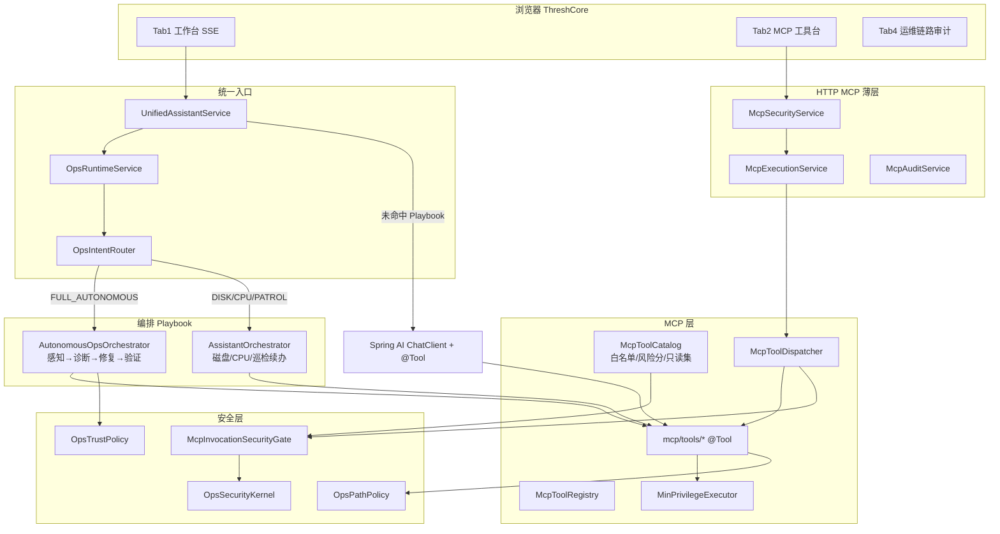

# ThreshCore（award-log）开发者文档

| 项 | 说明 |
|----|------|
| **文档类型** | 工程与研发说明（产品 / 运维 / 测试 / 研发 / 部署均可读） |
| **系统名称** | ThreshCore 控制台 + award-log 后端服务 |
| **Context Path** | `/award-log`（所有后端接口前的统一前缀） |
| **默认端口** | `8088`（后端）；前端开发常见 `3000`（Vite） |
| **技术栈** | Java 17 · Spring Boot 3.5 · Spring AI 1.1.0 · Vue 3 · MySQL 8 |
| **版本** | 与当前仓库实现同步（2026-05-23） |
| **HTTP MCP 工具** | 26+（白名单由 `McpToolCatalog` 启动扫描，HTTP 列表见 `GET /api/mcp/tools`） |

**版权声明**：Apache License 2.0，见 `LICENSE` 与 `NOTICE`。

---

## 目录

- [谁该读哪一节](#谁该读哪一节)
- [文档体系](#文档体系)
- [系统是做什么的](#系统是做什么的)
- [架构总览](#架构总览)
- [Agent 运行时（核心）](#agent-运行时核心)
- [MCP 工具链](#mcp-工具链)
- [扩展 MCP 工具（开发指南）](#扩展-mcp-工具开发指南)
- [安全与审计](#安全与审计)
- [后端 API 索引](#后端-api-索引)
- [前端开发](#前端开发)
- [日志分析流水线](#日志分析流水线)
- [配置参考](#配置参考)
- [快速开始](#快速开始)
- [本地开发与测试](#本地开发与测试)
- [构建与部署](#构建与部署)
- [麒麟 V11 + LoongArch](#麒麟-v11--loongarch)
- [赛题对照](#赛题对照)
- [近期更新](#近期更新)
- [监控与排障](#监控与排障)
- [报表导出（前端）](#报表导出前端)
- [仓库结构](#仓库结构)
- [许可协议](#许可协议)

---

## 谁该读哪一节

| 你是… | 建议阅读 |
|--------|----------|
| **产品 / 运维** | [系统是做什么的](#系统是做什么的)、[赛题对照](#赛题对照)、`docs/deployment/麒麟V11-LoongArch生产上线检查清单.md` |
| **运维 / 值班** | [安全与审计](#安全与审计)、[配置参考](#配置参考)、`docs/deployment/麒麟V11-LoongArch生产上线检查清单.md` |
| **测试** | [后端 API 索引](#后端-api-索引)、[MCP 工具链](#mcp-工具链)、[本地开发与测试](#本地开发与测试) |
| **后端 / 全栈** | 全文；接口细节以 **Knife4j**（`/award-log/doc.html`）为准 |
| **前端** | [前端开发](#前端开发)、[后端 API 索引](#后端-api-索引) |
| **部署** | [快速开始](#快速开始)、[构建与部署](#构建与部署)、[麒麟 V11 + LoongArch](#麒麟-v11--loongarch) |

---

## 文档体系

| 文档 | 路径 | 用途 |
|------|------|------|
| **本文 README** | 根目录 | 架构、API、配置、开发扩展 |
| **麒麟上线检查清单** | `docs/deployment/麒麟V11-LoongArch生产上线检查清单.md` | LoongArch 生产验收 |
| **生产配置示例** | `docs/deployment/prod-config-example.yml` | 复制为未入库的 `application-prod.yml` |
| **在线接口** | `http://<host>:8088/award-log/doc.html` | Knife4j / OpenAPI |

> 仓库仅保留与运行/部署相关的文档；赛题 PPT、路演稿、需求 docx 等已移出代码库。

---

## 系统是做什么的

**一句话**：ThreshCore 是 B/S 运维与日志平台——既能**上传分析海量日志**，也能用**中文对话**让 Agent 感知磁盘、进程、日志、容器、证书等，但所有「动机器」的操作都经过**白名单、风险评分、二次确认和六步审计**，避免 AI 或误操作破坏生产。

| 主线 | 说明 | 典型入口 |
|------|------|----------|
| **可观测与根因** | Drain-Plus 模板挖掘 + 异常检测 + AI 诊断 | Tab 5 日志分析 |
| **受控智能运维** | 登记过的 MCP 工具 + 统一安全门 | Tab 1 工作台 / Tab 2 工具台 |
| **主动闭环** | 定时巡检 + 有界自动修复 + 全工具自主编排 | 顶栏告警 / `POST /api/ops/autonomous/run` |

**不是什么**：不是「给 AI 一个 root 终端」；不是必须装齐 Kafka/Redis（默认关闭）。

**答辩叙事（建议）**：日志过阈 → 异常定位 → Agent 处置建议 → 安全门评分 → 最小权限执行（可预览）→ 全链路审计。对外少铺工具数量，多讲闭环。

### 开发者 30 秒速览

| 动作 | 怎么做 |
|------|--------|
| 起服务 | MySQL + `schema.sql` → `mvn spring-boot:run` → `cd frontend && npm run dev` |
| 调 MCP | Tab **2** 或 `POST /api/mcp/execute`（body 带 `userMessage`） |
| 调对话编排 | Tab **1**；全栈自主 →「全自动运维」或 `POST /api/ops/autonomous/run` |
| 看审计 | Tab **3**（HTTP 访问）/ Tab **4**（traceId + CoT，可导出） |
| 加工具 | `mcp/tools/*` + `@McpTool` + `McpToolDispatcher` 分支 + 前端 `mcpToolsMeta.js` |
| 文档接口 | http://localhost:8088/award-log/doc.html |

---

## 架构总览

### 分层（2026 重构后）



### 三条执行路径（开发必记）

| 路径 | 入口 | 编排 | 审计 |
|------|------|------|------|
| **HTTP MCP** | `McpExecuteController` → `McpSecurityService` / `McpExecutionService` / `McpAuditService` → `McpToolDispatcher` | 单工具调用 | `ops_audit_trace` 四步 CoT（接收→感知→推理→校验） |
| **对话 Playbook** | `UnifiedAssistantService` → `OpsRuntimeService` | 规则编排，不经过 LLM 多步 | `AssistantAuditRecorder` **六步** |
| **对话 LLM** | 同上，意图 `NONE` | `ChatClient` 自动 `@Tool` | 切面 `McpToolSecurityAspect` + 工具层 dry-run |

### 技术栈

| 层级 | 技术 |
|------|------|
| 后端 | Spring Boot 3.5、MyBatis、Spring AI 1.1.0、WebSocket |
| 前端 | Vue 3、Vite 4、Element Plus、ECharts |
| 必选 | MySQL 8 |
| 可选 | Redis、Kafka、Elasticsearch、Qdrant（默认不加载） |
| 观测 | Actuator、Prometheus |
| 文档 | Knife4j 4.5、Springdoc |

---

## Agent 运行时（核心）

### OpsIntentRouter — 意图 → Playbook

实现：`com.award.log.agent.OpsIntentRouter`

| Playbook | 触发示例 | 执行器 |
|----------|----------|--------|
| `FULL_AUTONOMOUS` | 自动运维、一键巡检、autonomous ops | `AutonomousOpsOrchestrator` |
| `DISK_CLEANUP` | 清理垃圾、磁盘满、执行修复 | `AssistantOrchestrator` |
| `CPU_PRESSURE` | CPU 高、负载异常 | `AssistantOrchestrator` |
| `PATROL_CONTINUATION` | 继续处理巡检、待确认方案 | `AssistantOrchestrator` |
| `NONE` | 其它 | 走 LLM + `@Tool` |

`forceRemediate(message)`：匹配「确认执行」「执行修复」等时，Playbook 内跳过 dry-run 预览。

### OpsRuntimeService — 统一 `run` API

实现：`com.award.log.agent.OpsRuntimeService`

```java
// 对话入口（UnifiedAssistantService 在编排前调用）
if (opsRuntimeService.shouldOrchestrate(userMessage)) {
    RunResult r = opsRuntimeService.run(userMessage, surface, intentRisk);
    // 返回 markdown + traceId + report（自主运维时有 report）
}
```

| 方法 | 用途 |
|------|------|
| `shouldOrchestrate(msg)` | `agent.runtime.enabled` 且意图非 `NONE` |
| `run(msg, surface, risk)` | 按 Playbook 分发 |
| `runScheduledAutonomous(surface, force)` | HTTP / 定时 / 巡检后触发，无自然语言 |

开关：`agent.runtime.enabled`（默认 `true`）。

### AutonomousOpsOrchestrator — 全工具融合闭环

实现：`com.award.log.agent.AutonomousOpsOrchestrator`

**阶段**：

1. **感知**（并行，最多 12 线程）：磁盘、负载、进程、systemd、网络、端口、Docker、防火墙、Cron、日志、journalctl/ss/lsof 等  
2. **诊断**：规则引擎生成 `findings`（磁盘压力、失败 unit、证书临期、僵尸进程提示等）  
3. **处置**：`OpsTrustPolicy` 内自动/待确认（临时目录清理、日志裁剪、白名单服务重启）  
4. **验证**：再次采集关键指标写入 `report`

**感知快照 API**（只读，带 TTL 缓存）：

```http
GET /award-log/api/ops/perception/snapshot?useCache=true
```

缓存：`OpsPerceptionCache` + `agent.perception.cache-ttl-ms`（默认 60000 ms）。写操作成功或 `useCache=false` 会失效缓存。

自主编排执行修复后写入 **`remediationEffect`**（磁盘/CPU 前后对比与 0–100 自愈评分）。

**自主运维 API**：

```http
POST /award-log/api/ops/autonomous/run?forceRemediate=false&readOnly=false
GET  /award-log/api/ops/autonomous/supports?message=全自动运维
```

### 六步审计（赛题闭环）

常量：`com.award.log.agent.audit.OpsAuditPhases`

| 步 | 英文 key | 中文 |
|----|----------|------|
| 1 | `receive` | 接收 |
| 2 | `perceive` | 感知 |
| 3 | `reason` | 推理 |
| 4 | `security` | 安全校验 |
| 5 | `execute` | 执行 |
| 6 | `verify` | 验证 |

Playbook 路径写入 `ops_audit_trace`；HTTP MCP 仍为四步 CoT（兼容工具台展示）。

### AssistantOrchestrator — 单场景 Playbook

保留磁盘清理、CPU 压力、巡检续办等**短路径**闭环（预览 → 确认 → 执行），与全工具自主编排互补。

---

## MCP 工具链

### 实现形态

- **进程内 Spring Bean**，非独立 stdio MCP Server。  
- **元数据**：`McpToolCatalog`（`@PostConstruct` 扫描 `mcp.tools.*Tool`，可选 `@McpTool` 注解）。  
- 对话注册：`McpToolRegistry`（`@Tool` 注入 LLM）。  
- HTTP 分发：`McpToolDispatcher`（按 toolName `switch` 调用具体 Bean）。  
- HTTP 门控：`McpInvocationSecurityGate` → `mcpToolCatalog.isHttpAllowed()` / `isReadOnlyObservation()`。  
- HTTP 控制器：`McpExecuteController` 委托 `McpSecurityService`、`McpExecutionService`、`McpAuditService`。

### 工具清单

HTTP / 对话调用时 `toolName` 须与 **Bean 短名**一致。

**读写合一（推荐，一个 toolName + `operation`）**

| toolName | operation 示例 | 读 | 写 |
|----------|----------------|----|----|
| `DiskOpsTool` | `df` / `hotspots` / `analyze` / `clean-temp` | df、du、诊断 | 清临时目录（dry-run） |
| `LogOpsTool` | `analyze` / `cleanup` | 日志分析 | 日志清理（dry-run） |
| `ServiceOpsTool` | `failed` / `status` / `restart` | systemd 状态 | 白名单服务重启 |
| `ContainerOpsTool` | `list` / `inspect` / `restart` / `stop` | docker ps | 容器重启/停止 |
| `ProcessOpsTool` | `list` / `kill` | ps 列表 | 结束进程（PID>10） |

**细粒度工具（兼容保留）**

| toolName | 源文件 | 能力 | 写操作 |
|----------|--------|------|--------|
| `DiskTool` | `mcp/tools/DiskTool.java` | df 磁盘占用 | 否 |
| `DiskInsightTool` | `DiskTool` | du 热点排行（白名单路径） | 否 |
| `DiskAnalyzeTool` | `mcp/tools/DiskAnalyzeTool.java` | 磁盘压力综合诊断 | 否 |
| `ProcessTool` | `mcp/tools/ProcessTool.java` | 进程列表；可选 `kill`（PID>10） | **可选写** |
| `SystemLoadTool` | `mcp/tools/SystemLoadTool.java` | 负载 | 否 |
| `LogAnalysisTool` | `mcp/tools/LogAnalysisTool.java` | 读主机日志并分析 | 否 |
| `NetworkTool` | `mcp/tools/NetworkTool.java` | ping / traceroute | 否 |
| `OsInsightTool` | `mcp/tools/OsInsightTool.java` | journalctl / ss / lsof | 否 |
| `ConfigCheckTool` | `mcp/tools/ConfigCheckTool.java` | 配置语法只读检查 | 否 |
| `ConfigDriftTool` | `mcp/tools/ConfigDriftTool.java` | 配置 checksum 漂移（两次快照对比） | 否 |
| `PrivilegeTool` | `mcp/tools/PrivilegeTool.java` | 权限探测 | 否 |
| `PortHealthTool` | `mcp/tools/PortHealthTool.java` | TCP 端口探测 | 否 |
| `DockerTool` | `mcp/tools/DockerTool.java` | docker ps / inspect；`restart` / `stop` | **可选写** |
| `CronJobTool` | `mcp/tools/CronJobTool.java` | crontab / schtasks | 否 |
| `FirewallTool` | `mcp/tools/FirewallTool.java` | ufw / firewalld / netsh | 否 |
| `SslCertTool` | `mcp/tools/SslCertTool.java` | TLS 证书过期 | 否 |
| `SystemdTool` | `mcp/tools/SystemdTool.java` | failed units / 服务状态；`operation=restart` | **可选写** |
| `CleanTempTool` | `mcp/tools/CleanTempTool.java` | 清临时目录 | **是** |
| `LogCleanupTool` | `mcp/tools/LogCleanupTool.java` | 清陈旧日志 | **是** |
| `ServiceRestartTool` | `mcp/tools/ServiceRestartTool.java` | 重启白名单服务 | **是** |
| `AutonomousOpsTool` | `mcp/tools/AutonomousOpsTool.java` | 一键全工具自主运维 | 策略内写 |
| `FirstMcpTools` | `mcp/FirstMcpTools.java` | 示例（对话实验） | — |

### 写操作参数

| 工具 / 操作 | 真实执行条件 |
|-------------|----------------|
| `CleanTempTool` / `LogCleanupTool` / `*OpsTool` 清理类 | `dryRun=false` **且** `confirmDelete=true` |
| `ServiceRestartTool` / `ServiceOpsTool` restart | `dryRun=false` **且** `confirmRestart=true` |
| `ProcessTool` / `ProcessOpsTool` kill | `dryRun=false` **且** `confirmKill=true` |
| `DockerTool` / `ContainerOpsTool` restart / stop | `dryRun=false` **且** `confirmRestart` / `confirmStop=true` |

**默认**：写类工具首次调用 `dryRun=true`（只预览命令）。HTTP 与工作台在 `needConfirm` 后走 `POST /api/mcp/confirmExecute`。

**二次确认不会自动把预览变真删**：`McpToolParamReader.applyConfirmedWriteToolParams(tool, params, userMessage)` 与前端 `applyMcpWriteConfirmParams` 仅在下列情况关闭 `dryRun`：

- 参数已带 `confirmDelete` / `confirmRestart` / `confirmKill` / `confirmStop`，或 `dryRun=false`；或  
- `userMessage` 含「真实删除」「立即重启」等明确执行话术（见 `userRequestedRealWrite`）。

请求体建议始终传 **`userMessage`**（用户原话），供 `IntentRiskFilter` 与 **`INTENT_TOOL_MISMATCH`**（破坏性话术 + 只读工具）判定。

**示例（日志真实删除）**：

```json
{
  "toolName": "LogCleanupTool",
  "parameters": {
    "path": "/var/log",
    "days": 30,
    "dryRun": false,
    "confirmDelete": true
  }
}
```

### HTTP MCP 接口

| 方法 | 路径 | 说明 |
|------|------|------|
| GET | `/api/mcp/tools` | 工具元数据（`McpToolCatalog.listToolsForApi()`，供前端动态同步） |
| POST | `/api/mcp/execute` | 执行（body 含 `userMessage`；可能返回 `needConfirm`） |
| POST | `/api/mcp/confirmExecute` | 二次确认后执行（`confirmCode=确认执行`，`userMessage` 同上） |

### 风险评分

`AgenticRiskScoreEngine`：0–10 分；工具基线分来自 `McpToolCatalog.defaultRiskScore()`。

| 配置项 | 默认 | 含义 |
|--------|------|------|
| `agent.security.risk-score-auto-max` | 3 | 低于此分倾向自动 |
| `agent.security.risk-score-confirm-max` | 7 | 高于此分拒绝；中间需确认 |

---

## 扩展 MCP 工具（开发指南）

新增工具（以只读 `ExampleProbeTool` 为例）的**最小清单**：

### 1. 实现 Tool Bean

```java
@McpTool(httpAllowed = true, readOnlyObservation = true, defaultRiskScore = 1.0)
@Component
public class ExampleProbeTool {
    @Tool(name = "probeExample", description = "示例探测")
    public String probeExample(@ToolParam(description = "目标") String target) {
        // 使用 MinPrivilegeExecutor，勿 Runtime.exec 裸调
        return "...";
    }
}
```

未加 `@McpTool` 时，`McpToolCatalog` 仍按 `*Tool` 类名与约定推断白名单/只读/风险分。

### 2. 必改（分发与对话）

| 位置 | 操作 |
|------|------|
| `McpToolDispatcher` | `switch` 增加 `case "ExampleProbeTool"` |
| `McpToolRegistry` | 构造器注入 Bean（供 LLM `@Tool`） |

白名单与默认风险分：**无需**再改 `ALLOWED_TOOLS` 静态集合（已废弃），由 `McpToolCatalog` 统一维护。

### 3. 前端

| 位置 | 操作 |
|------|------|
| `mcpToolsMeta.js` | `MCP_TOOL_DEFINITIONS` 增加表单项（控制台表单） |
| 启动后 | `GET /api/mcp/tools` 自动带回 `description` / `commandHint`（`mergeToolRegistry` 合并） |

### 4. 可选

- 自主运维：在 `AutonomousOpsOrchestrator.perceiveAll` 中 `safeCall`  
- 写操作成功：确认 `McpToolDispatcher` 会 `OpsPerceptionCache.invalidate()`（非只读且非 dryRun）

### 5. 测试

单元测试 + 安全回归（只读面、破坏性话术 + 只读工具 → `INTENT_TOOL_MISMATCH`）。

---

## 安全与审计

### 多层护栏

| 层 | 组件 | 说明 |
|----|------|------|
| 认证 | `AuthInterceptor` | 除登录、Swagger、部分只读 API 外需会话 |
| 工具白名单 | `McpInvocationSecurityGate` | 仅允许登记的 `toolName` |
| 路径白名单 | `OpsPathPolicy` | 读/清/配置检查路径 |
| 日志删除保护 | `LogSafetyClassifier` | 识别 DB/中间件日志路径 |
| 注入 / 意图 | `PromptInjectionGuard`、`IntentRiskFilter` | 自然语言过滤 |
| 高危命令 | `HighRiskCommandDetector` | rm -rf 等模式 |
| Agentic 风险分 | `AgenticRiskScoreEngine` | 与确认流、巡检修复联动 |
| 信任策略 | `OpsTrustPolicy` | 自主运维写操作分级 |
| 最小权限 | `MinPrivilegeExecutor` | `sudo -u award-agent`；Windows 跳过 sudo |
| 全局演练 | `OpsDryRunProperties` | `ops.dry-run.global=true` 时写类命令仅返回 `[DRY-RUN]` |
| 门面 | `OpsSecurityKernel` | 安全能力聚合（供编排层调用） |
| 审计 | `OpsAuditTraceService`、`AssistantAuditRecorder` | `ops_audit_trace`；`audit.retention-days` 定时清理 |

### 工作台本地护栏（Tab1）

实现：`frontend/src/utils/opsIntentSafety.js`，与后端 `IntentRiskFilter` 口径对齐。

- 破坏性话术（如「删除整个系统」）**不**走本地 MCP 快捷路由，避免误绑 `SystemLoadTool`。  
- 延时任务创建前同样拦截；延时白名单与 `OpsDeferredTaskService` 一致（只读/清理类，**不含** `ServiceRestartTool` 等）。

### 两条工具入口

| 入口 | 门控 | 二次确认 |
|------|------|----------|
| HTTP `/api/mcp` | `evaluate` + `userMessage` | NEED_CONFIRM + `confirmExecute`（预览保持 dryRun） |
| 对话 `@Tool` | `McpToolSecurityAspect` → `evaluateChatToolInvocation` | 写工具默认 dry-run；BLOCK 直接拒绝 |

### 生产检查项

- `app.security.ai-audit-relaxed-read=false`  
- `agent.min-privilege.enabled=true`  
- `agent.run-as-user=award-agent` + sudoers  
- Profile `prod-kylin` 时 `ProductionProfileValidator` 拒绝放宽审计  
- 限制 Knife4j / Actuator 公网暴露  

### 平台只读 API（无需登录）

```http
GET /award-log/api/platform/info
GET /award-log/api/ops/perception/snapshot
```

---

## 后端 API 索引

**约定**：完整 URL = `http(s)://主机:端口/award-log` + 路径。除注明外需登录 Cookie。

### 智能运维（Agent）

| 方法 | 路径 | 控制器 |
|------|------|--------|
| POST | `/api/assistant/chat/stream` | `UnifiedAssistantController` — 工作台 SSE |
| GET | `/api/assistant/context` | 会话上下文 |
| POST | `/api/ops/autonomous/run` | `AutonomousOpsController` |
| GET | `/api/ops/autonomous/supports` | 意图是否走自主运维 |
| GET | `/api/ops/perception/snapshot` | `PerceptionController` — 只读感知 |
| GET | `/api/platform/info` | `PlatformInfoController` — 平台/麒麟/最小权限 |
| GET/POST | `/api/mcp/*` | `McpExecuteController` |
| GET | `/api/ops-trace/**` | `OpsTraceController` — 链路审计 |
| GET/POST | `/api/ops/patrol/**` | `OpsPatrolController` — 巡检与修复提案 |

**巡检补充接口**：

| 方法 | 路径 | 说明 |
|------|------|------|
| GET | `/api/ops/patrol/alerts/recent` | 内存环形最近告警 |
| GET | `/api/ops/patrol/correlation/latest` | 最近一轮关联快照 |
| GET | `/api/ops/patrol/history?days=7&limit=50` | 持久化历史（`ops_patrol_history`） |
| GET | `/api/ops/patrol/history/trend?days=7` | 按日告警/巡检次数（顶栏趋势图） |

### 日志与业务

| 前缀 | 用途 |
|------|------|
| `/log/**` | 上传、任务、报告、下载；`GET /log/history` 支持 `fileName`、`status`、`startTime`、`endTime`（`YYYY-MM-DD`，服务端转 `LocalDateTime` 闭区间） |
| `/log/diagnose/**` | AI 全盘/单行诊断 |
| `/admin/user`、`/admin/role`、`/admin/permission` | RBAC |
| `/admin/audit/ai` | 执行审计列表 |
| `/api/alarm*` | 告警配置与历史 |
| `/admin/statistics/*` | 仪表盘汇总、性能、任务状态（`log-summary`、`task-status` 等） |
| `/api/performance` | 性能 REST（若单独暴露） |
| `/api/agent/path-policy` | 路径白名单读写 |

### WebSocket

| 路径 | 说明 |
|------|------|
| `/ws/performance` | ~5s 推送性能；`patrol_alert` / `patrol_remediation`；客户端重连发 `sync` 补发缓冲消息 |
| `/ws/logs` | 日志流（可选） |

### 对话入口区别（易混淆）

| 接口 | 用途 |
|------|------|
| `POST /api/assistant/chat/stream` | 主机运维主入口（编排 + LLM） |
| `POST /api/chat/analyze*` | 针对**已选日志内容**的问答，不执行主机写操作 |

---

## 前端开发

### 目录

```
frontend/
├── src/App.vue                    # 8 Tab + 快捷键 1–8
├── src/api/index.js               # Axios（含 securityCode 统一提示）
├── src/components/
│   ├── OpsChatInterface.vue       # Tab1 工作台
│   ├── McpToolsDemo.vue           # Tab2 工具台
│   ├── AiAuditCenter.vue          # Tab3 执行审计（可导出 PNG/PDF）
│   ├── OpsTraceCenter.vue         # Tab4 链路审计 + CoT 弹窗导出
│   ├── LogAnalysis.vue            # Tab5 日志分析
│   ├── HistoryList.vue            # Tab6 历史任务
│   ├── LogAnalysisDashboard.vue   # Tab7 仪表盘（导出 PNG/PDF）
│   ├── AlarmHistoryAnalysis.vue   # Tab8 告警
│   └── TopPerformanceBar.vue      # 顶栏性能 + 巡检趋势图
└── src/utils/
    ├── mcpToolsMeta.js            # 工具表单；mergeToolRegistry 对接 /api/mcp/tools
    ├── opsIntentSafety.js         # 工作台高危话术拦截
    ├── formatDate.js              # 本地日期（避免 UTC 错位）
    ├── apiError.js                # 错误文案 + securityCode
    ├── tableExport.js             # 表格/CoT 截图导出
    └── dashboardExport.js         # 图表 PDF（jspdf）
```

### 环境变量

| 变量 | 说明 |
|------|------|
| `VITE_AWARD_LOG_BASE_URL` | **必须**含 `/award-log`，无尾斜杠；开发推荐 `http://localhost:3000/award-log`（Vite 代理） |
| `VITE_AWARD_LOG_WS_URL` | 跨域时指定 wss |
| `VITE_API_TIMEOUT_MS` | 大文件上传可调大（默认 600000） |

### 控制台 Tab

| 键 | Tab | 说明 |
|----|-----|------|
| 1 | 工作台对话 | SSE；优先 `runAutonomousOps` / Playbook |
| 2 | 工具控制台 | 直连 `/api/mcp` |
| 3 | 执行审计 | AI/HTTP 访问记录；支持导出 PNG/PDF |
| 4 | 运维链路审计 | traceId + CoT；列表与弹窗均可导出 |
| 5 | 日志分析 | 上传、Drain、AI 诊断 |
| 6 | 历史任务 | 文件名/状态/日期筛选（`HistoryFilterTime`） |
| 7 | 日志分析仪表盘 | 近 7 日汇总；导出 PNG / PDF（jspdf） |
| 8 | 告警 | 配置与历史 |

```bash
cd frontend
cp .env.example .env.development   # 可选
npm install && npm run dev
```

---

## 日志分析流水线

实现：`LogAnalysisServiceImpl#startAnalysisAsync`

| 阶段 | 说明 |
|------|------|
| 分片读取 | `shardSize` 控制内存 |
| Drain-Plus | `log.pipeline.analyzer.drain` |
| 异常检测 | 启发式 + 可选 RF ONNX |
| 导出 | `target/output/<taskId>/` |
| 取消 | `cancelAnalysis` |

解析原则：`LinuxLogParseSupport` 等失败时**不伪造时间戳**。

### 仪表盘统计口径

`GET /admin/statistics/log-summary?days=7`（实现：`StatisticsServiceImpl#getRecentLogSummary`）：

| 字段 | 含义 |
|------|------|
| `summaryDays` | 统计窗口天数（与 `days` 参数一致） |
| `totalTasks` / `totalLogs` | **窗口内**任务数、明细条数（`countSinceDays`） |
| `anomalyLogs` / `anomalyRate` | 窗口内异常条数；异常率 = 异常 / 窗口内总日志 × 100% |
| `taskTrend` / `anomalyDistribution` | 近 N 日趋势与分布 |

前端趋势图使用 `formatLocalDateKey`，避免 `toISOString()` 在 UTC+8 下日期错位。

实时分析写 ES 时优先走 **`LogDocumentAsyncIndexer`**（`log.elasticsearch.async.*`），避免阻塞分析线程。

---

## 配置参考

### 环境变量（常用）

| 变量 | 必填 | 含义 |
|------|------|------|
| `DB_PASSWORD` | **是** | MySQL 密码 |
| `AI_API_KEY` | 助手需要 | 大模型密钥 |
| `AI_BASE_URL` | 否 | 兼容网关 |
| `AGENT_MIN_PRIVILEGE` | 否 | 生产建议 `true` |
| `AGENT_RUN_AS_USER` | 否 | 默认 `award-agent` |
| `AGENT_RUNTIME_ENABLED` | 否 | Playbook 总开关 |
| `AGENT_AUTONOMOUS_ENABLED` | 否 | 自主运维 |
| `AGENT_PERCEPTION_CACHE_TTL_MS` | 否 | 感知缓存 |
| `RF_FORCE_HEURISTIC_LOONGARCH` | 龙芯 | ONNX 不可用时启发式 |
| `SPRING_PROFILES_ACTIVE` | 生产 | `prod` 或 `prod-kylin` |
| `APP_AI_AUDIT_RELAXED_READ` | 否 | **生产必须 false** |

本地密钥：复制 `application-local.example.yml` → `application-local.yml`（已 gitignore）。

### application.yml 关键块

| 路径 | 含义 |
|------|------|
| `server.servlet.context-path` | `/award-log` |
| `spring.profiles.group.prod-kylin` | `prod` + `kylin` |
| `agent.runtime.enabled` | OpsRuntimeService |
| `agent.perception.cache-ttl-ms` | 感知快照缓存 |
| `agent.autonomous.*` | 自主运维阈值与端口探测 |
| `agent.security.risk-score-*` | 风险分阈值 |
| `agent.paths.*` | 路径策略版本 `path-policy-v2-kylin` |
| `agent.service-restart.allowlist` | 可重启服务 |
| `ops.patrol.*` | 巡检 Cron；历史落库 `ops_patrol_history` |
| `ops.auto-remediation.*` | 有界自动修复 HYBRID/CONFIRM_FIRST |
| `ops.dry-run.global` | 全局演练，写命令不落地 |
| `ops.websocket.replay-buffer-size` | WS 断线重连消息缓冲条数 |
| `audit.retention-days` / `audit.cleanup-cron` | 审计表自动清理 |
| `log.elasticsearch.async.*` | ES 异步批量索引 |
| `log.pipeline.decision.rf.force-heuristic-on-loongarch` | 龙芯 ONNX 降级 |

路径白名单也可通过控制台「路径白名单」写入 `agent-path-policy-overrides.json`（工作目录，已 gitignore）。

---

## 快速开始

### 环境

JDK 17 · Maven 3.8+ · MySQL 8 · Node 18+

### 开发者一条龙

```bash
# 1. 数据库
mysql -u root -p -e "CREATE DATABASE IF NOT EXISTS log_analysis DEFAULT CHARSET utf8mb4;"
mysql -u root -p log_analysis < src/main/resources/schema.sql

# 2. 密钥：application-local.yml 或环境变量 DB_PASSWORD、AI_API_KEY

# 3. 后端
mvn spring-boot:run

# 4. 前端
cd frontend && npm install && npm run dev
```

- 接口文档：http://localhost:8088/award-log/doc.html  
- Windows 开发可将 `application-dev.yml` 中 `agent.min-privilege.enabled` 设为 `false`  
- 演练环境可设 `ops.dry-run.global=true`，验证写工具而不改机器

---

## 本地开发与测试

```bash
mvn test                    # 单元测试（~40+ 用例）
mvn -DskipTests package     # 打包
```

| 测试类 | 覆盖 |
|--------|------|
| `LinuxLogParseSupportTest` | 日志解析 |
| `LogSafetyClassifierTest` | 日志删除安全 |
| `DiskToolTest` | 磁盘工具 |
| `OsRuntimeTest` | 麒麟/龙芯检测 |
| `ProductionProfileValidatorKylinTest` | prod-kylin 校验 |
| `HistoryFilterTimeTest` | 历史列表日期边界 |
| `McpToolParamReaderTest` | 二次确认是否升级真实写入 |

**安全回归建议**（答辩前手测）：

1. 「删除整个系统」→ 工作台拦截，不执行只读工具  
2. 「预览清理 /tmp」→ 二次确认后仍为 `dryRun`  
3. 「真实删除」+ 参数 `confirmDelete` → 才真删  
4. 历史任务按日期筛选与列表 `createTime` 一致  
5. 仪表盘近 7 日卡片与趋势图日期对齐  

CI：`.github/workflows/ci.yml`（`mvn test` + `frontend` build）。

---

## 构建与部署

### Fat Jar

```bash
mvn -DskipTests package
java -jar target/award-log-*.jar --spring.profiles.active=prod
```

### 前端静态资源

```bash
cd frontend && npm ci && npm run build
# dist/ 由 Nginx 托管；/award-log 反代到 8088
```

参考：`scripts/deploy/nginx.sample.conf`、`deploy.sh`、`deploy.ps1`。

### Docker Compose（可选）

```bash
docker compose up -d mysql
# 首次对容器执行 schema.sql
```

---

## 麒麟 V11 + LoongArch

**Profile**：`prod-kylin`（= `prod` + `kylin`）

```bash
bash scripts/deploy/deploy_kylin_loongarch.sh
export SPRING_PROFILES_ACTIVE=prod-kylin
java -Xms512m -Xmx2g -jar award-log.jar

# 验收（无需登录）
curl -s http://127.0.0.1:8088/award-log/api/platform/info
bash scripts/deploy/smoke_kylin_acceptance.sh
```

| 资源 | 路径 |
|------|------|
| 环境变量模板 | `scripts/deploy/env.kylin.prod.example` |
| systemd 单元 | `scripts/deploy/award-log.service` |
| Nginx 样例 | `scripts/deploy/nginx.kylin.sample.conf` |
| 检查清单 | `docs/deployment/麒麟V11-LoongArch生产上线检查清单.md` |

`OsRuntime.isKylin()` / `isLoongArch()`；`deliveryTargetMatch` 仅在目标机为 `true`。

---

## 赛题对照

摘要（完整映射见代码与 Knife4j）：

| 赛题要求 | 实现 |
|----------|------|
| OS 深度感知 | `OsInsightTool`、`ProcessTool`、`DiskTool`、自主编排并行感知 |
| MCP 插件化 | `mcp/tools/*`、`McpToolDispatcher`、`McpToolRegistry` |
| 安全意图校验 | `IntentRiskFilter`、`PromptInjectionGuard`、`McpInvocationSecurityGate` |
| 最小权限 | `MinPrivilegeExecutor`、`GET /api/platform/info` |
| 推理链路溯源 | 六步 `OpsAuditPhases` + `ops_audit_trace` |
| 配置防篡改 | `ConfigDriftTool`（checksum 漂移，只读） |
| 巡检历史 | `ops_patrol_history` + `/api/ops/patrol/history/trend` |
| B/S | Vue + Spring Boot |
| 龙芯 + 麒麟 | `prod-kylin` + 交付实测报告 |

**3 分钟演示建议**：

1. `GET /api/platform/info`（实机 `deliveryTargetMatch: true`）  
2. Tab7 仪表盘：近 7 日任务趋势 + 异常率  
3. 工作台：「请执行全自动运维」或「磁盘使用情况」  
4. 「帮我预览清理临时文件」→ 二次确认 → 结果仍为预览（`dryRun`）  
5. Tab4：traceId 展示六步审计  

---


## 近期更新

| 日期 | 变更 |
|------|------|
| 2026-05-23 | **McpToolCatalog**：HTTP 白名单/只读集/风险分启动扫描；`GET /api/mcp/tools` 动态元数据 |
| 2026-05-23 | **MCP 分层**：`McpSecurityService` / `McpExecutionService` / `McpAuditService` |
| 2026-05-23 | **巡检持久化**：`ops_patrol_history`；`GET /api/ops/patrol/history`、`/history/trend`；顶栏趋势图 |
| 2026-05-23 | **感知缓存**：`OpsPerceptionCache`；写操作后失效；`useCache=false` 强制刷新 |
| 2026-05-23 | **ES 异步索引**：`LogDocumentAsyncIndexer`；`log.elasticsearch.async.*` |
| 2026-05-23 | **全局 dry-run**：`ops.dry-run.global`；**审计清理**：`audit.retention-days` |
| 2026-05-23 | **自愈评分**：`RemediationEffectEvaluator` 写入自主编排 report/审计 |
| 2026-05-23 | **WS**：消息缓冲 + 客户端 `sync`；**Prometheus**：`PatrolMetricsExporter` + `docs/deployment/prometheus-alerts.yml` |
| 2026-05-23 | **前端导出**：仪表盘 PDF（jspdf）；审计表 PNG/PDF；CoT 弹窗 PNG/PDF；`apiError` 统一安全码提示 |
| 2026-05-24 | MCP 二次确认与 `INTENT_TOOL_MISMATCH`；读写合一 Gateway 工具；仪表盘/历史筛选修复 |

---

## 监控与排障

### Actuator

`health`、`metrics`、`prometheus`（见 `management.endpoints`）。指标示例：`threshcore_patrol_zombie_processes`、`threshcore_disk_usage_percent`。告警规则样例：`docs/deployment/prometheus-alerts.yml`。生产勿公网裸暴露。

### 常见问题

| 现象 | 处理 |
|------|------|
| prod 启动退出 | 检查 `DB_PASSWORD` |
| 前端 401 | 登录、`VITE_AWARD_LOG_BASE_URL`、Cookie credentials |
| AI 无回复 | `AI_API_KEY`、`AI_BASE_URL` |
| 助手不调工具 | `agent.assistant.use-tool-agent-default` |
| MCP 权限错误（Windows） | `agent.min-privilege.enabled=false`（仅 dev） |
| ONNX 龙芯加载失败 | `RF_FORCE_HEURISTIC_LOONGARCH=true` |
| 感知快照过旧 | `useCache=false` 或调小 `cache-ttl-ms` |
| 历史筛选无结果 | 确认 `startTime`/`endTime` 为 `YYYY-MM-DD`；库中 `create_time` 在区间内 |
| 仪表盘趋势错位 | 清 Redis 统计缓存键 `statistics:log_summary:v3:*` 后刷新 |
| 二次确认仍真删 | 检查是否传了「真实删除」或 `confirmDelete=true` |
| 工作台显示执行成功但应为拦截 | 确认请求带 `userMessage`；升级后 destructive+只读工具应返回 `securityCode` |

---

## 仓库结构

```
项目根目录/
├── pom.xml
├── README.md                     # 本文
├── docker-compose.yml
├── .env.example
├── docs/deployment/              # 麒麟上线清单、生产配置示例
├── frontend/                     # Vue 控制台（唯一前端主线）
├── scripts/deploy/               # 部署与验收脚本
├── src/main/java/com/award/log/
│   ├── AwardWinningLogApplication.java
│   ├── controller/               # REST（含 AutonomousOps、Perception、Platform）
│   ├── agent/                    # OpsRuntimeService、编排器、OpsIntentRouter
│   │   └── audit/OpsAuditPhases.java
│   ├── util/HistoryFilterTime.java  # 历史列表日期解析
│   ├── mcp/
│   │   ├── McpToolCatalog.java / McpTool.java
│   │   ├── dispatch/             # McpToolDispatcher、McpToolParamReader
│   │   └── tools/                # 全部 @Tool
│   ├── service/mcp/              # McpSecurity/Execution/AuditService
│   ├── security/                 # Gate、OpsPathPolicy、OpsSecurityKernel
│   ├── service/                  # 业务、PatrolHistory、LogDocumentAsyncIndexer
│   ├── metrics/                  # PatrolMetricsExporter
│   ├── analyzer/ / analysis/     # Drain、日志解析
│   ├── decision/                 # RF ONNX、规则融合
│   ├── platform/                 # KylinCommandProbe、OsRuntime
│   └── config/                   # WebMvc、ProductionProfileValidator
├── src/main/resources/
│   ├── application.yml
│   ├── application-dev.yml
│   ├── application-kylin.yml     # 麒麟路径/命令探测
│   ├── application-local.example.yml
│   └── schema.sql
└── src/test/java/
```

### 名词速查

| 术语 | 说明 |
|------|------|
| **MCP** | 进程内 Java `@Tool`，非独立 MCP Server |
| **Playbook** | `OpsIntentRouter` 决定的规则编排路径 |
| **traceId** | 一次运维操作的审计流水号 |
| **dry-run** | 写工具默认只预览命令 |
| **prod-kylin** | 生产 + 麒麟安全与路径策略 |
| **McpToolCatalog** | 启动时扫描工具 Bean，替代手写 ALLOWED_TOOLS |

---

## 报表导出（前端）

| 页面 | PNG | PDF | 说明 |
|------|-----|-----|------|
| Tab7 日志分析仪表盘 | 分图导出 | jspdf 多图 A4 横向 | `dashboardExport.js` |
| Tab3 执行审计 | 表格截图 | 多页 PDF | `tableExport.js` |
| Tab4 运维链路审计 | 列表截图 | 多页 PDF | 同上 |
| Tab4 CoT 弹窗 | 详情截图 | 多页 PDF | 含四步闭环 + 结果摘要 |

导出前会临时展开表格/摘要滚动区域，尽量包含当前已加载的全部行。

---

## Git 与发布

- 勿提交：`.env`、`application-local.yml`、`application-prod.yml`、`alarm-config.json`（含真实密钥）  
- CI：`.github/workflows/ci.yml`；`PROD_BUILD=1` 时 `deploy.sh` 强制跑测试  

---

## 许可协议

本项目采用 **Apache License, Version 2.0**，全文见 `LICENSE`。

Copyright 2026 zhaowenkai（见 `LICENSE` 与 `NOTICE`）。欢迎 Issue 与 Pull Request。
