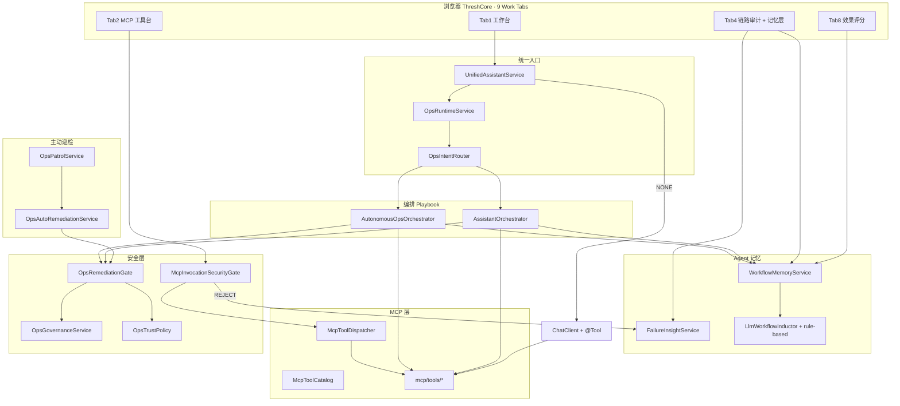

# ThreshCore（award-log）开发者文档

| 项 | 说明 |
|----|------|
| **文档类型** | 工程与研发说明（产品 / 运维 / 测试 / 研发 / 部署均可读） |
| **系统名称** | ThreshCore 控制台 + award-log 后端服务 |
| **Context Path** | `/award-log`（所有后端接口前的统一前缀） |
| **默认端口** | `8088`（后端）；前端开发常见 `3000`（Vite） |
| **技术栈** | Java 17 · Spring Boot 3.5 · Spring AI 1.1.0 · Vue 3 · MySQL 8 |
| **版本** | 与当前仓库实现同步（2026-06-07 · Auto 写操作治理统一 + 巡检单轨） |
| **控制台 Tab** | **9** 项（快捷键 `1`–`9`；个人中心走右上角用户菜单） |
| **HTTP MCP 工具** | 26+（白名单由 `McpToolCatalog` 启动扫描，HTTP 列表见 `GET /api/mcp/tools`） |

**版权声明**：Apache License 2.0，见 `LICENSE` 与 `NOTICE`。

---

## 目录

- [谁该读哪一节](#谁该读哪一节)
- [文档体系](#文档体系)
- [系统是做什么的](#系统是做什么的)
- [架构总览](#架构总览)
- [Agent 运行时（核心）](#agent-运行时核心)
- [Agent Workflow Memory（AWM）](#agent-workflow-memoryawm)
- [MCP 工具链](#mcp-工具链)
- [扩展 MCP 工具（开发指南）](#扩展-mcp-工具开发指南)
- [安全与审计](#安全与审计)
- [生产治理改造路线](#生产治理改造路线)
- [后端 API 索引](#后端-api-索引)
- [前端开发](#前端开发)
- [日志分析流水线](#日志分析流水线)
- [知识库 RAG](#知识库-rag)
- [配置参考](#配置参考)
- [快速开始](#快速开始)
- [本地开发与测试](#本地开发与测试)
- [构建与部署](#构建与部署)
- [麒麟 V11 + LoongArch](#麒麟-v11--loongarch)
- [赛题对照](#赛题对照)
- [答辩演示路径（8 步）](#答辩演示路径8-步)
- [近期更新](#近期更新)
- [监控与排障](#监控与排障)
- [报表导出（前端）](#报表导出前端)
- [仓库结构](#仓库结构)
- [许可协议](#许可协议)

---

## 谁该读哪一节

| 你是… | 建议阅读 |
|--------|----------|
| **产品 / 运维** | [系统是做什么的](#系统是做什么的)、顶栏安全自检、Tab **8** 效果评分、[AWM](#agent-workflow-memoryawm)、[赛题对照](#赛题对照) |
| **运维 / 值班** | [安全与审计](#安全与审计)、[配置参考](#配置参考)、`docs/deployment/麒麟V11-LoongArch生产上线检查清单.md` |
| **测试** | [后端 API 索引](#后端-api-索引)、[MCP 工具链](#mcp-工具链)、[本地开发与测试](#本地开发与测试) |
| **后端 / 全栈** | 全文；接口细节以 **Knife4j**（`/award-log/doc.html`）为准 |
| **前端** | [前端开发](#前端开发)、[知识库 RAG](#知识库-rag)、[后端 API 索引](#后端-api-索引) |
| **部署** | [快速开始](#快速开始)、[构建与部署](#构建与部署)、[麒麟 V11 + LoongArch](#麒麟-v11--loongarch) |

---

## 文档体系

| 文档 | 路径 | 用途 |
|------|------|------|
| **本文 README** | 根目录 | 架构、API、配置、开发扩展 |
| **麒麟上线检查清单** | `docs/deployment/麒麟V11-LoongArch生产上线检查清单.md` | LoongArch 生产验收 |
| **生产配置示例** | `docs/deployment/prod-config-example.yml` | 复制为未入库的 `application-prod.yml` |
| **在线接口** | `http://<host>:8088/award-log/doc.html` | Knife4j / OpenAPI |

> 答辩/PPT 等历史材料已归档至 `docs/archive/competition/`（不参与产品构建）。

---

## 系统是做什么的

**一句话**：ThreshCore 是 B/S 运维与日志平台——支持**上传分析日志**，也支持**中文对话**排查磁盘、进程、服务等问题；所有会修改系统的操作都经过**路径白名单、风险评分、二次确认和审计记录**。

| 能力 | 说明 | 界面入口 |
|------|------|----------|
| **智能对话** | 自然语言运维、Playbook 编排、RAG 引用与执行计划 | 工作台 · 对话 |
| **工具箱** | 登记过的运维能力，统一安全校验与结构化结果 | 工作台 · 工具箱 |
| **知识库 RAG** | Runbook 入库（txt/md/pdf）、向量检索，对话自动引用 | 工作台 · 知识库 |
| **溯源审计** | HTTP 访问记录 + MCP 执行链路（CoT 步骤） | 工作台 · 溯源 |
| **环境状态** | AI / Qdrant / MCP 连接自检与执行策略一览 | 工作台 · 环境 |
| **异常诊断** | 模板挖掘 + 多维异常检测 + AI 建议 | 洞察 · 诊断 |
| **态势大屏** | 本机 CPU/内存/磁盘/告警实时可视化（浅色工作区风格，与控制台一致） | 洞察 · 态势 |
| **巡检** | 定时巡检与待确认修复 | 顶栏巡检 |

**不是什么**：不是「给 AI 一个 root 终端」；不是必须装齐 Kafka/Redis（默认关闭）。

**答辩叙事（建议）**：日志过阈 → 异常定位 → Agent 处置建议 → 安全门评分 → 最小权限执行（可预览）→ 全链路审计 → **AWM 套路沉淀 / Reflexion 教训**。对外少铺工具数量，多讲闭环与可进化记忆。

### 开发者 30 秒速览

| 动作 | 怎么做 |
|------|--------|
| 起服务 | MySQL + `schema.sql` → `mvn spring-boot:run` → `cd frontend && npm run dev` |
| 调 MCP | Tab **2** 或 `POST /api/mcp/execute`（body 带 `userMessage`） |
| 调对话编排 | Tab **1**；磁盘/CPU 短路径 →「磁盘满了」「CPU占用过高」；全栈 →「一键巡检」或 `POST /api/ops/autonomous/run` |
| 巡检 Auto | 默认仅 `ops.auto-remediation`（HYBRID + 治理）；`run-after-patrol` 默认 **关** |
| 看审计 | Tab **3**（HTTP 访问）/ Tab **4**（traceId + CoT，可导出） |
| 效果评分 | Tab **8** 运维效果评分，或 `GET /api/ops/effect/dashboard` |
| AWM 套路 | Tab **4** 链路审计顶栏「Agent 记忆层」；或 `GET /api/ops/workflow/memory` |
| Reflexion 教训 | Tab **4** 记忆层「安全教训」；或 `GET /api/ops/workflow/failure-insights` |
| 安全自检 | 顶栏 **安全自检**；`GET /api/security/self-check`（探针走真实安全门） |
| 加工具 | `mcp/tools/*` + `@McpTool` + `McpToolDispatcher` 分支 + `mcpToolsMeta.js` + `mcpHumanReadable.js` 摘要分支 |
| 文档接口 | http://localhost:8088/award-log/doc.html |
| LLM 归纳 workflow | `AGENT_AWM_LLM_INDUCTION=true` + `AI_API_KEY`；Tab **4**「离线诱导」或成功 Playbook 后自动尝试 |

---

## 架构总览

### 分层（2026 重构后）



### 三条执行路径（开发必记）

| 路径 | 入口 | 编排 | 审计 |
|------|------|------|------|
| **HTTP MCP** | `McpExecuteController` → … → `McpToolDispatcher` | 单工具调用 | `ops_audit_trace` 记录执行步骤 |
| **对话 Playbook** | `UnifiedAssistantService` → `OpsRuntimeService` | 规则编排，不经过 LLM 多步 | `AssistantAuditRecorder` **六步** |
| **对话 LLM** | 同上，意图 `NONE` | `ChatClient` 自动 `@Tool` | 切面 `McpToolSecurityAspect` + 工具层 dry-run |

### 技术栈

| 层级 | 技术 |
|------|------|
| 后端 | Spring Boot 3.5、MyBatis、Spring AI 1.1.0、WebSocket |
| 前端 | Vue 3、Vite 4、Element Plus、ECharts、markdown-it |
| 关系库 | **本地/Windows 默认 MySQL 8**；麒麟生产 **MariaDB 10.6+**（双 JDBC 驱动，环境变量切换） |
| 向量库 | **Qdrant**（本机 Docker 或 Cloud + `api-key`）；运维知识库 RAG |
| 可选 | Redis、Kafka、Elasticsearch（默认不加载） |
| 观测 | Actuator、Prometheus |
| 文档 | Knife4j 4.5、Springdoc |

---

## Agent 运行时（核心）

### OpsIntentRouter — 意图 → Playbook

实现：`com.award.log.agent.OpsIntentRouter`

| Playbook | 触发示例 | 执行器 |
|----------|----------|--------|
| `FULL_AUTONOMOUS` | 自动运维、一键巡检、**服务挂了 / systemd failed** | `AutonomousOpsOrchestrator` |
| `DISK_CLEANUP` | **磁盘满了**、清理临时、预览清理、根分区告警 | `AssistantOrchestrator` |
| `CPU_PRESSURE` | **CPU占用过高**、负载过高、系统慢 | `AssistantOrchestrator` |
| `PATROL_CONTINUATION` | 继续处理巡检、待确认方案 | `AssistantOrchestrator` |
| `NONE` | 其它 | 走 LLM + `@Tool` |

**路由优先级**（2026-06-07）：`PATROL_CONTINUATION` → **磁盘/CPU 短 Playbook** → 服务失败 → 宽泛「自动运维」话术。例如「自动修复磁盘空间」走 `DISK_CLEANUP`，不会误进全栈 `FULL_AUTONOMOUS`。

`forceRemediate(message)`：匹配「确认执行」「执行修复」等时，Playbook 内跳过 dry-run 预览；服务重启在治理 `CONFIRM_ONLY` 下**必须**命中此话术才真执行。

**答辩推荐话术（稳定走 Playbook，不赌 ChatClient 多步）**：

| 目的 | 建议输入 |
|------|----------|
| 磁盘 Playbook | `磁盘满了` / `帮我预览清理临时文件` / `自动修复磁盘空间` |
| CPU Playbook | `CPU占用过高` / `系统负载过高` |
| 服务 / 全栈 | `服务挂了` / `一键巡检` |
| 巡检续办 | `继续处理巡检待办` |
| 服务重启（须确认） | 先说「重启 nginx」→ 再「确认执行」 |

### LLM 输出稳定性（项目策略）

| 层级 | 做法 |
|------|------|
| **路由** | `OpsIntentRouter` 正则优先 → 命中则 **不经过** ChatClient 多步 |
| **执行** | 写操作由 MCP Bean + 安全门 + dry-run/confirm，非模型生成 shell |
| **采样** | `spring.ai.openai.chat.options.temperature` 默认 **0.1**（`AI_CHAT_TEMPERATURE`） |
| **兜底** | 流式 `timeout` + `retry(1)`；LLM 归纳失败回退 rule-based；ChatClient 不可用回退关键词 |

开放对话（`Playbook.NONE`）仍可能有措辞差异；答辩主路径请用上表固定话术。

### OpsRuntimeService — 统一 `run` API

实现：`com.award.log.agent.OpsRuntimeService`

```java
// 对话入口（UnifiedAssistantService 在编排前调用）
if (opsRuntimeService.shouldOrchestrate(userMessage)) {
    RunResult r = opsRuntimeService.run(userMessage, surface, intentRisk);
    // 返回 markdown + traceId + report（自主运维时有 report）
}
```

| 方法 | 用途 |
|------|------|
| `shouldOrchestrate(msg)` | `agent.runtime.enabled` 且意图非 `NONE` |
| `run(msg, surface, risk)` | 按 Playbook 分发 |
| `runScheduledAutonomous(surface, force)` | HTTP / 手动触发全栈闭环（**默认不在巡检后自动调用**） |

开关：`agent.runtime.enabled`（默认 `true`）。

### 两条 Auto 修复路径（勿混用）

| 路径 | 触发 | 实现 | 默认 |
|------|------|------|------|
| **巡检 HYBRID Auto** | 定时巡检 `OpsPatrolService` | `OpsAutoRemediationService` → `OpsRemediationGate` | **开**（`ops.auto-remediation.enabled=true`） |
| **全栈自主编排** | Tab1 话术 / `POST /api/ops/autonomous/run` | `AutonomousOpsOrchestrator` → `OpsRemediationGate` | 开（`agent.autonomous.enabled=true`） |
| **巡检后串联全栈** | 同上巡检轮次末尾 | `agent.autonomous.run-after-patrol` | **关**（避免与 HYBRID 重复清盘/重启） |

生产/答辩建议：**仅开巡检 HYBRID**；需要演示全栈时再手动调 `/api/ops/autonomous/run` 或工作台「一键巡检」。

### AutonomousOpsOrchestrator — 全工具融合闭环

实现：`com.award.log.agent.AutonomousOpsOrchestrator`

**阶段**：

1. **感知**（并行，最多 12 线程）：磁盘、负载、进程、systemd、网络、端口、Docker、防火墙、Cron、日志、journalctl/ss/lsof 等  
2. **诊断**：规则引擎生成 `findings`（磁盘压力、失败 unit、证书临期、僵尸进程提示等）  
3. **处置**：`OpsRemediationGate`（治理准入 **优先于** `OpsTrustPolicy` 风险分）→ 临时/日志清理、白名单服务重启；`FAILED_SERVICE` 从 systemd 感知解析 failed unit（`ServiceRestartCandidateResolver`），不再固定重启白名单第一项  
4. **验证**：再次采集关键指标写入 `report`

感知快照字段含 **`failedUnitNames`**（从 `SystemdTool` 输出解析），Markdown 摘要会列出具体 unit 名。

**感知快照 API**（只读，带 TTL 缓存）：

```http
GET /award-log/api/ops/perception/snapshot?useCache=true
```

缓存：`OpsPerceptionCache` + `agent.perception.cache-ttl-ms`（默认 60000 ms）。写操作成功或 `useCache=false` 会失效缓存。

自主编排执行修复后写入 **`remediationEffect`**（磁盘/CPU 前后对比与 0–100 自愈评分）。

**自主运维 API**：

```http
POST /award-log/api/ops/autonomous/run?forceRemediate=false&readOnly=false
GET  /award-log/api/ops/autonomous/supports?message=全自动运维
```

### 操作审计（六步）

常量：`com.award.log.agent.audit.OpsAuditPhases`

| 步 | 英文 key | 中文 |
|----|----------|------|
| 1 | `receive` | 接收 |
| 2 | `perceive` | 感知 |
| 3 | `reason` | 推理 |
| 4 | `security` | 安全校验 |
| 5 | `execute` | 执行 |
| 6 | `verify` | 验证 |

Playbook 路径写入 `ops_audit_trace`；HTTP 工具调用在界面「操作追踪」中展示执行步骤。

### AssistantOrchestrator — 单场景 Playbook

保留磁盘清理、CPU 压力、巡检续办等**短路径**闭环（预览 → 确认 → 执行），与全工具自主编排互补。

**已接入 AWM（Agent Workflow Memory）**：

| Playbook | 命中 workflow（seed） | 编排行为 |
|----------|----------------------|----------|
| `DISK_CLEANUP` | `disk-pressure-diagnose` / `disk-pressure-remediation` | 报告展示套路；成功执行后在线诱导/累计 `utility_count` |
| `CPU_PRESSURE` | `cpu-pressure-diagnose` / `cpu-pressure-whitelist-restart` | 展示套路 + `SystemLoadTool` + `ProcessTool`；白名单内才 `ServiceRestartTool` |
| `FULL_AUTONOMOUS` | `failed-service-*` 等（按 findings） | `AutonomousOpsOrchestrator` 报告展示 AWM；`FAILED_SERVICE` 白名单内可重启 |

审计 `steps_json` 中可含 `phase=workflow` 记录命中的 `workflowId`。

---

## Agent Workflow Memory（AWM）

对齐论文 *Agent Workflow Memory*（ICML 2025）思路：**从成功轨迹沉淀可复用子流程（workflow）**，抽象参数后注入 Agent 记忆；**失败轨迹不诱导动作**，改走 Reflexion 教训层。

### 双层记忆

| 层 | 模块 | 存什么 | 不存什么 |
|----|------|--------|----------|
| **Workflow Memory（AWM）** | `WorkflowMemoryService` | 成功处置套路：`(title, steps[env+reason+tool])` | REJECT / PREVIEW 轨迹 |
| **Failure Insight（Reflexion）** | `FailureInsightService` | 安全拦截后的自然语言教训 | 可执行命令序列 |

### 包与表

```
src/main/java/com/award/log/agent/awm/
├── OpsWorkflow / OpsWorkflowStep      # workflow 模型
├── WorkflowMemoryService              # ops_workflow_memory 持久化 + 缓存
├── WorkflowSeedData                   # 冷启动 seed（disk×2 + cpu×2 + service×2）
├── WorkflowRetriever                  # 按 domain / finding / 话术检索 Top-K
├── WorkflowInductionService           # 在线/离线诱导（LLM 优先，rule-based 兜底）
├── LlmWorkflowInductor                # Spring AI 归纳 workflow JSON
├── TrajectoryEvaluator                # 仅 EXECUTED/REMEDIATED 且非 REJECT 才入库
├── OpsExperienceLoader                # 从 ops_audit_trace 加载经验
├── FailureInsightService              # ops_failure_insight
└── FailureInsightReflections          # 规则化 Reflexion 文案
```

| 表 | 说明 |
|----|------|
| `ops_workflow_memory` | workflow 定义、`utility_count`；来源 `seed` / `online` / `llm` |
| `ops_failure_insight` | `security_code + tool + intent_hint` 去重；`hit_count` 累计 |

### Seed workflow（启动自动写入）

| workflowId | domain | 工具链概要 |
|------------|--------|------------|
| `disk-pressure-diagnose` | disk | `DiskTool` → `DiskAnalyzeTool` |
| `disk-pressure-remediation` | disk | 诊断 → `CleanTempTool` / `LogCleanupTool`（dryRun）→ 验证 `DiskTool` |
| `cpu-pressure-diagnose` | cpu | `SystemLoadTool` → `ProcessTool`（只读） |
| `cpu-pressure-whitelist-restart` | cpu | 负载 → 白名单 `ServiceRestartTool` 预览/执行 |
| `failed-service-diagnose` | service | `SystemdTool` → 白名单内 `ServiceRestartTool`（dryRun 预览） |
| `failed-service-whitelist-restart` | service | 预览 → 确认执行 → 复采 `SystemdTool` |

已有库若缺 CPU / service seed，启动时 `seedMissingDomains()` 会自动补种。

### 注入点

| 位置 | 行为 |
|------|------|
| `AssistantOrchestrator` | Playbook 报告展示 AWM；磁盘/CPU 成功执行后 `afterSuccessfulRun()` |
| `AutonomousOpsOrchestrator` | 全栈自主：按 findings 展示 AWM；`FAILED_SERVICE` 白名单内可 `ServiceRestartTool`；结束后在线诱导 |
| `MultiAgentContextBuilder.buildForUser(msg)` | JSON 字段 `workflowMemory` + `failureInsightMemory` |
| `UnifiedAssistantService.getAssistantContext(msg)` | 多 Agent 上下文带相关 workflow / 教训 |
| `ChatAnalysisServiceImpl` | 对话 prompt 追加 `【历史安全教训 Reflexion】` |

**偏离规则**（写入 context）：环境感知与 workflow `[envDesc]` 不一致时，Agent 应偏离套路并说明理由；写操作仍受 `OpsRemediationGate` / 安全门约束。

### Reflexion 写入点（仅教训）

| 入口 | 典型 securityCode |
|------|-------------------|
| `McpExecuteController` | `INTENT_TOOL_MISMATCH`、`INJECTION`、`RISK_SCORE_HIGH` 等 |
| `ChatController` | `REJECT_INJECTION` / `REJECT_HIGH_INTENT` / `REJECT_HIGH_RISK_COMMAND` |
| `UnifiedAssistantService` | 流式工具链前置拦截 |

### HTTP API

```http
GET  /award-log/api/ops/workflow/memory?domain=all
GET  /award-log/api/ops/workflow/memory?domain=disk&q=清理
GET  /award-log/api/ops/workflow/failure-insights
POST /award-log/api/ops/workflow/induce-from-audit?limit=20
```

`GET .../memory` 响应含 `llmInductionAvailable`（是否已配 `AI_API_KEY` 且开启 LLM 归纳）。

实现：`OpsWorkflowController`。

### 配置（`application.yml` → `agent.awm`）

| 键 | 默认 | 含义 |
|----|------|------|
| `enabled` | `true` | 总开关 |
| `seed-on-startup` | `true` | 空表写入 seed |
| `max-workflows-per-domain` | `12` | 每域 workflow 上限 |
| `failure-insight-enabled` | `true` | Reflexion 教训层 |
| `failure-insight-max` | `24` | 内存/查询缓存条数上限 |
| `llm-induction-enabled` | `false` | 开启后成功轨迹用 **LLM 归纳** workflow；需 `AI_API_KEY`；失败回退 rule-based |

环境变量：`AGENT_AWM_ENABLED`、`AGENT_AWM_SEED`、`AGENT_AWM_FAILURE_INSIGHT`、`AGENT_AWM_LLM_INDUCTION` 等（见 `application.yml`）。

**LLM 归纳流程**：`LlmWorkflowInductor` 读取审计 steps → 通义输出 JSON（title/steps/envDesc/reason/toolName/占位符参数）→ 白名单工具校验 → 写入 `ops_workflow_memory`（`source_type=llm`）。在线（Playbook/自主编排成功后）与离线（`POST .../induce-from-audit`）共用同一路径。

### 答辩话术（建议）

> 成功处置沉淀 **AWM 套路**（步数更少、可审计）；安全拦截沉淀 **Reflexion 教训**（只学原因、不学危险动作）。可选开启 **LLM 归纳**（`AGENT_AWM_LLM_INDUCTION=true`）对齐论文 workflow 抽象；执行仍由安全门与白名单兜底。

---

## MCP 工具链

### 实现形态

- **进程内 Spring Bean**，非独立 stdio MCP Server。  
- **元数据**：`McpToolCatalog`（`@PostConstruct` 扫描 `mcp.tools.*Tool`，可选 `@McpTool` 注解）。  
- 对话注册：`McpToolRegistry`（`@Tool` 注入 LLM）。  
- HTTP 分发：`McpToolDispatcher`（按 toolName `switch` 调用具体 Bean）。  
- HTTP 门控：`McpInvocationSecurityGate` → `mcpToolCatalog.isHttpAllowed()` / `isReadOnlyObservation()`。  
- HTTP 控制器：`McpExecuteController` 委托 `McpSecurityService`、`McpExecutionService`、`McpAuditService`。

### 工具清单

HTTP / 对话调用时 `toolName` 须与 **Bean 短名**一致。

**读写合一（推荐，一个 toolName + `operation`）**

| toolName | operation 示例 | 读 | 写 |
|----------|----------------|----|----|
| `DiskOpsTool` | `df` / `hotspots` / `analyze` / `clean-temp` | df、热点排行、综合诊断（`overview` + `hotspotsRank`） | 清临时目录（dry-run） |
| `LogOpsTool` | `analyze` / `cleanup` | 日志分析 | 日志清理（dry-run） |
| `ServiceOpsTool` | `failed` / `status` / `restart` | systemd 状态 | 白名单服务重启 |
| `ContainerOpsTool` | `list` / `inspect` / `restart` / `stop` | docker ps | 容器重启/停止 |
| `ProcessOpsTool` | `list` / `kill` | 进程列表（Linux `ps -eo`；Windows CPU 归一化） | 结束进程（PID>10） |

**细粒度工具（兼容保留）**

| toolName | 源文件 | 能力 | 写操作 |
|----------|--------|------|--------|
| `DiskTool` | `mcp/tools/DiskTool.java` | 磁盘占用（Linux `df`；Windows `Get-PSDrive`） | 否 |
| `DiskInsightTool` | `DiskTool` | du 热点排行（白名单路径） | 否 |
| `DiskAnalyzeTool` | `mcp/tools/DiskAnalyzeTool.java` | 磁盘压力综合诊断（结构化 `overview` + 可选 `hotspotsRank`） | 否 |
| `ProcessTool` | `mcp/tools/ProcessTool.java` | 进程列表；Linux 稳定列格式，Windows `PercentProcessorTime / ProcessorCount` 归一化；可选 `kill`（PID>10） | **可选写** |
| `SystemLoadTool` | `mcp/tools/SystemLoadTool.java` | 负载 | 否 |
| `LogAnalysisTool` | `mcp/tools/LogAnalysisTool.java` | 读主机日志并分析 | 否 |
| `NetworkTool` | `mcp/tools/NetworkTool.java` | ping / traceroute | 否 |
| `OsInsightTool` | `mcp/tools/OsInsightTool.java` | journalctl / ss / lsof | 否 |
| `ConfigCheckTool` | `mcp/tools/ConfigCheckTool.java` | 配置语法只读检查 | 否 |
| `ConfigDriftTool` | `mcp/tools/ConfigDriftTool.java` | 配置 checksum 漂移（两次快照对比） | 否 |
| `PrivilegeTool` | `mcp/tools/PrivilegeTool.java` | 权限探测 | 否 |
| `PortHealthTool` | `mcp/tools/PortHealthTool.java` | TCP 端口探测 | 否 |
| `DockerTool` | `mcp/tools/DockerTool.java` | docker ps / inspect；`restart` / `stop` | **可选写** |
| `CronJobTool` | `mcp/tools/CronJobTool.java` | crontab / schtasks | 否 |
| `FirewallTool` | `mcp/tools/FirewallTool.java` | ufw / firewalld / netsh | 否 |
| `SslCertTool` | `mcp/tools/SslCertTool.java` | TLS 证书过期 | 否 |
| `SystemdTool` | `mcp/tools/SystemdTool.java` | failed units / 服务状态；`operation=restart` | **可选写** |
| `CleanTempTool` | `mcp/tools/CleanTempTool.java` | 清临时目录 | **是** |
| `LogCleanupTool` | `mcp/tools/LogCleanupTool.java` | 清陈旧日志 | **是** |
| `ServiceRestartTool` | `mcp/tools/ServiceRestartTool.java` | 重启白名单服务 | **是** |
| `AutonomousOpsTool` | `mcp/tools/AutonomousOpsTool.java` | 一键全工具自主运维 | 策略内写 |
| `FirstMcpTools` | `mcp/FirstMcpTools.java` | 示例（对话实验） | — |

### 写操作参数

| 工具 / 操作 | 真实执行条件 |
|-------------|----------------|
| `CleanTempTool` / `LogCleanupTool` / `*OpsTool` 清理类 | `dryRun=false` **且** `confirmDelete=true` |
| `ServiceRestartTool` / `ServiceOpsTool` restart | `dryRun=false` **且** `confirmRestart=true` |
| `ProcessTool` / `ProcessOpsTool` kill | `dryRun=false` **且** `confirmKill=true` |
| `DockerTool` / `ContainerOpsTool` restart / stop | `dryRun=false` **且** `confirmRestart` / `confirmStop=true` |

**默认**：写类工具首次调用 `dryRun=true`（只预览命令）。HTTP 与工作台在 `needConfirm` 后走 `POST /api/mcp/confirmExecute`。

**二次确认不会自动把预览变真删**：`McpToolParamReader.applyConfirmedWriteToolParams(tool, params, userMessage)` 与前端 `applyMcpWriteConfirmParams` 仅在下列情况关闭 `dryRun`：

- 参数已带 `confirmDelete` / `confirmRestart` / `confirmKill` / `confirmStop`，或 `dryRun=false`；或  
- `userMessage` 含「真实删除」「立即重启」等明确执行话术（见 `userRequestedRealWrite`）。

请求体建议始终传 **`userMessage`**（用户原话），供 `IntentRiskFilter` 与 **`INTENT_TOOL_MISMATCH`**（破坏性话术 + 只读工具）判定。

### MCP 返回与前端展示契约

HTTP 与对话工具统一返回 **`ToolResult`** JSON（`success` / `data` / `error` / `durationMs`）。前端经两层解析后展示**人话摘要**，避免评委看到嵌套 JSON 或 `undefined` 字段。

| 层级 | 模块 | 作用 |
|------|------|------|
| 后端 | `McpDurationSupport` | 纠正误将 `startTime` 当作 `durationMs` 的历史写法；`ToolResult.error()` 统一归一化 |
| 后端 | `McpNestedResultSupport` | 组合工具（如 `DiskAnalyzeTool`）解包子工具 `ToolResult` 字符串 |
| 后端 | `ProcessTool` | Linux `ps -eo` 稳定列；Windows `PercentProcessorTime / ProcessorCount` 归一化到 0–100% |
| 后端 | `DiskAnalyzeTool` | 输出结构化 `overview` + 可选 `hotspotsRank`（非原始 JSON 字符串） |
| 前端 | `mcpToolResult.js` | `normalizeMcpToolResponse`：解包 HTTP 外层 + 内层 `ToolResult` |
| 前端 | `mcpHumanReadable.js` | `generateHumanReadableResponse`：工作台 Tab1 与工具台 Tab2 **共用**摘要逻辑 |

**开发注意**：新增工具若返回嵌套 `ToolResult`，组合类工具应使用 `McpNestedResultSupport`；前端在 `mcpHumanReadable.js` 的 `switch(toolName)` 增加分支（或回落到 `formatObjectAsNaturalLanguage`）。

**示例（日志真实删除）**：

```json
{
  "toolName": "LogCleanupTool",
  "parameters": {
    "path": "/var/log",
    "days": 30,
    "dryRun": false,
    "confirmDelete": true
  }
}
```

### HTTP MCP 接口

| 方法 | 路径 | 说明 |
|------|------|------|
| GET | `/api/mcp/tools` | 工具元数据（`McpToolCatalog.listToolsForApi()`，供前端动态同步） |
| POST | `/api/mcp/execute` | 执行（body 含 `userMessage`；可能返回 `needConfirm`） |
| POST | `/api/mcp/confirmExecute` | 二次确认后执行（`confirmCode=确认执行`，`userMessage` 同上） |

### 风险评分

`AgenticRiskScoreEngine`：0–10 分；工具基线分来自 `McpToolCatalog.defaultRiskScore()`。

| 配置项 | 默认 | 含义 |
|--------|------|------|
| `agent.security.risk-score-auto-max` | 3 | 低于此分倾向自动 |
| `agent.security.risk-score-confirm-max` | 7 | 高于此分拒绝；中间需确认 |

---

## 扩展 MCP 工具（开发指南）

新增工具（以只读 `ExampleProbeTool` 为例）的**最小清单**：

### 1. 实现 Tool Bean

```java
@McpTool(httpAllowed = true, readOnlyObservation = true, defaultRiskScore = 1.0)
@Component
public class ExampleProbeTool {
    @Tool(name = "probeExample", description = "示例探测")
    public String probeExample(@ToolParam(description = "目标") String target) {
        // 使用 MinPrivilegeExecutor，勿 Runtime.exec 裸调
        return "...";
    }
}
```

未加 `@McpTool` 时，`McpToolCatalog` 仍按 `*Tool` 类名与约定推断白名单/只读/风险分。

### 2. 必改（分发与对话）

| 位置 | 操作 |
|------|------|
| `McpToolDispatcher` | `switch` 增加 `case "ExampleProbeTool"` |
| `McpToolRegistry` | 构造器注入 Bean（供 LLM `@Tool`） |

白名单与默认风险分：**无需**再改 `ALLOWED_TOOLS` 静态集合（已废弃），由 `McpToolCatalog` 统一维护。

### 3. 前端

| 位置 | 操作 |
|------|------|
| `mcpToolsMeta.js` | `MCP_TOOL_DEFINITIONS` 增加表单项（控制台表单） |
| 启动后 | `GET /api/mcp/tools` 自动带回 `description` / `commandHint`（`mergeToolRegistry` 合并） |

### 4. 可选

- 自主运维：在 `AutonomousOpsOrchestrator.perceiveAll` 中 `safeCall`  
- 写操作成功：确认 `McpToolDispatcher` 会 `OpsPerceptionCache.invalidate()`（非只读且非 dryRun）

### 5. 测试

单元测试 + 安全回归（只读面、破坏性话术 + 只读工具 → `INTENT_TOOL_MISMATCH`）。

---

## 安全与审计

### 多层护栏

| 层 | 组件 | 说明 |
|----|------|------|
| 认证 | `AuthInterceptor` | 除登录、Swagger、部分只读 API 外需会话 |
| 工具白名单 | `McpInvocationSecurityGate` | 仅允许登记的 `toolName` |
| 路径白名单 | `OpsPathPolicy` | 读/清/配置检查路径 |
| 日志删除保护 | `LogSafetyClassifier` | 识别 DB/中间件日志路径 |
| 注入 / 意图 | `PromptInjectionGuard`、`IntentRiskFilter` | 自然语言过滤 |
| 高危命令 | `HighRiskCommandDetector` | rm -rf 等模式 |
| Agentic 风险分 | `AgenticRiskScoreEngine` | 与确认流、巡检修复联动 |
| 信任策略 | `OpsTrustPolicy` | 风险分 → AUTO/NOTIFY/APPROVE/BLOCK 档位 |
| **生产治理** | `OpsGovernanceService` | 资产分级 + 动作准入矩阵 |
| **写操作统一门禁** | `OpsRemediationGate` | 治理 **先于** 风险分；Playbook / 自主编排 / 巡检 Auto **共用** |
| **重启目标解析** | `ServiceRestartCandidateResolver` | failed unit × 白名单 × 治理，避免误重启 allowlist[0] |
| 最小权限 | `MinPrivilegeExecutor` | `sudo -u award-agent`；Windows 跳过 sudo |
| 全局演练 | `OpsDryRunProperties` | `ops.dry-run.global=true` 时写类命令仅返回 `[DRY-RUN]` |
| 门面 | `OpsSecurityKernel` | 安全能力聚合（供编排层调用） |
| 审计 | `OpsAuditTraceService`、`AssistantAuditRecorder` | `ops_audit_trace`；`audit.retention-days` 定时清理 |
| **AWM** | `WorkflowMemoryService` | 成功轨迹 → 可复用 workflow（`ops_workflow_memory`） |
| **Reflexion** | `FailureInsightService` | REJECT 轨迹 → 教训（`ops_failure_insight`），**不**写入 workflow |

### 工作台本地风控（助手页）

实现：`frontend/src/utils/opsIntentSafety.js`，与后端 `IntentRiskFilter` 口径对齐。

- 破坏性话术（如「删除整个系统」）**不**走本地工具快捷路由。  
- 延时任务创建前同样拦截；延时白名单与 `OpsDeferredTaskService` 一致（只读/清理类，**不含**服务重启等写操作）。

### 安全自检

| 项 | 说明 |
|----|------|
| **入口** | 顶栏 **安全自检** |
| **接口** | `GET /api/security/self-check` |
| **实现** | `SecuritySelfCheckService`：固定用例调用真实安全校验逻辑，**不执行系统命令** |
| **展示** | 配置快照 + 检查项表（预期 vs 实际：放行 / 须确认 / 拒绝） |

### 两条工具入口

| 入口 | 门控 | 二次确认 |
|------|------|----------|
| HTTP `/api/mcp` | `evaluate` + `userMessage` | NEED_CONFIRM + `confirmExecute`（预览保持 dryRun） |
| 对话 `@Tool` | `McpToolSecurityAspect` → `evaluateChatToolInvocation` | 写工具默认 dry-run；BLOCK 直接拒绝 |

### 生产检查项

- `app.security.ai-audit-relaxed-read=false`  
- `agent.min-privilege.enabled=true`  
- `agent.run-as-user=award-agent` + sudoers  
- Profile `prod-kylin` 时 `ProductionProfileValidator` 拒绝放宽审计  
- 限制 Knife4j / Actuator 公网暴露  

---

## 生产治理改造路线

> **交付主场**：麒麟 V11 + LoongArch（`prod-kylin`）。Windows 仅作本地开发联调，不作为生产对等目标。

目标形态：**只自动处理低风险、可回滚、幂等动作**（过期日志/临时目录清理、非关键无状态服务重启）；核心资产与关键写操作一律 **确认/审批**；AI 只做归因与候选编排，执行必须落到 **Runbook + 白名单工具**。

### 改造阶段（渐进式）

| 阶段 | 主题 | 状态 |
|------|------|------|
| **P1-①** | 资产四级 + 动作准入；巡检/Playbook/自主编排写操作统一门禁 | ✅ 已落地（见下） |
| P1-② | Runbook 注册表；Chat 路径禁止直执写工具 | 待做 |
| P1-③ | 验证契约 + 审计字段（policyId / runbookId / verifyResult） | 待做 |
| P2 | 审批流、证据链导出、失败率熔断 → dry-run only | 待做 |
| P3 | 控制面 + 主机执行代理（签名任务） | 待做 |
| P4 | 灰度发布、平台 HA | 待做 |

### P1-① 已落地（2026-06-06，2026-06-07 增强）

**包**：`com.award.log.governance`（`OpsGovernanceService`、`OpsRemediationGate`）  
**Agent**：`com.award.log.agent.ServiceRestartCandidateResolver`

| 概念 | 说明 |
|------|------|
| **资产分级** | `CORE_STATEFUL` / `CORE_STATELESS` / `NON_CORE` / `FORBIDDEN_AUTO` |
| **动作类型** | `temp-cleanup` / `log-cleanup` / `service-restart` |
| **准入结论** | `ALLOW_AUTO`（可进 HYBRID 低分自动车道）/ `CONFIRM_ONLY` / `FORBIDDEN` |
| **写操作决策** | `OpsRemediationGate`：`FORBIDDEN` → 拒绝；`CONFIRM_ONLY` → 仅 `forceRemediate`/「确认执行」后执行；`ALLOW_AUTO` → 再按风险分 AUTO/NOTIFY |

**默认策略（麒麟）**：

- `/tmp`、`/var/log` 等 **NON_CORE** → 临时/日志清理可 `ALLOW_AUTO`（仍受 dry-run、风险分、冷却约束）
- `nginx` 等白名单服务 restart → **CONFIRM_ONLY**（须「确认执行」；**不会**因 NOTIFY 档自动重启）
- `mysqld`、`sshd` 等 → **FORBIDDEN**（不进入自动/待确认方案）

**接入点**：

- `OpsAutoRemediationService.buildPlanSteps` → `OpsGovernanceService.filterPlanSteps` → 执行前 `OpsRemediationGate` 同口径
- `AutonomousOpsOrchestrator` / `AssistantOrchestrator` 全部写步骤 → **`OpsRemediationGate`**
- HYBRID 拆分时：`CONFIRM_ONLY` 强制进入待确认桶
- IMMEDIATE：仅执行 `ALLOW_AUTO` 步骤
- `FAILED_SERVICE`：`ServiceRestartCandidateResolver.pickFromFailedUnits`
- `GET /api/platform/info` → `governance` 字段（动作矩阵摘要）

**配置**：`ops.governance.enabled`（默认 `true`）；`agent.autonomous.run-after-patrol`（默认 **`false`**）；完整矩阵见 `OpsGovernanceProperties`。

---

### 平台 API

**公开验收（无需登录）** — 仅 OS/架构/`deliveryTargetMatch`，不含运行用户与自动化开关：

```http
GET /award-log/api/platform/acceptance
GET /award-log/api/ops/perception/snapshot
```

**完整快照（需登录）** — 含 `governance`、最小权限用户、profile 等：

```http
GET /award-log/api/platform/info
```

---

## 后端 API 索引

**约定**：完整 URL = `http(s)://主机:端口/award-log` + 路径。除注明外需登录 Cookie。

### 智能运维（Agent）

| 方法 | 路径 | 控制器 |
|------|------|--------|
| POST | `/api/assistant/chat/stream` | `UnifiedAssistantController` — 工作台 SSE |
| GET | `/api/assistant/context` | 会话上下文 |
| POST | `/api/ops/autonomous/run` | `AutonomousOpsController` |
| GET | `/api/ops/autonomous/supports` | 意图是否走自主运维 |
| GET | `/api/ops/perception/snapshot` | `PerceptionController` — 只读感知 |
| GET | `/api/platform/acceptance` | `PlatformInfoController` — 公开验收（架构/麒麟） |
| GET | `/api/platform/info` | `PlatformInfoController` — 完整平台快照（需登录） |
| GET/POST | `/api/mcp/*` | `McpExecuteController` |
| GET | `/api/ops-trace/**` | `OpsTraceController` — 链路审计 |
| GET/POST | `/api/ops/patrol/**` | `OpsPatrolController` — 巡检与修复提案 |
| GET | `/api/security/self-check` | `SecuritySelfCheckController` — 安全护栏探针（只读） |
| GET | `/api/ops/effect/dashboard?days=7` | `OpsEffectDashboardController` — 运维效果评分聚合 |
| GET | `/api/ops/workflow/memory` | `OpsWorkflowController` — AWM 已沉淀套路 |
| GET | `/api/ops/workflow/failure-insights` | Reflexion 失败教训 |
| POST | `/api/ops/workflow/induce-from-audit` | 从近期成功审计诱导（LLM 或 rule-based） |

**巡检补充接口**：

| 方法 | 路径 | 说明 |
|------|------|------|
| GET | `/api/ops/patrol/alerts/recent` | 内存环形最近告警 |
| GET | `/api/ops/patrol/correlation/latest` | 最近一轮关联快照 |
| GET | `/api/ops/patrol/history?days=7&limit=50` | 持久化历史（`ops_patrol_history`） |
| GET | `/api/ops/patrol/history/trend?days=7` | 按日告警/巡检次数（顶栏趋势图） |

### 配置中心与个人中心

| 方法 | 路径 | 说明 |
|------|------|------|
| GET | `/api/system-config/effective` | 统一系统配置有效视图；所有登录用户可查看 |
| PUT | `/api/system-config/effective` | 保存统一系统配置；仅管理员（`role == 1`）可写 |
| GET | `/api/profile/user-info` | 当前登录用户资料；不再回落到管理员或首个用户 |
| PUT | `/api/profile/user-info` | 仅更新当前用户自己的资料字段（如 `email`、`wechat_userid`） |
| POST | `/api/profile/change-password` | 基于 BCrypt 校验旧密码后修改 |
| GET/PUT | `/api/profile/notification-settings` | 通知偏好持久化读写 |
| GET | `/api/profile/access-trail` | 当前用户访问足迹；`/api/profile/login-history` 保留兼容别名 |
| GET | `/api/profile/user-stats` | 当前用户个人统计 |
| GET | `/api/profile/api-keys` | 当前用户 API Key 列表（仅返回前缀/状态/时间） |
| POST | `/api/profile/api-keys` | 创建 API Key；完整明文仅返回一次 |
| POST | `/api/profile/api-keys/{id}/rotate` | 轮换 API Key；旧 Key 立即失效 |
| POST | `/api/profile/api-keys/{id}/revoke` | 停用 API Key |

**API Key 约定**：
- 请求头使用 `X-API-Key`
- v1 固定为“个人资料只读 + 只读查询”权限包
- 可访问当前用户资料、通知设置、统计、访问足迹、运维效果评分、巡检历史/趋势/最新关联快照、安全自检、平台信息
- 不允许写系统配置、不允许执行运维动作、不允许修改密码
- 失败错误码包括 `API_KEY_INVALID`、`API_KEY_REVOKED`、`API_KEY_SCOPE_DENIED`

### 日志与业务

| 前缀 | 用途 |
|------|------|
| `/log/**` | 上传、任务、报告、下载；`GET /log/history` 支持 `fileName`、`status`、`startTime`、`endTime`（`YYYY-MM-DD`，服务端转 `LocalDateTime` 闭区间） |
| `/log/diagnose/**` | AI 全盘/单行诊断 |
| `/admin/user`、`/admin/role`、`/admin/permission` | RBAC |
| `/admin/audit/ai` | 执行审计列表 |
| `/api/alarm*` | 告警配置与历史 |
| `/admin/statistics/*` | 仪表盘汇总、性能、任务状态（`log-summary`、`task-status` 等） |
| `/api/performance` | 性能 REST（若单独暴露） |
| `/api/agent/path-policy` | 路径白名单读写 |

### WebSocket

| 路径 | 说明 |
|------|------|
| `/ws/performance` | ~5s 推送性能；`patrol_alert` / `patrol_remediation`；客户端重连发 `sync` 补发缓冲消息 |
| `/ws/logs` | 日志流（可选） |

### 对话入口区别（易混淆）

| 接口 | 用途 |
|------|------|
| `POST /api/assistant/chat/stream` | 主机运维主入口（编排 + LLM） |
| `POST /api/chat/analyze*` | 针对**已选日志内容**的问答，不执行主机写操作 |

---

## 知识库 RAG

实现：`KnowledgeBaseServiceImpl` + `KnowledgeController`；对话侧由 `MultiAgentContextBuilder` / `UnifiedAssistantService` 在编排前检索并随 SSE 返回引用元数据（`ASSISTANT_META:`）。

| 能力 | 说明 |
|------|------|
| 入库 | 文本 JSON 上传；文件支持 **txt / md / pdf / log** |
| 分块 | 可配置 `chunk-size` / `chunk-overlap`，写入 Qdrant 集合 `ops_knowledge` |
| 向量 | 优先 DashScope Embedding（Spring AI）；不可用时可选本地降级向量 |
| 检索 | `GET /api/v1/knowledge/search?query=&topK=` |
| 对话 | 助手自动检索 Top-K，前端展示依据条与引用摘要 |
| 集合创建 | **惰性创建**：`getStatus` / `search` 不自动 POST；**首次上传**时进程内仅发起一次创建请求 |
| 状态缓存 | 集合探测与文档数缓存 120s，降低 Qdrant scroll / GET 频率 |

**Qdrant 部署方式**（二选一）：

```bash
# 本机 Docker（无需 API Key）
docker compose up -d qdrant
# QDRANT_URL=http://localhost:6333

# Qdrant Cloud：控制台复制 Cluster URL + API Key，写入 application-local.yml 或环境变量
# QDRANT_URL=https://<cluster>.region.gcp.cloud.qdrant.io
# QDRANT_API_KEY=...
```

首次空库：**环境页**显示「集群已连接，集合将在首次上传时创建」；文档列表返回空表；检索返回空结果。上传文档后自动建集合并向量化入库。

---

## 前端开发

### 目录

```
frontend/
├── src/App.vue                    # 9 个主导航页 + 快捷键 1–9 + 右上角个人中心
├── src/api/index.js               # Axios（含 securityCode 统一提示）
├── src/components/
│   ├── OpsChatInterface.vue       # Tab1 工作台
│   ├── McpToolsDemo.vue           # Tab2 工具台
│   ├── AiAuditCenter.vue          # Tab3 执行审计（可导出 PNG/PDF）
│   ├── OpsTraceCenter.vue         # Tab4 链路审计 + CoT + Agent 记忆层面板
│   ├── LogAnalysis.vue            # Tab5 日志分析
│   ├── HistoryList.vue            # Tab6 任务记录
│   ├── LogAnalysisDashboard.vue   # Tab7 日志分析仪表盘（导出 PNG/PDF）
│   ├── OpsMemoryPanel.vue         # AWM 套路 / Reflexion 教训展示
│   ├── OpsEffectDashboard.vue     # Tab8 运维效果评分（综合分 + 五维雷达）
│   ├── SystemConfigCenter.vue     # Tab9 系统配置与效果
│   ├── UserProfileCenter.vue      # 右上角用户菜单进入的个人中心
│   ├── SecuritySelfCheckDialog.vue # 顶栏安全自检弹窗
│   └── TopPerformanceBar.vue      # 顶栏性能 + 巡检趋势 + 安全自检入口
└── src/utils/
    ├── mcpToolsMeta.js            # 工具表单；mergeToolRegistry 对接 /api/mcp/tools
    ├── mcpToolResult.js           # MCP HTTP 响应解包 + duration 纠正
    ├── mcpHumanReadable.js        # 工具结果人话摘要（Tab1/Tab2 共用）
    ├── opsIntentSafety.js         # 工作台高危话术拦截
    ├── formatDate.js              # 本地日期（避免 UTC 错位）
    ├── apiError.js                # 错误文案 + securityCode
    ├── tableExport.js             # 表格/CoT 截图导出
    └── dashboardExport.js         # 图表 PDF（jspdf）
```

### 导航分组

| 分组 | 页面 | 快捷键 |
|------|------|--------|
| **工作台** | 对话 · 工具箱 · 溯源 · 知识库 · 环境 | 1–5 |
| **洞察** | 态势 · 诊断 · 报告 · 看板 | 6–9 |

### 环境变量

| 变量 | 说明 |
|------|------|
| `VITE_AWARD_LOG_BASE_URL` | **必须**含 `/award-log`，无尾斜杠；开发推荐 `http://localhost:3000/award-log`（Vite 代理到 8088） |
| `VITE_DEV_PROXY_TARGET` | Vite dev 代理目标，默认 `http://127.0.0.1:8088` |
| `VITE_AWARD_LOG_WS_URL` | 跨域时指定 wss |
| `VITE_API_TIMEOUT_MS` | 大文件上传可调大（默认 600000） |

### 控制台 Tab（主导航 9 项，快捷键 1–9）

| 键 | Tab | 说明 |
|----|-----|------|
| 1 | 工作台对话 | SSE；Playbook / 自主运维 / LLM；`mcpHumanReadable.js` 人话摘要 |
| 2 | 工具控制台 | 直连 `/api/mcp`；与工作台共用 `formatMcpResultPreview` |
| 3 | 执行审计 | AI/HTTP 访问记录；支持导出 PNG/PDF |
| 4 | 运维链路审计 | traceId + CoT（**AWM 步骤高亮**）；顶栏 **Agent 记忆层**（套路 + Reflexion + 离线诱导） |
| 5 | 日志分析 | 上传、Drain、AI 诊断 |
| 6 | 任务记录 | 文件名/状态/日期筛选 |
| 7 | 日志分析仪表盘 | 近 7 日汇总；导出 PNG / PDF |
| 8 | 运维效果评分 | 综合分 + 五维雷达（安全拦截 / 成功执行 / 巡检 / 释放空间 GB / 自愈） |
| 9 | 系统配置与效果 | 左侧“设置与治理”分组；统一配置、效果联动、JSON/PDF 导出 |

**顶栏**：本机负载、巡检趋势、**安全自检**（`SecuritySelfCheckDialog`）。
**个人中心**：通过右上角用户下拉进入，不混入左侧主工作流；包含基础资料、账号安全、通知偏好、API Key 管理、访问足迹与个人统计。
**顶部“安全白名单”按钮**：不再弹旧对话框，直接跳转到 Tab9 的安全白名单分组。

**Tab8 五维口径**（`OpsEffectDashboardService`）：

1. **安全拦截** — 审计中 `REJECT_*` 次数  
2. **成功执行** — `execution_ok=1` 次数  
3. **巡检闭环** — `ops_patrol_history` 巡检轮次  
4. **资源优化** — 清理类工具摘要中的 MiB/GiB + 自愈磁盘降幅，折合 **释放空间 X GB**  
5. **自愈效果** — `effect` 步骤中 `healingScore` 均分  

顶栏价值 KPI：**安全拦截 N 次 · 成功执行 M 次 · 巡检闭环 · 释放空间 X GB**。支持 7 / 14 / 30 日窗口。

```bash
cd frontend
cp .env.example .env.development   # 可选，仓库已含 .env.development
npm install && npm run dev
```

---

## 日志分析流水线

实现：`LogAnalysisServiceImpl#startAnalysisAsync`

| 阶段 | 说明 |
|------|------|
| 分片读取 | `shardSize` 控制内存 |
| Drain-Plus | `log.pipeline.analyzer.drain` |
| 异常检测 | 启发式 + 综合评分 + IntelligentRouter（按模板去重，上限 400 条；大任务可 `skipLlm` 跳过逐条 LLM） |
| 进度 | 89% 后为综合评分与智能决策阶段（映射至 90%–97%）；前端轮询可显示细粒度步骤 |
| 导出 | `target/output/<taskId>/` |
| 取消 | `cancelAnalysis` |

解析原则：`LinuxLogParseSupport` 等失败时**不伪造时间戳**。

### 仪表盘统计口径

`GET /admin/statistics/log-summary?days=7`（实现：`StatisticsServiceImpl#getRecentLogSummary`）：

| 字段 | 含义 |
|------|------|
| `summaryDays` | 统计窗口天数（与 `days` 参数一致） |
| `totalTasks` / `totalLogs` | **窗口内**任务数、明细条数（`countSinceDays`） |
| `anomalyLogs` / `anomalyRate` | 窗口内异常条数；异常率 = 异常 / 窗口内总日志 × 100% |
| `taskTrend` / `anomalyDistribution` | 近 N 日趋势与分布 |

前端趋势图使用 `formatLocalDateKey`，避免 `toISOString()` 在 UTC+8 下日期错位。

实时分析写 ES 时优先走 **`LogDocumentAsyncIndexer`**（`log.elasticsearch.async.*`），避免阻塞分析线程。

### 后台日志采集（可选）

实现：`LogCollectorConfig` + `FileLogCollector` + `LogCollectorPathResolver`

| 配置 | 默认 | 说明 |
|------|------|------|
| `log.collector.enabled` | `true` | 关闭可显著降低开发机磁盘 I/O |
| `LOG_COLLECTOR_ROOT` / `log.collector.file.path` | `auto` | `auto` 时按 OS 扫描常见日志目录（非整盘） |
| `LOG_COLLECTOR_MAX_DEPTH` | `4` | 目录递归深度上限 |
| `LOG_COLLECTOR_POLL_MS` | `5000` | 文件轮询间隔（毫秒） |
| `log.pipeline.collector.dispatch-interval-ms` | `5000` | 采集批次派发间隔 |

开发机若 CPU/磁盘压力大，可在 `application-local.yml` 设 `log.collector.enabled: false`，或 `LOG_COLLECTOR_ROOT=./logs` 缩小范围。

---

## 配置参考

### 环境变量（常用）

| 变量 | 必填 | 含义 |
|------|------|------|
| `DB_URL` | 否 | JDBC；默认 **MySQL** `jdbc:mysql://localhost:3306/log_analysis?...` |
| `DB_DRIVER` | 否 | 默认 `com.mysql.cj.jdbc.Driver`；麒麟改为 `org.mariadb.jdbc.Driver` |
| `DB_PASSWORD` | **是** | 数据库密码 |
| `AI_API_KEY` | 助手需要 | 大模型密钥（DashScope 等） |
| `AI_BASE_URL` | 否 | 兼容网关 |
| `AI_CHAT_TEMPERATURE` | 否 | 对话采样温度，默认 **0.1**（答辩建议 0～0.2） |
| `AI_CHAT_TOP_P` | 否 | 默认 0.85 |
| `AGENT_MIN_PRIVILEGE` | 否 | 生产建议 `true` |
| `AGENT_RUN_AS_USER` | 否 | 默认 `award-agent` |
| `AGENT_RUNTIME_ENABLED` | 否 | Playbook 总开关 |
| `AGENT_AUTONOMOUS_ENABLED` | 否 | 自主运维 |
| `AGENT_AUTONOMOUS_AFTER_PATROL` | 否 | 巡检后是否再跑全栈编排；默认 **`false`**（与 `ops.auto-remediation` 二选一） |
| `AGENT_AWM_ENABLED` | 否 | AWM 总开关（默认 true） |
| `AGENT_AWM_LLM_INDUCTION` | 否 | LLM workflow 归纳（默认 false；需 `AI_API_KEY`） |
| `AGENT_PERCEPTION_CACHE_TTL_MS` | 否 | 感知缓存 |
| `APP_CONFIG_SECRET` | 配置中心敏感项必需 | 用于加密 `system-config-secrets.json` 中的 AI Key 等敏感配置 |
| `RF_FORCE_HEURISTIC_LOONGARCH` | 龙芯 | ONNX 不可用时启发式 |
| `SPRING_PROFILES_ACTIVE` | 环境 | `dev` / `prod` / `prod-kylin` / `test-kylin` |
| `APP_AI_AUDIT_RELAXED_READ` | 否 | **生产必须 false** |

本地密钥：复制 `application-local.example.yml` → `application-local.yml`（已 gitignore）。麒麟联调密钥见 `application-test-kylin.yml`。

### 统一配置中心补充

- 系统配置页统一展示“当前有效值 + 生效方式（HOT / RESTART）+ 风险提示”
- 敏感项不回显明文；未设置 `APP_CONFIG_SECRET` 时前端只能查看状态，不能保存新的敏感配置
- `system-config-overrides.json`：非敏感覆盖项
- `system-config-secrets.json`：敏感项密文（需 `APP_CONFIG_SECRET`）
- `agent-path-policy-overrides.json`：路径白名单兼容文件
- 旧路径白名单接口 `/api/agent/path-policy` 仍保留兼容，但主流程已迁移到系统配置页
- `ping` 默认目标不再写死，统一从运行时配置读取

### application.yml 关键块

| 路径 | 含义 |
|------|------|
| `server.servlet.context-path` | `/award-log` |
| `spring.sql.init.mode` | **`never`** — 不自动跑 `schema.sql`，需手动建表 |
| `spring.profiles.group.prod-kylin` | `prod` + `kylin` |
| `spring.ai.openai.chat.options.temperature` | LLM 低温（默认 0.1） |
| `agent.runtime.enabled` | OpsRuntimeService / Playbook 路由 |
| `agent.perception.cache-ttl-ms` | 感知快照缓存 |
| `agent.autonomous.*` | 自主运维阈值与端口探测 |
| `agent.autonomous.run-after-patrol` | 巡检后触发 `AutonomousOpsOrchestrator`；默认 **`false`** |
| `agent.security.risk-score-*` | 风险分阈值 |
| `agent.paths.*` | 路径策略版本 `path-policy-v2-kylin` |
| `agent.service-restart.allowlist` | 可重启服务 |
| `agent.awm.enabled` | AWM 总开关 |
| `agent.awm.seed-on-startup` | 冷启动 seed workflow |
| `agent.awm.max-workflows-per-domain` | 每域 workflow 上限 |
| `agent.awm.failure-insight-enabled` | Reflexion 教训层 |
| `agent.awm.failure-insight-max` | 教训条数上限 |
| `agent.awm.llm-induction-enabled` | LLM 归纳（默认 false；失败回退 rule-based） |
| `ops.patrol.*` | 巡检 Cron；历史落库 `ops_patrol_history` |
| `ops.auto-remediation.*` | 有界自动修复 HYBRID/CONFIRM_FIRST |
| `ops.governance.enabled` | 资产分级 + 动作准入矩阵（P1-①，默认开） |
| `ops.governance.delivery-profile` | 交付 profile 标识（默认 `prod-kylin`） |
| `ops.dry-run.global` | 全局演练，写命令不落地 |
| `ops.websocket.replay-buffer-size` | WS 断线重连消息缓冲条数 |
| `audit.retention-days` / `audit.cleanup-cron` | 审计表自动清理 |
| `log.elasticsearch.async.*` | ES 异步批量索引 |
| `log.collector.*` | 后台文件日志采集（path / max-depth / poll-interval） |
| `log.pipeline.decision.rf.force-heuristic-on-loongarch` | 龙芯 ONNX 降级 |

路径白名单也可通过控制台「路径白名单」写入 `agent-path-policy-overrides.json`（工作目录，已 gitignore）。

---

## 快速开始

### 环境

JDK 17 · Maven 3.8+ · MySQL 8 · **Node.js 18+**（推荐 18 LTS 或 20+；`frontend/package.json` 声明 `engines.node >= 18`）

### 开发者一条龙（Windows / 本地 MySQL）

```bash
# 1. 数据库（任选其一）
#    A) 本机 MySQL
mysql -u root -p -e "CREATE DATABASE IF NOT EXISTS log_analysis DEFAULT CHARSET utf8mb4;"
mysql -u root -p log_analysis < src/main/resources/schema.sql

#    B) Docker MySQL
docker compose up -d mysql
# 等待 healthy 后对容器执行 schema.sql（见 docker-compose.yml 注释）

# 2. 密钥：application-local.yml（见 application-local.example.yml）或 .env 导出 DB_PASSWORD、AI_API_KEY

# 3. 可选向量库
docker compose up -d qdrant
# 或使用 Qdrant Cloud：在 application-local.yml 填写 qdrant.url / api-key

# 4. 后端
mvn spring-boot:run

# 5. 前端（Vite 3000 → 代理 8088）
cd frontend && npm install && npm run dev
```

- 接口文档：http://localhost:8088/award-log/doc.html  
- 前端控制台：http://localhost:3000  
- Windows 开发可将 `application-dev.yml` 或 `application-local.yml` 中 `agent.min-privilege.enabled` 设为 `false`  
- 演练环境可设 `ops.dry-run.global=true`，验证写工具而不改机器

### 麒麟 / MariaDB 联调

```bash
# Profile test-kylin（MariaDB + 麒麟路径策略），密钥见 application-test-kylin.yml
export SPRING_PROFILES_ACTIVE=test-kylin
# 或 docker compose --profile mariadb up -d mariadb
```

---

## 本地开发与测试

```bash
mvn test                    # 单元测试（~40+ 用例）
mvn -DskipTests package     # 打包
```

| 测试类 | 覆盖 |
|--------|------|
| `LinuxLogParseSupportTest` | 日志解析 |
| `LogSafetyClassifierTest` | 日志删除安全 |
| `DiskToolTest` | 磁盘工具 |
| `McpDurationSupportTest` | MCP 耗时字段（兼容误传 startTime） |
| `WorkflowSeedDataTest` / `TrajectoryEvaluatorTest` / `FailureInsightReflectionsTest` / `LlmWorkflowInductorTest` | AWM seed、轨迹评估、Reflexion、LLM JSON 校验 |
| `OpsIntentRouterTest` | Playbook 答辩话术路由（含磁盘优先于「自动运维」） |
| `OpsGovernanceServiceTest` / `OpsRemediationGateTest` | 资产分级、服务重启 CONFIRM_ONLY、统一写门禁 |
| `ServiceRestartCandidateResolverTest` | systemd failed unit 解析与白名单/治理交叉 |
| `OsRuntimeTest` | 麒麟/龙芯检测 |
| `ProductionProfileValidatorKylinTest` | prod-kylin 校验 |
| `HistoryFilterTimeTest` | 历史列表日期边界 |
| `McpToolParamReaderTest` | 二次确认是否升级真实写入 |

**安全回归建议**（发版前手测）：

1. 「删除整个系统」→ 工作台拦截，不执行只读工具  
2. 「预览清理 /tmp」→ 二次确认后仍为 `dryRun`  
3. 「真实删除」+ 参数 `confirmDelete` → 才真删  
4. 历史任务按日期筛选与列表 `createTime` 一致  
5. 仪表盘近 7 日卡片与趋势图日期对齐  
6. Tab4 记忆层可见 **6 条 seed**；MCP 拦截后 **Reflexion** 有新增  
7. （可选）`AGENT_AWM_LLM_INDUCTION=true` 后离线诱导出现 `source_type=llm` 条目  
8. 「自动修复磁盘空间」→ 走磁盘 Playbook，非全栈；nginx 重启须「确认执行」后才真跑  
9. 生产默认 `run-after-patrol=false`，避免巡检双轨重复清理  

CI：`.github/workflows/ci.yml`（`mvn test` + `frontend` build）。

---

## 构建与部署

### Fat Jar

```bash
mvn -DskipTests package
java -jar target/award-log-*.jar --spring.profiles.active=prod
```

### 前端静态资源

```bash
cd frontend && npm ci && npm run build
# dist/ 由 Nginx 托管；/award-log 反代到 8088
```

Windows 说明：
- PowerShell 若禁用了脚本执行，可改用 `npm.cmd --prefix frontend run build`
- 若系统自带 Node 在中文路径下构建异常，可在 `frontend/` 目录直接执行 `node node_modules/vite/bin/vite.js build`

参考：`scripts/deploy/nginx.sample.conf`、`deploy.sh`、`deploy.ps1`。

### Docker Compose（可选依赖）

```bash
# MySQL（本地默认）
docker compose up -d mysql
# 首次：对库执行 src/main/resources/schema.sql

# Qdrant（知识库向量）
docker compose up -d qdrant

# MariaDB（麒麟联调 profile）
docker compose --profile mariadb up -d mariadb
```

应用进程建议仍本机 `mvn spring-boot:run` 或 jar，便于 MCP 访问宿主路径。

---

## 麒麟 V11 + LoongArch

**Profile**：`prod-kylin`（= `prod` + `kylin`）；联调 **`test-kylin`**（= `prod` + `kylin` + `application-test-kylin.yml`）  
**数据库**：系统 MariaDB（`jdbc:mariadb://…`，见 `env.kylin.prod.example` / `application-test-kylin.yml`）

```bash
# 首次：目标机环境（MariaDB / award-agent / /opt/threshcore）
sudo bash scripts/deploy/setup_kylin_host.sh

bash scripts/deploy/deploy_kylin_loongarch.sh
sudo cp deploy/release-kylin/award-log.jar /opt/threshcore/
sudo cp -r deploy/release-kylin/dist /opt/threshcore/
sudo cp deploy/release-kylin/award-log.service /etc/systemd/system/
sudo systemctl daemon-reload && sudo systemctl enable --now award-log

# 验收（无需登录）
curl -s http://127.0.0.1:8088/award-log/api/platform/acceptance
bash scripts/deploy/smoke_kylin_acceptance.sh
curl -s http://127.0.0.1:8088/award-log/api/platform/info
```

| 资源 | 路径 |
|------|------|
| 环境变量模板 | `scripts/deploy/env.kylin.prod.example` |
| 目标机初始化 | `scripts/deploy/setup_kylin_host.sh` |
| 最小权限 sudoers | `scripts/deploy/sudoers.award-agent.example` |
| systemd 单元 | `scripts/deploy/award-log.service` |
| Nginx 样例 | `scripts/deploy/nginx.kylin.sample.conf` |
| 检查清单 | `docs/deployment/麒麟V11-LoongArch生产上线检查清单.md` |

`OsRuntime.isKylin()` / `isLoongArch()`；`deliveryTargetMatch` 仅在目标机为 `true`。

---

## 赛题对照

摘要（完整映射见代码与 Knife4j）：

| 赛题要求 | 实现 |
|----------|------|
| OS 深度感知 | `OsInsightTool`、`ProcessTool`、`DiskTool`、自主编排并行感知 |
| MCP 插件化 | `mcp/tools/*`、`McpToolDispatcher`、`McpToolRegistry` |
| 安全意图校验 | `IntentRiskFilter`、`PromptInjectionGuard`、`McpInvocationSecurityGate` |
| 最小权限 | `MinPrivilegeExecutor`、`GET /api/platform/info` |
| 推理链路溯源 | 六步 `OpsAuditPhases` + `ops_audit_trace` |
| 配置防篡改 | `ConfigDriftTool`（checksum 漂移，只读） |
| 巡检历史 | `ops_patrol_history` + `/api/ops/patrol/history/trend` |
| Agent 记忆 / 进化 | AWM（`ops_workflow_memory`）+ Reflexion（`ops_failure_insight`）；可选 LLM 归纳 |
| B/S | Vue + Spring Boot |
| 龙芯 + 麒麟 | `prod-kylin` + 交付实测报告 |

## 答辩演示路径（8 步）

按下列顺序演示，**不必读配置**，评委可直观看到安全设计与量化价值。建议总时长约 5–7 分钟。

| 步 | 名称 | 操作入口 | 向评委说明的要点 |
|----|------|----------|------------------|
| 1 | **平台信息** | `GET /api/platform/acceptance` 或麒麟验收脚本 | 实机架构/麒麟/LoongArch/`deliveryTargetMatch` |
| 2 | **安全自检** | 顶栏 **安全自检** → 弹窗 | 真实探针调用安全门：未注册工具、注入、高危意图、只读 vs 写 四类全部 PASS |
| 3 | **效果评分** | Tab **8** 运维效果评分 | 综合分 + 五维雷达；强调「安全拦截 N 次」「释放空间 X GB」 |
| 4 | **日志仪表盘** | Tab **7** 日志分析仪表盘 | 近 7 日日志量、异常率、任务趋势（日志分析主线） |
| 5 | **工作台对话** | Tab **1** | 「磁盘满了」或「CPU 高」→ 报告含 **AWM 处置套路** + 审计 traceId |
| 6 | **安全拦截 + 教训** | Tab **2** MCP → Tab **4** 记忆层「安全教训」 | 破坏性话术 + 只读工具 → `INTENT_TOOL_MISMATCH`；Tab4 可见 Reflexion 卡片 |
| 7 | **二次确认预览** | Tab **1** 或 Tab **2** | 「帮我预览清理临时文件」→ 须确认 → 仍为 dry-run |
| 8 | **审计六步** | Tab **4** 运维链路审计 | traceId：接收→感知→推理→校验→执行→验证；CoT 中 **AWM** 步骤高亮；顶栏可查看记忆层 |

**答辩前 10 分钟预热**：

1. Tab **2**：跑 1 次正常 MCP + 1 次必拦请求（沉淀 Reflexion）  
2. Tab **1**：磁盘 / CPU Playbook 各 1 次（产生 AWM 命中与审计 trace）  
3. Tab **4**：记忆层确认 **6 条 seed**；CoT 可见 **AWM** 高亮  
4. Tab **8**：效果评分有非零 KPI  
5. （可选）开启 `AGENT_AWM_LLM_INDUCTION=true` → Tab4「离线诱导」  

---


## 近期更新

| 日期 | 变更 |
|------|------|
| 2026-05-23 | **McpToolCatalog**：HTTP 白名单/只读集/风险分启动扫描；`GET /api/mcp/tools` 动态元数据 |
| 2026-05-23 | **MCP 分层**：`McpSecurityService` / `McpExecutionService` / `McpAuditService` |
| 2026-05-23 | **巡检持久化**：`ops_patrol_history`；`GET /api/ops/patrol/history`、`/history/trend`；顶栏趋势图 |
| 2026-05-23 | **感知缓存**：`OpsPerceptionCache`；写操作后失效；`useCache=false` 强制刷新 |
| 2026-05-23 | **ES 异步索引**：`LogDocumentAsyncIndexer`；`log.elasticsearch.async.*` |
| 2026-05-23 | **全局 dry-run**：`ops.dry-run.global`；**审计清理**：`audit.retention-days` |
| 2026-05-23 | **自愈评分**：`RemediationEffectEvaluator` 写入自主编排 report/审计 |
| 2026-05-23 | **WS**：消息缓冲 + 客户端 `sync`；**Prometheus**：`PatrolMetricsExporter` + `docs/deployment/prometheus-alerts.yml` |
| 2026-05-23 | **前端导出**：仪表盘 PDF（jspdf）；审计表 PNG/PDF；CoT 弹窗 PNG/PDF；`apiError` 统一安全码提示 |
| 2026-05-24 | MCP 二次确认与 `INTENT_TOOL_MISMATCH`；读写合一 Gateway 工具；仪表盘/历史筛选修复 |
| 2026-05-24 | **一键安全自检**：`GET /api/security/self-check`；顶栏弹窗 + `SecuritySelfCheckService` 探针 |
| 2026-05-24 | **运维效果评分仪表板**：Tab8 + `GET /api/ops/effect/dashboard`；`OpsEffectDashboardService` 聚合审计/巡检/自愈 |
| 2026-05-24 | **答辩对齐**：五维改名（含资源优化/释放空间 GB）；安全自检四类评委标签 |
| 2026-05-27 | **MCP 展示契约**：`McpDurationSupport`、`McpNestedResultSupport`；`mcpHumanReadable.js` + `mcpToolResult.js` |
| 2026-05-27 | **工具数据口径**：Windows CPU 归一化；`DiskAnalyzeTool` 结构化 overview/hotspots |
| 2026-05-27 | **前端**：Node `>=18`；主导航 **8 Tab**（含效果评分） |
| 2026-06-05 | **AWM MVP**：`agent/awm/*` + 6 条 seed；Playbook + 自主编排注入 + 在线诱导 |
| 2026-06-05 | **Reflexion**：`ops_failure_insight`；MCP/Chat/助手流拦截写入；注入 LLM 上下文 |
| 2026-06-05 | **前端记忆层**：Tab4 `OpsMemoryPanel` + CoT AWM 高亮；Tab8 效果评分入导航 |
| 2026-06-05 | **LLM 归纳**：`LlmWorkflowInductor` + `agent.awm.llm-induction-enabled`（默认关；rule-based 兜底） |
| 2026-06-05 | **LLM 稳定性**：`temperature=0.1`；扩展 `OpsIntentRouter` 答辩话术（磁盘/CPU/服务） |
| 2026-06-06 | **配置中心 + 个人中心**：新增 Tab9 系统配置与效果页、右上角独立个人中心、通知偏好持久化、真实 API Key 生命周期与 `X-API-Key` 只读鉴权 |
| 2026-06-06 | **生产治理 P1-①**：`ops.governance` 资产分级 + 动作准入矩阵；巡检自动修复接入；`GET /api/platform/info` 返回 `governance` 摘要 |
| 2026-06-07 | **Auto 治理统一**：`OpsRemediationGate` 接入 `AutonomousOpsOrchestrator` + `AssistantOrchestrator`；治理 `CONFIRM_ONLY` 与风险分 NOTIFY 解耦 |
| 2026-06-07 | **巡检单轨**：`agent.autonomous.run-after-patrol` 默认 **`false`**；避免 HYBRID 与全栈编排重复写操作 |
| 2026-06-07 | **服务重启目标**：`ServiceRestartCandidateResolver` 从 systemd 感知解析 failed unit；感知快照含 `failedUnitNames` |
| 2026-06-07 | **意图路由**：磁盘/CPU Playbook 优先于宽泛「自动运维」话术（如「自动修复磁盘空间」） |
| 2026-06-07 | **安全加固**：仓库移除 DB/AI 默认密钥；注入/高危命令 **正则优先**；MEDIUM 意图须二次确认；MCP 写工具默认不开放 HTTP（`AGENT_MCP_HTTP_ALLOW_ALL=false`）；`/api/platform/acceptance` 公开验收 |

---

## 监控与排障

### Actuator

`health`、`metrics`、`prometheus`（见 `management.endpoints`）。指标示例：`threshcore_patrol_zombie_processes`、`threshcore_disk_usage_percent`。告警规则样例：`docs/deployment/prometheus-alerts.yml`。生产勿公网裸暴露。

### 常见问题

| 现象 | 处理 |
|------|------|
| prod 启动退出 | 检查 `DB_PASSWORD`、`AI_API_KEY`；本地复制 `application-local.example.yml` → `application-local.yml` |
| 前端 401 | 登录、`VITE_AWARD_LOG_BASE_URL`、Cookie credentials |
| AI 无回复 | `AI_API_KEY`、`AI_BASE_URL` |
| 助手不调工具 | `agent.assistant.use-tool-agent-default` |
| MCP 权限错误（Windows） | `agent.min-privilege.enabled=false`（仅 dev） |
| ONNX 龙芯加载失败 | `RF_FORCE_HEURISTIC_LOONGARCH=true` |
| 感知快照过旧 | `useCache=false` 或调小 `cache-ttl-ms` |
| 历史筛选无结果 | 确认 `startTime`/`endTime` 为 `YYYY-MM-DD` |
| 二次确认仍真删 | 检查是否传了「真实删除」或 `confirmDelete=true` |
| 工作台显示执行成功但应为拦截 | 确认请求带 `userMessage`；升级后 destructive+只读工具应返回 `securityCode` |
| MCP 失败却显示超大「耗时」 | 升级 `McpDurationSupport` / `mcpToolResult.normalizeDurationMs`；勿把 `startTime` 当 duration |
| 工具失败却显示 `路径/候选 undefined` | 使用 `mcpHumanReadable` 失败分支；检查是否未解包内层 `ToolResult` |
| Windows 多个进程均 ~99% CPU | 应已按 `ProcessorCount` 归一化；确认拉取最新 `ProcessTool` |
| 磁盘综合诊断显示 JSON | 确认 `DiskAnalyzeTool` 使用 `McpNestedResultSupport` 且前端走 `generateHumanReadableResponse` |
| AWM 套路为空 | 确认 `agent.awm.enabled=true` 且 MySQL 有 `ops_workflow_memory`；或 `POST .../induce-from-audit` |
| 拦截后无 Reflexion | 确认 `agent.awm.failure-insight-enabled=true`；查 `ops_failure_insight` 或 failure-insights API |
| LLM 归纳无新 workflow | 设 `AGENT_AWM_LLM_INDUCTION=true` 且配 `AI_API_KEY`；查 `memory` 的 `llmInductionAvailable`；失败会自动 rule-based |
| workflow 与 env 不符仍盲跟 | 偏离规则在 context 中说明；写操作仍走安全门 |
| 巡检后重复清理 / 双 trace | 确认 `agent.autonomous.run-after-patrol=false`；勿与 `ops.auto-remediation` 同时全开 |
| 全栈编排未确认就重启 nginx | 升级后走 `OpsRemediationGate`；服务 restart 为 `CONFIRM_ONLY`，须 Playbook「确认执行」 |
| 「自动修复磁盘」走了全栈 | 2026-06-07 起路由到 `DISK_CLEANUP`；拉最新 `OpsIntentRouter` |

---

## 仓库结构

```
项目根目录/
├── pom.xml
├── README.md                     # 本文
├── docker-compose.yml
├── .env.example
├── docs/deployment/              # 麒麟上线清单、生产配置示例
├── frontend/                     # Vue 控制台（唯一前端主线）
├── scripts/deploy/               # 部署与验收脚本
├── src/main/java/com/award/log/
│   ├── AwardWinningLogApplication.java
│   ├── controller/               # REST（含 AutonomousOps、OpsWorkflow、SecuritySelfCheck…）
│   ├── agent/                    # OpsRuntimeService、编排器、OpsIntentRouter
│   │   ├── awm/                  # AWM + Reflexion + LlmWorkflowInductor
│   │   ├── ServiceRestartCandidateResolver.java
│   │   └── audit/OpsAuditPhases.java
│   ├── governance/               # OpsGovernanceService、OpsRemediationGate、资产分级
│   ├── util/HistoryFilterTime.java  # 历史列表日期解析
│   ├── mcp/
│   │   ├── McpToolCatalog.java / McpTool.java
│   │   ├── McpDurationSupport.java / McpNestedResultSupport.java
│   │   ├── ToolResult.java
│   │   ├── dispatch/             # McpToolDispatcher、McpToolParamReader
│   │   └── tools/                # 全部 @Tool
│   ├── service/mcp/              # McpSecurity/Execution/AuditService
│   ├── security/                 # Gate、OpsPathPolicy、OpsSecurityKernel
│   ├── service/                  # 业务、KnowledgeBase、PatrolHistory、LogDocumentAsyncIndexer、SecuritySelfCheck
│   ├── metrics/                  # PatrolMetricsExporter
│   ├── analyzer/ / analysis/     # Drain、日志解析
│   ├── collector/                # FileLogCollector、LogCollectorPathResolver
│   ├── decision/                 # RF ONNX、规则融合
│   ├── platform/                 # KylinCommandProbe、OsRuntime
│   └── config/                   # WebMvc、ProductionProfileValidator
├── src/main/resources/
│   ├── application.yml
│   ├── application-dev.yml
│   ├── application-kylin.yml     # 麒麟路径/命令探测
│   ├── application-local.example.yml
│   ├── application-test-kylin.yml  # 麒麟/MariaDB 联调
│   └── schema.sql
└── src/test/java/
```

### 名词速查

| 术语 | 说明 |
|------|------|
| **AWM** | Agent Workflow Memory：从**成功**轨迹沉淀可复用处置套路（`ops_workflow_memory`） |
| **Reflexion** | 从**安全拦截**轨迹沉淀自然语言教训，不诱导可执行动作（`ops_failure_insight`） |
| **LLM 归纳** | `LlmWorkflowInductor` 用通义从审计 steps 抽象 workflow JSON；默认关闭 |
| **MCP** | 进程内 Java `@Tool`，非独立 MCP Server |
| **Playbook** | `OpsIntentRouter` 决定的规则编排路径 |
| **traceId** | 一次运维操作的审计流水号 |
| **dry-run** | 写工具默认只预览命令 |
| **RAG** | 知识库向量检索增强对话（Qdrant + Embedding） |
| **prod-kylin** | 生产 + 麒麟安全与路径策略 |
| **McpToolCatalog** | 启动时扫描工具 Bean，替代手写 ALLOWED_TOOLS |
| **OpsRemediationGate** | 写操作统一门禁：治理准入 → 风险分档位 → PREVIEW / EXECUTE |
| **ServiceRestartCandidateResolver** | 从 systemd failed unit + 白名单 + 治理选取重启目标 |

### 答辩一页纸（5–7 分钟）

| 顺序 | 说啥 | 点哪 |
|------|------|------|
| 1 | 最小权限 + 麒麟/龙芯实机 | 平台信息 / 验收脚本 |
| 2 | 四层安全护栏真在工作 | 顶栏 **安全自检** |
| 3 | 量化价值：拦截 N 次、释放 X GB | Tab **8** |
| 4 | 日志分析主线 | Tab **7** |
| 5 | Agent 会处置 + 有套路 | Tab **1**「磁盘满了」 |
| 6 | 拦截会学教训、不会学坏动作 | Tab **2** 故意拦 → Tab **4** 记忆层 |
| 7 | 写操作须确认、默认预览 | Tab **1/2** dry-run |
| 8 | 六步审计 + AWM 高亮 | Tab **4** CoT |

**一句话收尾**：可控 Agent = 白名单工具 + 安全门 + 全链路审计 + **成功学套路（AWM）/ 失败学教训（Reflexion）**。

---

## 报表导出（前端）

| 页面 | PNG | PDF | 说明 |
|------|-----|-----|------|
| 看板 | 分图导出 | jspdf 多图 A4 横向 | `dashboardExport.js` |
| 溯源 · 访问记录 | 表格截图 | 多页 PDF | `tableExport.js` |
| 溯源 · 执行链路 | 列表截图 | 多页 PDF | 同上 |
| 执行链路 · 详情 | 详情截图 | 多页 PDF | 含执行步骤与结果摘要 |

导出前会临时展开表格/摘要滚动区域，尽量包含当前已加载的全部行。

---

## Git 与发布

- 勿提交：`.env`、`application-local.yml`、`application-prod.yml`、`alarm-config.json`（含真实密钥）  
- CI：`.github/workflows/ci.yml`；`PROD_BUILD=1` 时 `deploy.sh` 强制跑测试  

---

## 许可协议

本项目采用 **Apache License, Version 2.0**，全文见 `LICENSE`。

Copyright 2026 zhaowenkai（见 `LICENSE` 与 `NOTICE`）。欢迎 Issue 与 Pull Request。
