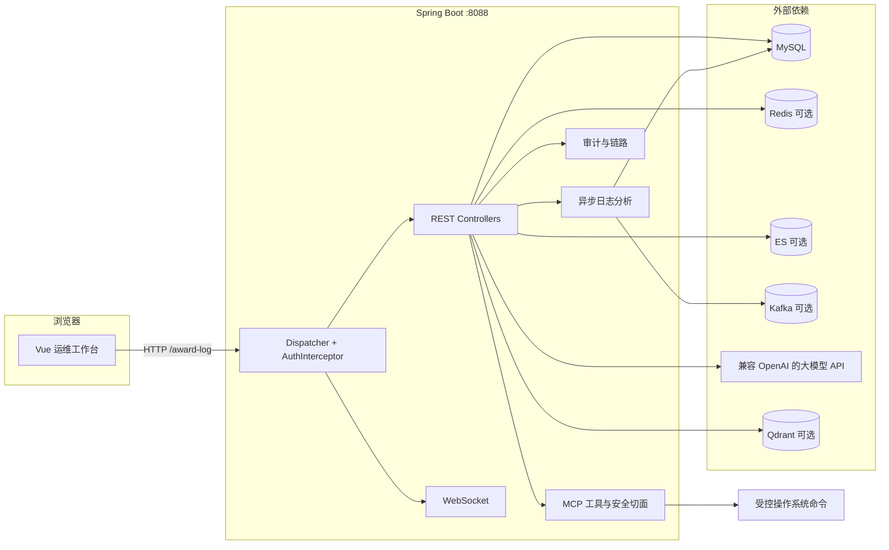

# Award Log（award-log）开发者文档

本文档面向**所有**阅读本仓库的人：后端/前端开发者、测试、产品经理、技术写作者、以及需要安装与运维但不写业务代码的同事。遇到不熟悉的术语，请先阅读「名词解释」一节。

**版权声明**：本软件采用 **Apache License 2.0** 开源，版权与主要贡献者信息见根目录 `LICENSE` 与 `NOTICE`。

---

## 目录

1. [名词解释（非开发同事可先看）](#1-名词解释非开发同事可先看)  
2. [系统是什么、解决什么问题](#2-系统是什么解决什么问题)  
3. [功能全景（业务视角）](#3-功能全景业务视角)  
4. [架构与技术栈](#4-架构与技术栈)  
5. [仓库与代码结构](#5-仓库与代码结构)  
6. [前端控制台（运维工作台）](#6-前端控制台运维工作台)  
7. [后端 API 分组总览](#7-后端-api-分组总览)  
8. [日志分析引擎（核心流水线）](#8-日志分析引擎核心流水线)  
9. [决策、规则与机器学习](#9-决策规则与机器学习)  
10. [MCP 工具链与主机侧能力](#10-mcp-工具链与主机侧能力)  
11. [安全、审计与拦截器](#11-安全审计与拦截器)  
12. [数据持久化与 MyBatis](#12-数据持久化与-mybatis)  
13. [中间件与可选组件](#13-中间件与可选组件)  
14. [配置说明（环境变量与 application）](#14-配置说明环境变量与-application)  
15. [本地开发](#15-本地开发)  
16. [构建、部署与运维](#16-构建部署与运维)  
17. [监控、健康检查与排障](#17-监控健康检查与排障)  
18. [测试与性能](#18-测试与性能)  
19. [Git、协作与发布](#19-git协作与发布)  
20. [`.gitignore` 说明](#20-gitignore-说明)  
21. [许可协议](#21-许可协议)

---

## 1. 名词解释（非开发同事可先看）

| 术语 | 通俗含义 |
|------|-----------|
| **后端 / API** | 跑在服务器上的程序，浏览器或其它系统通过「接口」把日志文件、指令发给它，它返回结果。 |
| **前端 / 控制台** | 浏览器里看到的页面（本项目的「运维工作台」），负责上传、看报告、对话、点按钮调工具。 |
| **MySQL** | 关系型数据库，存用户、任务、告警记录等结构化数据。 |
| **Redis** | 内存型缓存/会话加速（可选）；未安装时部分能力会弱或不可用。 |
| **Kafka** | 消息队列，用于日志采集管线（可选）；未安装时需关配置，否则可能连不上。 |
| **Elasticsearch（ES）** | 日志检索与存储（可选）。 |
| **Qdrant** | 向量数据库，用于知识库检索（可选）。 |
| **Spring Boot** | Java 生态里常用的后端框架，本项目后端即基于此。 |
| **Vue / Vite** | 前端界面技术；`npm run dev` 启动开发页面，`npm run build` 生成可部署的静态文件。 |
| **Context Path** | 所有后端 URL 前面的统一前缀，本项目为 **`/award-log`**。完整示例：`http://主机:8088/award-log/log/upload`。 |
| **Drain / 模板** | 一种从原始日志里自动归纳「日志模板」的算法，便于统计异常模式。 |
| **MCP / 工具** | 在受控策略下，让助手或对话能调用「读磁盘、看进程」等主机侧能力；有审计与路径限制。 |
| **ONNX / 随机森林** | 一种导出的机器学习模型文件，用于异常打分等（见 `resources/models`）。 |

---

## 2. 系统是什么、解决什么问题

Award Log 是一套 **日志上传 → 异步分析 → 模板与异常检测 → 可视化报告 / 导出 →（可选）AI 诊断与运维对话 →（可选）MCP 主机工具与审计** 的一体化系统。

- **默认端口**：`8088`；**统一前缀**：`/award-log`。  
- **前端**：Vue 3 + Element Plus + ECharts，入口在 `frontend/`。  
- **后端**：Spring Boot 3 + MyBatis + Spring AI（可选）+ 自研采集与决策管线。

---

## 3. 功能全景（业务视角）

| 能力 | 用户可见形态 | 主要技术位置 |
|------|----------------|----------------|
| 单文件 / 多文件日志上传 | 控制台「日志分析」页 | `LogAnalysisController`、`LogAnalysisServiceImpl` |
| 任务进度、取消、历史分页 | 任务记录、轮询状态 | `AnalysisTaskManager`、`/log/task`、`/log/history` |
| 分析报告与图表 | 仪表盘、详情表 | `LogAnalysis.vue`、`LogAnalysisDashboard.vue` |
| CSV / HTML 导出 | 按任务 ID 下载 | `target/output/<taskId>/`、`/log/download/{taskId}/{type}` |
| AI 全盘 / 单行诊断 | 按钮与弹窗 | `AiDiagnosisService`、`/log/diagnose` |
| 工作台自然语言对话 | 「工作台对话」Tab，SSE | `UnifiedAssistantController`、`/api/assistant` |
| MCP 工具台 | 「工具控制台」Tab（动态拉取工具列表；Agentic 风险二次确认） | `McpExecuteController`、`/api/mcp` |
| AI 执行审计列表 | 「执行审计」Tab | `AiAuditController`、`/admin/audit/ai` |
| 运维链路审计 | 「运维链路审计」Tab（列表 + 按 traceId 查看思维链 CoT） | `OpsTraceController`、`/api/ops-trace`、`OpsAuditTraceService` |
| 告警配置 / 历史 / 统计 | 顶部「告警配置」与各分析页 | `AlarmConfigController`、`AlarmHistoryController` 等 |
| 用户 / 角色 / 权限 / 统计 | 管理类接口 | `/admin/user`、`/admin/role`、`/admin/permission`、`/admin/statistics` |
| 决策反馈与再训练入口 | API + Python 脚本 | `DecisionFeedbackController`、`scripts/ml/` |
| Runbook 审批流 | API | `RunbookApprovalController`、`/api/runbook` |
| 性能采集与多维分析 | API + WebSocket | `PerformanceAnalysisController`、`/ws/performance` |
| 日志流 WebSocket | 可选实时通道 | `/ws/logs` |
| 知识库 / 模板 / 规则管理 | REST v1 | `/api/v1/knowledge`、`templates`、`rules` 等 |
| 模型评估与健康 | REST | `ModelEvaluationController`、`ModelHealthController` |
| 实验与决策管线 v1 | REST | `ExperimentController`、`DecisionController` 等 |
| 日志清洗规则 | REST | `LogCleanController` |
| 平台就绪检查 | REST | `PlatformReadinessController` |
| 延时运维任务 | REST | `OpsScheduleController`、`/api/ops-schedule` |

未部署的中间件（Kafka、ES、Redis、Qdrant 等）时，上表中依赖它们的行可能报错或功能降级，属预期现象。

---

## 4. 架构与技术栈

### 4.1 逻辑架构（Mermaid）



### 4.2 技术栈清单

| 层级 | 技术 |
|------|------|
| 后端运行时 | Java 17、Spring Boot 3.5.x |
| Web | Spring MVC、Tomcat、部分 WebSocket |
| 持久化 | MyBatis、MySQL 8 |
| AI | Spring AI BOM（OpenAI 兼容协议，默认对接通义千问兼容地址） |
| API 文档 | Springdoc + Knife4j |
| 日志 | Log4j2 |
| 前端 | Vue 3、Vite 4、Element Plus、ECharts、Axios |
| 观测 | Actuator、Micrometer Prometheus（配置见 `application.yml`） |

---

## 5. 仓库与代码结构

```
项目根目录/
├── pom.xml                      # Maven 工程定义与依赖版本
├── LICENSE                      # Apache-2.0 全文 + 版权行
├── NOTICE                       # Apache 惯例的归属说明
├── .env.example                 # 环境变量模板（勿提交真实 .env）
├── alarm-config.example.json    # 告警 JSON 模板（真实文件 alarm-config.json 不入库）
├── schema.sql / *.sql           # 根目录增量 SQL（与 resources 内 schema 配合使用）
├── frontend/                    # ★ 主控制台：Vite + Vue（日常开发与部署以此为准）
├── src/main/java/com/award/log/ # ★ 后端主代码
│   ├── AwardWinningLogApplication.java
│   ├── controller/              # HTTP 控制器（按 URL 分包，见第 7 节）
│   ├── service/ / impl/         # 业务服务实现
│   ├── task/                    # 异步任务与 TaskInfo
│   ├── analyzer/                # Drain / Drain-Plus 等解析器
│   ├── analysis/                # 异常启发式等
│   ├── decision/                # 决策与协作管线
│   ├── mcp/                     # MCP 注册、执行、路径策略、工具类
│   ├── security/                # 登录拦截、MCP 切面、路径策略、提示注入防护等
│   ├── collector/               # 文件/网络/DB/Kafka 采集与调度
│   ├── config/                  # Spring 配置（WebMvc、线程池、Redis、WebSocket…）
│   ├── handler/                 # 如 Performance / Log 的 WS 处理器
│   ├── websocket/               # 如日志流 WS 等附加配置（与 `config/WebSocketConfig` 并存，以代码为准）
│   └── …                        # model、mapper、util、trace 等
├── src/main/resources/
│   ├── application.yml            # 主配置（含敏感项占位，见第 14 节）
│   ├── application-dev.yml      # 开发 profile
│   ├── mapper/*.xml             # MyBatis SQL 映射
│   ├── schema.sql               # 建表脚本（部署必备）
│   └── models/*.onnx            # 随机森林等导出模型
├── src/test/java/               # JUnit 测试
├── scripts/
│   ├── ml/*.py                  # 决策反馈样本导出与训练脚本
│   └── deploy/*.sh              # 部署辅助脚本
├── tests/performance/*.jmx      # JMeter 性能测试工程（如有）
└── src/（根下另一套 Vue 片段）  # ChatView 等实验/子模块，与 frontend 主应用并存；主路径仍以 frontend 为准
```

---

## 6. 前端控制台（运维工作台）

入口：`frontend/src/App.vue`。登录后左侧菜单分组如下（快捷键 1–8）：

| Tab 键 | 名称 | 作用简述 |
|--------|------|-----------|
| `ops-chat` | 工作台对话 | 自然语言运维助手，流式输出；可接收其它页发来的预填问题（自定义事件）。 |
| `mcp-tools` | 工具控制台 | 列出可调 MCP 工具、参数表单、执行与确认流。 |
| `audit` | 执行审计 | AI/MCP 执行记录只读列表（受后端 `app.security.ai-audit-relaxed-read` 影响）。 |
| `ops-audit-trace` | 运维链路审计 | 运维 Agent/MCP 落库审计；支持按 traceId 拉详情（含 `steps_json` 解析后的思维链步骤）。 |
| `analysis` | 日志分析 | 上传、进度、报告、导出、单行诊断等主流程。 |
| `history` | 任务记录 | 历史任务分页与筛选。 |
| `dashboard` | 日志分析仪表盘 | 汇总图表与统计。 |
| `alarm-history` | 告警历史分析 | 告警列表与趋势类视图。 |

**API 基地址**：`frontend/src/api/index.js` 中根据浏览器 `hostname` 与固定端口 `8088` 拼接 `http(s)://<host>:8088/award-log`（与后端 `server.servlet.context-path` 一致）。若前后端不同域或端口，需改此处或通过反向代理统一域名。

**与 MCP/助手对齐的前端模块**（名称与后端工具名一致，避免两套清单分叉）：

| 文件 | 作用 |
|------|------|
| `frontend/src/utils/mcpToolsMeta.js` | 工具展示元数据、命令提示、`mergeToolRegistry()` 与服务端 `/api/mcp/tools` 合并 |
| `frontend/src/utils/mcpRiskConfirm.js` | 二次确认框文案（风险分、维度、说明） |
| `frontend/src/utils/mcpToolResult.js` | 统一解析 MCP 返回（含 `riskScore` 等） |
| `McpToolsDemo.vue` | 工具控制台：动态列表 + Agentic 确认 UI |
| `OpsChatInterface.vue` | 工作台：快捷意图映射到新工具 + 安全拦截展示 |
| `OpsTraceCenter.vue` | 调用 `/api/ops-trace/detail` 查看思维链步骤 |

**Cookie / 会话**：需携带登录态的请求（含部分流式 `fetch`）应设置 **`credentials: 'include'`**，并与上述 **`/award-log`** 前缀一致，否则易出现 401 或路径错位。

**跨域**：`WebMvcConfig` 中对 `localhost:3000–3003` 等来源放开 CORS 且 `allowCredentials(true)`；生产应对齐真实前端域名。

---

## 7. 后端 API 分组总览

下列路径均相对于 **`/award-log`** 根（即完整 URL 需加此前缀）。**登录拦截**：`AuthInterceptor` 作用于 `/admin/**`、`/log/**`、`/api/**`，排除登录注册、Swagger 静态资源等（见 `WebMvcConfig`）。

| 前缀 | 代表控制器 | 用途摘要 |
|------|-------------|-----------|
| `/log` | `LogAnalysisController` | 上传、任务状态、报告、下载、取消/删除等 |
| `/log/diagnose` | `AiDiagnosisController` | AI 诊断（路径以类上注解为准） |
| `/admin/user` | `SysUserController` | 用户注册登录、分页、维护 |
| `/admin/role` | `SysRoleController` | 角色 |
| `/admin/permission` | `SysPermissionController` | 权限点 |
| `/admin/statistics` | `StatisticsController` | 日志摘要、性能、任务状态统计等 |
| `/admin/audit/ai` | `AiAuditController` | 执行审计查询 |
| `/api` | `ChatController` 等 | 根在 `/api` 下的聚合接口（具体方法见类内 Mapping） |
| `/api/chat` | `ChatAnalysisController` | 聊天分析相关 |
| `/api/assistant` | `UnifiedAssistantController` | 统一助手上下文、流式对话 |
| `/api/mcp` | `McpExecuteController` | MCP 工具列表、执行、确认 |
| `/api/ops-schedule` | `OpsScheduleController` | 延时运维任务 |
| `/api/ops-trace` | `OpsTraceController` | 运维链路列表（`/recent`）与单条详情（`/detail?traceId=`，含思维链） |
| `/api/alarm` | `AlarmConfigController` | 告警配置读写 |
| `/api/alarm-rule` | `AlarmRuleCompatController` | 与前端路径对齐的告警规则兼容接口（内存存储，重启清空） |
| `/api/alarm/history` | `AlarmHistoryController` | 告警历史与统计接口 |
| `/api/v1/alarm/lifecycle` | `AlarmLifecycleController` | 告警生命周期 |
| `/api/profile` | `UserProfileController` | 个人中心、密码、通知设置等 |
| `/api/performance` | `PerformanceAnalysisController` | 性能趋势、基线、多维分析等 |
| `/api/collector` | `CollectorStatusController` | 采集器状态 |
| `/api/kafka` | `KafkaMonitorController` | Kafka 监控 |
| `/api/elasticsearch` | `ElasticsearchController` | ES 索引与搜索 |
| `/api/log/clean` | `LogCleanController` | 清洗规则与单条清洗 |
| `/api/platform` | `PlatformReadinessController` | 就绪检查 |
| `/api/runbook` | `RunbookApprovalController` | Runbook 提交/审批/执行 |
| `/decision-feedback` | `DecisionFeedbackController` | 决策反馈、训练触发、样本计数 |
| `/api/v1/experiment` | `ExperimentController` | 实验 |
| `/api/v1/decision` | `DecisionController` | 决策 v1 |
| `/api/v1/llm` | `LlmChatController` | LLM 对话 v1 |
| `/api/v1/knowledge` | `KnowledgeController` | 知识库 |
| `/api/v1/templates` | `TemplateManagementController` | 模板管理 |
| `/api/v1/rules` | `RuleManagementController` | 规则管理 |
| `/api/v1/model` | `ModelEvaluationController`、`ModelHealthController` | 模型评估与健康 |

**Knife4j / OpenAPI**：`knife4j.enable=true` 时，可在服务启动后访问文档 UI（路径随 Springdoc 配置，常见为 `/award-log/doc.html`），获得**带注释的完整接口列表**（比本表更细）。

**WebSocket（相对 `/award-log`）**

| 路径 | 处理器 | 说明 |
|------|--------|------|
| `/ws/performance` | `PerformanceWebSocketHandler` | 性能推送 |
| `/ws/logs` | `LogWebSocketHandler` | 日志流 |

握手使用 `WebSocketAuthHandshakeInterceptor`，生产应收紧 `setAllowedOrigins`。

---

## 8. 日志分析引擎（核心流水线）

实现类：`com.award.log.service.impl.LogAnalysisServiceImpl`（异步方法 `startAnalysisAsync`）。

**典型阶段**（与代码顺序一致，细节以源码为准）：

1. **任务初始化**：`AnalysisTaskManager` 写入任务状态；可选防重复分析同一物理文件路径。  
2. **分片读取**：大文件按 `shardSize` 分片读入，降低内存峰值。  
3. **Drain-Plus 解析**：通过 `DrainParserFactory.getPlusParser()` 与配置 `log.pipeline.analyzer.drain`（`engine: plus`、`sim-threshold`、`max-depth`）控制模板树。  
4. **并行批处理**：自定义线程池 `logAnalysisExecutor` 处理各分片，合并为 `finalResult`。  
5. **异常检测（可关）**：时序、关键词、频次等启发式 + 综合得分；可接 `CollaborativeDecisionService` / IntelligentRouter 等决策组件。  
6. **导出**：若开启 CSV/HTML，写入 **`{user.dir}/target/output/{taskId}/`**，避免多任务互相覆盖。  
7. **收尾**：汇总 `TaskSummary`，持久化任务结果。

**取消任务**：`cancelAnalysis` 更新状态、中断线程映射中的 worker。

---

## 9. 决策、规则与机器学习

| 组件 | 包 / 类（方向性指引） | 说明 |
|------|------------------------|------|
| 规则引擎 | `decision`、`service.impl.RuleRegistryServiceImpl` 等 | 与赛题相关的规则命中与统计。 |
| 随机森林 ONNX | `application.yml` → `log.pipeline.decision.rf.model-path` | 默认 `random-forest-v2.onnx`，用于告警/异常打分阈值配置同节。 |
| LLM 决策 | `LlmChatController`、`decision` 包内引擎 | 与 Spring AI 协同的决策路径。 |
| 决策反馈再学习 | `ContinuousLearningService`、`DecisionFeedbackController` | 导出样本、`scripts/ml/train_model.py` 等脚本训练；依赖本机 Python 环境。 |

具体算法参数与特征版本以 `log.pipeline.decision` 下 YAML 为准。

---

## 10. MCP 工具链与主机侧能力

**注册表**：`McpToolRegistry` 将下列 Spring Bean 暴露为可调工具（HTTP 执行名需与下表 **Bean/工具名** 一致；Spring AI `@Tool` 方法名另见各类内注解）：

| Bean（HTTP `toolName`） | 源文件 | 能力方向 |
|-------------------------|--------|-----------|
| `LogAnalysisTool` | `mcp/tools/LogAnalysisTool.java` | 主机日志路径读取与分析入口 |
| `DiskTool` | `DiskTool.java` | 磁盘占用（df 类） |
| `DiskInsightTool` | `DiskTool.java`（排行接口） | 目录热点 du 排序（白名单路径） |
| `DiskAnalyzeTool` | `mcp/tools/DiskAnalyzeTool.java` | **只读**：磁盘压力综合诊断（全局概览 + 可选热点） |
| `ProcessTool` | `ProcessTool.java` | 进程列表与资源占用筛选 |
| `SystemLoadTool` | `SystemLoadTool.java` | 系统负载 |
| `CleanTempTool` | `CleanTempTool.java` | 临时目录清理（dry-run / 二次确认） |
| `LogCleanupTool` | `mcp/tools/LogCleanupTool.java` | **写操作**：日志根目录下陈旧文件清理（白名单路径，默认预览） |
| `ServiceRestartTool` | `mcp/tools/ServiceRestartTool.java` | **写操作**：白名单服务重启（默认预览；Linux `systemctl` 等） |
| `ConfigCheckTool` | `ConfigCheckTool.java` | 配置文件只读检查 |
| `NetworkTool` | `NetworkTool.java` | 网络诊断（ping / traceroute） |
| `PrivilegeTool` | `PrivilegeTool.java` | 权限与 sudo 探测类能力 |
| `OsInsightTool` | `OsInsightTool.java` | OS 侧综合洞察（journalctl / ss / lsof） |
| `FirstMcpTools` | `mcp/FirstMcpTools.java` | 基础示例/聚合工具 |

**执行控制器**：`McpExecuteController`（`/api/mcp`）负责列出工具、执行、二次确认等；与 `McpToolSecurityAspect`、`OpsPathPolicy`、`MinPrivilegeExecutor` 协同实现**路径白名单、禁止敏感路径、最小权限用户**（`agent.*` 配置段）。成功/拦截/需确认路径会将 **思维链（CoT）四步**（接收 → 感知 → 推理 → 校验与执行摘要）写入 `ops_audit_trace.steps_json`，供「运维链路审计」详情查看。

**统一安全门**：`McpInvocationSecurityGate` 在控制器层汇总校验：**工具名允许列表**、参数条目数与单字段长度上限、拼接后的「指令串」长度上限；并结合 `PromptInjectionGuard`、`IntentRiskFilter`、`HighRiskCommandDetector`。在此基础上叠加 **`AgenticRiskScoreEngine`**（0–10 分，多维度：工具基线、路径敏感度、命令模式、运行用户是否为 root 等）：低于 `agent.security.risk-score-auto-max` 倾向自动执行；处于 `[autoMax, confirmMax]` 且为首次请求时需前端二次确认（响应中带 `riskScore`、`riskDimensions`、`riskExplanation`）；高于 `risk-score-confirm-max` 直接拒绝（`RISK_SCORE_HIGH`）。信任边界仍由 `McpSecurityProfile` 区分——**首次请求**（`INITIAL_REQUEST`）遇中等意图风险或分数落入确认区间会要求二次确认；**已确认执行**（`POST_CONFIRMATION`）与**延时任务**（`DEFERRED_SCHEDULED`）不因 MEDIUM 重复阻断，但若分数仍超过确认上限仍会拒绝。聊天入口 `/api/chat` 对用户消息长度另由 `enforceChatMessageLimit` 约束。

**路径与重启策略**：日志清理允许根路径由 `agent.paths.log-cleanup-roots` / `windows-log-cleanup-roots` 与 `OpsPathPolicy#isAllowedLogCleanupPath` 约束；可重启服务列表见 `agent.service-restart.allowlist`。**延时任务**（`/api/ops-schedule`）白名单默认可调度只读类工具及既有巡检工具；含 **`DiskAnalyzeTool`**；高风险写操作默认不放入延时列表（以 `OpsDeferredTaskService` 为准）。

**命令输出**：`AbstractCommandExecutor` 对 stdout/stderr 做长度截断，避免超大回显撑爆内存或日志。

**统一助手对齐**：流式对话所用的 `UnifiedAssistantService` 系统提示中包含 **与本节点 `/api/mcp` 白名单一致的 MCP 工具英文名**，减少模型编造工具名；实际执行仍以控制器与安全门为准。

**运维注意**：Linux 生产建议配置专用用户与 `sudoers`；Windows 本地开发可在 `application-dev.yml` 将 `agent.min-privilege.enabled` 设为 `false` 以减少权限错误（仅开发环境）。`OpsPathPolicy` 在 Linux 下会将 `log.collector.file.path` 并入可读前缀；Windows 侧依赖 `agent.paths.windows-*` 覆盖常见日志盘符与目录。

---

## 11. 安全、审计与拦截器

| 机制 | 位置（包级） | 作用 |
|------|----------------|------|
| 登录拦截 | `security.AuthInterceptor` + `WebMvcConfig` | 保护业务与日志接口 |
| MCP 调用切面 | `security.McpToolSecurityAspect` | 工具层安检 |
| MCP 统一门控 | `security.McpInvocationSecurityGate`、`McpSecurityProfile` | 工具允许列表、参数/指令尺度、注入与意图/高危命令；**Agentic 风险分**与确认流；延时任务信任边界 |
| Agentic 风险评分 | `security.AgenticRiskScoreEngine` | 工具调用 0–10 分，与 `agent.security.risk-score-*` 阈值联动 |
| 路径策略 | `security.OpsPathPolicy`、`application.yml` → `agent.paths` | 可读/可清/禁止路径 |
| 高风险命令 | `security.HighRiskCommandDetector`、`HighRiskCommandRule` | 命令级拦截 |
| 提示注入防护 | `security.PromptInjectionGuard`、`IntentRiskFilter` | 对话与意图风险 |
| WebSocket 握手 | `security.WebSocketAuthHandshakeInterceptor` | WS 鉴权 |
| 执行审计 | `AiAuditController` + 相关 service | 记录敏感操作供合规查看 |
| MCP/运维链路审计表 | `service.OpsAuditTraceService`、`trace.TraceService` | `ops_audit_trace` 落库；含 CoT `steps_json` |

`app.security.ai-audit-relaxed-read`：为 `true` 时，已登录用户可读执行审计列表（**开发便利**）；**生产务必为 `false`**，仅管理员可见。

---

## 12. 数据持久化与 MyBatis

**建表**：以 `src/main/resources/schema.sql` 为主；根目录 `migrate_decision_feedback.sql`、`update_schema.sql`、`add_permission_columns.sql`、`fix_alarm_rule.sql` 为增量脚本，按环境选择执行顺序。

**Mapper XML（`resources/mapper/`）**

| 文件 | 典型领域 |
|------|-----------|
| `SysUserMapper.xml` / `SysRoleMapper.xml` / `SysPermissionMapper.xml` / `SysRolePermissionMapper.xml` | RBAC |
| `LogAnalysisTaskMapper.xml` / `LogAnalysisDetailMapper.xml` | 分析任务与明细 |
| `LogTemplateMapper.xml` | 日志模板 |
| `LogAlarmMapper.xml` | 告警 |
| `DecisionFeedbackMapper.xml` / `DecisionLogMapper.xml` | 决策反馈与日志 |
| `RuleHitStatMapper.xml` | 规则命中统计 |
| `ModelEvaluationMapper.xml` / `EngineOfflineMetricMapper.xml` | 模型与离线指标 |

实体与接口在 `com.award.log.model`、`mapper` 包中对应。

---

## 13. 中间件与可选组件

| 组件 | 配置入口 | 未部署时的建议 |
|------|-----------|----------------|
| MySQL | `spring.datasource.*` | **必须部署** |
| Redis | `spring.data.redis.*` | 连接失败时排查是否被强制依赖；视代码降级逻辑 |
| Elasticsearch | `spring.elasticsearch.*`、`ELASTIC_ENABLED` | 置 `false` 跳过 |
| Kafka | `spring.kafka.*`、`log.pipeline.kafka` | 无集群时务必将 **`spring.kafka.enabled` 设为 `false`**（`StartupConfigValidator` 仅在 `true` 时强制校验 `bootstrap-servers`；`KafkaLogConsumer` 等 Bean 是否仍创建以当前配置类为准） |
| 邮件 | `spring.mail.*` | 缺省为空则不发信 |
| 企业微信 | `wechat.*` | 缺省为空则不走推送 |
| Qdrant | `qdrant.*` | 向量检索不可用时不影响基础日志分析 |

---

## 14. 配置说明（环境变量与 application）

### 14.1 强烈建议使用环境变量（勿把密钥提交 Git）

复制 `.env.example` 为本地 `.env`（已被 `.gitignore` 忽略），或在系统中导出变量。

| 变量 | 含义 |
|------|------|
| `DB_URL` / `DB_USERNAME` / `DB_PASSWORD` | JDBC 连接与凭据；**`DB_PASSWORD` 必填**（`application.yml` 中无默认密码） |
| `AI_BASE_URL` / `AI_API_KEY` | 大模型兼容接口与密钥 |
| `MAIL_*` | SMTP |
| `WECHAT_*` | 企业微信 |
| `ELASTIC_*` | ES 开关与地址 |
| `QDRANT_URL` / `QDRANT_COLLECTION` | 向量库 |
| `APP_AI_AUDIT_RELAXED_READ` | 是否放宽执行审计只读权限 |
| `AGENT_MIN_PRIVILEGE` / `AGENT_RUN_AS_USER` | 最小权限 Agent |
| `LOG_COLLECTOR_ROOT` | 文件采集根路径（默认 `logs`） |

### 14.2 `application.yml` 中与业务强相关的块

| YAML 路径 | 含义 |
|-----------|------|
| `server.servlet.context-path` | 固定为 `/award-log`（若修改需同步前端 baseURL） |
| `spring.servlet.multipart.max-*` | 上传大小上限（大日志场景） |
| `log.collector.*` | 文件/网络/DB 采集器开关与路径 |
| `log.pipeline.*` | Kafka topic、Drain 参数、RF 模型路径与阈值 |
| `alarm.*` | 告警聚合窗口、最小级别、推送间隔 |
| `management.endpoints.web.exposure.include` | Actuator 暴露端点 |
| `knife4j` / `springdoc` | 文档 UI |
| `agent.security.max-instruction-length` | MCP 拼接指令串最大字符数（环境变量 `AGENT_MAX_INSTRUCTION_LEN`） |
| `agent.security.max-parameter-entries` | 单次工具调用参数键值对数量上限（`AGENT_MAX_PARAM_ENTRIES`） |
| `agent.security.max-single-string-param-chars` | 单个字符串参数最大字符数（`AGENT_MAX_PARAM_STRING_CHARS`，防参数炸弹） |
| `agent.security.risk-score-auto-max` | Agentic 风险分「倾向自动」上限（默认与赛题示例一致时可设为 `3`） |
| `agent.security.risk-score-confirm-max` | 超过则拒绝；区间内首次请求需二次确认（默认 `7`） |
| `agent.service-restart.allowlist` | 允许重启的服务单元名（逗号分隔） |
| `agent.paths.log-cleanup-roots` / `agent.paths.windows-log-cleanup-roots` | 日志清理允许根路径列表 |

---

## 15. 本地开发

1. **安装**：JDK 17、Maven、MySQL、Node 18+。  
2. **建库并执行** `src/main/resources/schema.sql`（及所需增量 SQL）。  
3. **导出** `DB_PASSWORD`（及按需 `AI_API_KEY`）。  
4. **后端**：`mvn spring-boot:run`（profile 默认 `dev`，见 `application-dev.yml`）。  
5. **前端**：`cd frontend && npm install && npm run dev`。  
6. **文档**：浏览器打开 Knife4j / Swagger 地址做接口联调。  

**微信小程序**：若维护小程序端，在微信开发者工具对 `frontend` 执行「构建 npm」生成本地 `miniprogram_npm/`（已在 `.gitignore`）。

---

## 16. 构建、部署与运维

### 16.1 后端 Fat Jar

```bash
mvn -DskipTests package
java -jar target/award-log-*.jar
```

生产请使用 **`spring.profiles.active=prod`** 与**未入库**的 `application-prod.yml`（文件名已在 `.gitignore` 中忽略）。

### 16.2 前端静态资源

```bash
cd frontend
npm ci
npm run build
```

将 `frontend/dist/` 部署到 Nginx `root`，并配置：

- 静态：`/` 或子路径  
- 反向代理：将浏览器对 `/award-log` 的请求转发到后端 `http://127.0.0.1:8088/award-log`

### 16.3 报告文件目录

分析完成后文件位于 **`{进程工作目录}/target/output/<taskId>/`**。备份与清理策略由运维制定；注意磁盘水位。

### 16.4 进程托管

Linux 推荐 `systemd`；Windows 可用服务或 NSSM。注意 JVM `-Xmx` 与 OOM 自动拉起。

---

## 17. 监控、健康检查与排障

- **Actuator**：`health`、`prometheus`、`metrics`、`engine-health` 等（见 `management.endpoints`）。生产应限制外网访问或通过防火墙仅允许采集网段。  
- **常见问题**：数据库连不通（检查 `DB_*`）、Kafka/ES 连接失败（关闭或部署）、前端 401（Cookie / 跨域 / 登录过期）、下载 404（任务未完成或导出被关闭）、AI 无响应（Key 与网络）。

---

## 18. 测试与性能

- **单元测试**：`src/test/java/`（JUnit）。  
- **JMeter**：`tests/performance/*.jmx`（若存在）。  
- **Python 训练**：`scripts/ml/`，需自备 Python 与依赖。

---

## 19. Git、协作与发布

- 分支策略建议：`main` 保持稳定；功能在 `feature/*` 开发，经 Code Review 合并。  
- 版本标签：`git tag -a v1.0.0 -m "release"` 后 `git push origin v1.0.0`。  
- 若托管于 GitHub/GitLab：HTTPS 推送需 **Personal Access Token** 或 **SSH 密钥**；网络超时需检查代理或防火墙。

---

## 20. `.gitignore` 说明

忽略 **构建产物**（`target/`、`frontend/dist/`）、**依赖**（`node_modules/`）、**密钥与本地配置**（`.env`、`alarm-config.json`）、**IDE 目录**、**日志与存储目录**、**安装包**（`*.msi`）、**微信小程序构建目录** `frontend/miniprogram_npm/` 等。详见仓库内 `.gitignore` 注释。

---

## 21. 许可协议

本项目使用 **Apache License, Version 2.0** 授权，完整条款见根目录 **`LICENSE`**。  

**版权与主要贡献者**：`Copyright 2026 zhaowenkai`（见 `LICENSE` 附录与 `NOTICE`）。在遵守 Apache-2.0 的前提下，欢迎提交 Issue 与 Pull Request 共同改进文档与代码。
