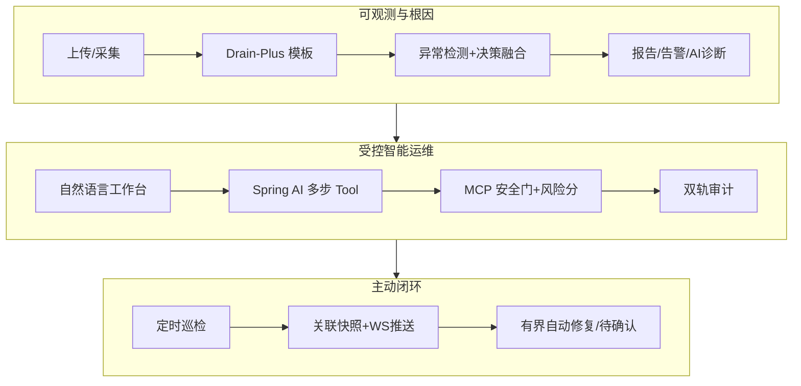
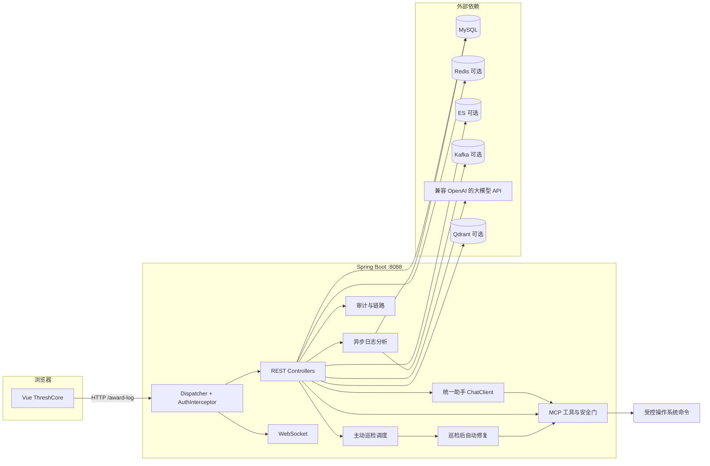

# ThreshCore（award-log）功能设计文档 · 详细版

| 项 | 说明 |
|----|------|
| **文档类型** | 功能设计说明书（详细版） |
| **系统名称** | ThreshCore 控制台 + award-log 后端服务 |
| **Context Path** | `/award-log` |
| **默认端口** | `8088` |
| **编制依据** | 源代码树、`schema.sql`、`application.yml`、`README.md`、`docs/项目需求与设计规格说明书.md` |
| **版本** | 与当前工程实现同步（2026） |

---

## 目录

1. [产品总览](#1-产品总览)
2. [ThreshCore 控制台（前端）](#2-threshcore-控制台前端)
3. [身份、权限与个人中心](#3-身份权限与个人中心)
4. [日志批量分析子系统](#4-日志批量分析子系统)
5. [实时日志与采集管线](#5-实时日志与采集管线)
6. [AI 诊断与聊天分析](#6-ai-诊断与聊天分析)
7. [统一运维助手（工作台）](#7-统一运维助手工作台)
8. [MCP 工具链](#8-mcp-工具链)
9. [安全护栏体系](#9-安全护栏体系)
10. [审计双轨](#10-审计双轨)
11. [主动巡检与有界自动修复](#11-主动巡检与有界自动修复)
12. [告警子系统](#12-告警子系统)
13. [决策、规则与机器学习](#13-决策规则与机器学习)
14. [知识库、模板、规则与清洗](#14-知识库模板规则与清洗)
15. [性能监控](#15-性能监控)
16. [延时任务、Runbook 与平台就绪](#16-延时任务runbook-与平台就绪)
17. [后端已实现、前端无独立 Tab 的能力](#17-后端已实现前端无独立-tab-的能力)
18. [数据模型总览](#18-数据模型总览)
19. [配置项与设计意图对照](#19-配置项与设计意图对照)
20. [端到端用户故事](#20-端到端用户故事)
21. [非功能需求](#21-非功能需求)
22. [功能需求编号（F1–F8）](#22-功能需求编号f1f8)
23. [接口速查附录](#23-接口速查附录)
24. [赛题对照表](#24-赛题对照表)

---

## 1. 产品总览

### 1.1 设计背景

| 背景维度 | 具体问题 |
|----------|----------|
| **运维痛点** | 日志体量大、格式异构（syslog/journal/Docker/K8s CRI/Nginx 等），人工 grep 无法规模化；根因定位慢 |
| **AIOps 新风险** | 大模型可驱动主机操作，若无白名单、最小权限、审计，易出现误删、注入诱导、不可追责 |
| **赛题典型要求** | OS 感知、MCP 工具化、安全护栏、链路可追溯、**有界**自动化（非任意 Shell） |
| **交付现实** | 演示环境多样（Windows 开发、Linux/麒麟生产），中间件（Kafka/ES/Redis）未必齐全 |

行业趋势是「分析智能化」与「执行可治理」并重。本系统选择 **单体可部署、前后端分离** 的一体化方案，避免做成「只有聊天窗口」或「只有脚本集合」。

### 1.2 设计初衷（三大主线）



1. **可观测与根因**：把「打不开的 2G 日志」变成可统计模板、可点击诊断、可导出报告。
2. **受控智能运维**：让不熟悉命令的值班人员也能排障，但 **真实执行必须落在 MCP + 安全门**，而非模型直连 Shell。
3. **主动闭环**：从「人主动上传」扩展到「系统主动发现磁盘/告警/新模板等线索」，并在策略内给出修复提案或自动执行。

### 1.3 设计后效果

| 角色 | 设计前 | 设计后 |
|------|--------|--------|
| 夜班运维 | SSH + 记事本 + 口头问老师傅 | 一个浏览器：上传看报告、工作台问「磁盘满了吗」、工具台一键查、traceId 追溯 |
| 科长/审计 | 说不清「谁执行的、系统怎么判的」 | AI 执行审计 + 运维链路 CoT；口令「确认执行」留痕 |
| 算法/平台 | 模型与业务耦合、一改全站抖 | 决策 v1 实验接口、ONNX 可热加载、反馈再训练与主流程解耦 |
| 部署 | 缺 Kafka 就起不来 | `award.middleware.*` 默认关，MySQL 必选，其余可选降级 |

### 1.4 系统边界（刻意不做的事）

- **不是**完整虚拟机沙箱或 HIDS，而是 **工程可运维** 的路径白名单 + 风险分 + 二次确认。
- **不是**任意 Shell 全自动；写操作仅 **CleanTempTool / LogCleanupTool / ServiceRestartTool** 等封装工具。
- **LoongArch + 麒麟 V11** 等目标平台需 **部署侧实测**，代码为通用 Java/Vue。
- 部分能力 **仅有 API、无独立前端 Tab**（见 [§17](#17-后端已实现前端无独立-tab-的能力)）。

### 1.5 逻辑架构



### 1.6 技术栈

| 层级 | 技术 |
|------|------|
| 后端运行时 | Java 17、Spring Boot 3.5、Spring AI 1.1.0（BOM） |
| Web | Spring MVC、Tomcat、WebSocket |
| 持久化 | MyBatis、MySQL 8 |
| AI | OpenAI 兼容协议（默认通义 qwen-plus-latest） |
| API 文档 | Springdoc + Knife4j |
| 日志框架 | Log4j2 |
| 前端 | Vue 3、Vite 4、Element Plus、ECharts、Axios |
| 观测 | Actuator、Micrometer Prometheus |

---

## 2. ThreshCore 控制台（前端）

### 2.1 设计背景

运维工具链分散在 SSH、邮件、企业微信、临时脚本之间，**心智成本高**；赛题答辩需要 **一屏演示完整故事线**（分析 → 对话 → 工具 → 审计）。

### 2.2 设计初衷

- **单页多 Tab**：Vue 3 + Element Plus，与后端 `/award-log` 分离部署或同源反代。
- **懒加载 Tab**（`defineAsyncComponent({ suspensible: false })`）：避免轮询进度时 Suspense 与子组件竞态。
- **快捷键 1–8**：值班场景快速切换，焦点不在输入框时生效。
- **MCP 元数据与服务端合并**：`mcpToolsMeta.js` + `GET /api/mcp/tools`，避免前后端工具清单分叉。

### 2.3 设计后效果

登录后 **8 个主功能 Tab + 顶栏性能条**；带登录态请求使用 `credentials: 'include'`；MCP 与助手共用风险确认文案（`mcpRiskConfirm.js`）与结果解析（`mcpToolResult.js`）。

### 2.4 具体设计细节

#### 2.4.1 导航与信息架构

| 快捷键 | Tab key | 名称 | 核心组件 | 主要能力 |
|--------|---------|------|----------|----------|
| 1 | `ops-chat` | 工作台对话 | `OpsChatInterface.vue` | SSE 统一助手；本地 MCP 快捷意图；风险确认；延时任务；语音；附件 ≤48KB |
| 2 | `mcp-tools` | 工具控制台 | `McpToolsDemo.vue` | 工具概览/表单执行/会话历史 |
| 3 | `audit` | 执行审计 | `AiAuditCenter.vue` | HTTP 级 AI/MCP 请求审计列表 |
| 4 | `ops-audit-trace` | 运维链路审计 | `OpsTraceCenter.vue` | traceId + CoT 四阶段 |
| 5 | `analysis` | 日志分析 | `LogAnalysis.vue` | 上传、进度、报告、导出、诊断、告警配置 |
| 6 | `history` | 任务记录 | `HistoryList.vue` | 分页筛选、跳转报告、转工作台 |
| 7 | `dashboard` | 日志分析仪表盘 | `LogAnalysisDashboard.vue` | 汇总趋势、任务状态、性能图 |
| 8 | `alarm-history` | 告警历史分析 | `AlarmHistoryAnalysis.vue` | 告警统计、趋势、协助排查 |

**菜单分组**：

- **工作台 · 工具 · 审计**：Tab 1–4
- **日志与分析**：Tab 5–8

#### 2.4.2 登录与用户协议（`Login.vue`）

| 功能 | 说明 |
|------|------|
| 登录 / 注册 | `POST /admin/user/login`、`register` |
| 忘记密码 | `checkUserExists` → `resetPassword` |
| 用户服务协议 | `UserServiceAgreement.vue` 须滚动到底才能勾选 |
| 会话存储 | `localStorage.user` → `{ userId, username, role }` |

#### 2.4.3 顶栏（`TopPerformanceBar.vue`）

| 能力 | 说明 |
|------|------|
| 实时指标 | CPU/MEM/磁盘/网络 |
| WebSocket | `/award-log/ws/performance`（可 `VITE_AWARD_LOG_WS_URL` 覆盖） |
| 通道 | `performance`、`patrol_alert`、`patrol_remediation_pending`、`patrol_remediation` |
| HTTP 兜底 | 每 12s 轮询 `/api/ops/patrol/*` |
| 巡检 Popover | 最近告警、关联快照、磁盘热点、修复车道、待确认方案确认 |

#### 2.4.4 工作台对话（`OpsChatInterface.vue`）执行路径

**双路径设计**：

1. **MCP 快捷路径**：`parseUserIntent` + `extractParameters` → 短句直达 `executeMcpTool` / `confirmMcpExecute`（用户未明确拒绝工具时）。
2. **NL 助手路径**：`assistantChatStream`（`useToolAgent: true`）用于长句、解释性、追问或用户说「不要工具」。

**其他能力**：

- 附件：`.txt/.log/.csv/.json/.md`，≤48KB，合并进消息（文本 cap 32KB）
- 语音：Web Speech API（`zh-CN`）
- 延时任务：`parseDelayMinutesFromText` → `POST /api/ops-schedule/tasks`
- 跨 Tab：`defineExpose({ applyPrefill })` 接收 `ops-navigate-agent` 事件

#### 2.4.5 日志分析页（`LogAnalysis.vue`）

| 阶段 | UI 行为 |
|------|---------|
| 上传 | 点击/拖拽 → `uploadLog` → 轮询 `getTaskStatus` |
| 处理中 | 雷达进度、可 `cancelTask` |
| 失败 | 结果页 +「打开工作台对话复核」 |
| 完成 | 健康度图、KPI、异常表 Top100、严重级别饼图、建议列表 |
| 单行 | 「智能分析」→ `POST /log/quick-diagnose` |
| 全盘 | AI 诊断弹窗（Markdown） |
| 导出 | CSV/HTML blob 下载 |
| 深挖 | `anomalyCount >= 15` 引导工作台（`OPS_AGENT_ANOMALY_THRESHOLD`） |
| 告警配置 | `showAlarmConfig`：启用、微信/邮件、最小级别、阈值等 |

#### 2.4.6 API 客户端约定（`frontend/src/api/index.js`）

| 约定 | 说明 |
|------|------|
| 基址 | `VITE_AWARD_LOG_BASE_URL` 或 `http(s)://host:8088/award-log` |
| Cookie | `withCredentials: true` |
| 超时 | `VITE_API_TIMEOUT_MS` 默认 600000ms |
| 普通响应 | 解包 `{ code:200, data }`；401/403 清 user 并刷新 |
| MCP 响应 | **不解包**，保留 `needConfirm`、`riskScore`、`traceId` |
| 流式 | `fetch` + `sseStream.js`，非 axios |

---

## 3. 身份、权限与个人中心

### 3.1 设计背景

日志路径与 MCP 若匿名开放，主机工具可被脚本批量滥用；企业环境要求 **操作主体可识别**。

### 3.2 设计初衷

- **会话拦截**：`AuthInterceptor` 保护 `/admin/**`、`/log/**`、`/api/**`。
- **RBAC 数据模型**：`sys_user`、`sys_role`、`sys_permission`、`sys_role_permission`。
- **WebSocket 同源鉴权**：`WebSocketAuthHandshakeInterceptor` 校验 `LOGIN_USER_ID`。

### 3.3 设计后效果

未登录访问业务 API 返回 **401**；`ops_audit_trace.operator_user_id` 可关联操作人；生产环境 `ai-audit-relaxed-read=false` 限制执行审计可见范围。

### 3.4 具体设计细节

#### 3.4.1 拦截器配置

```text
保护路径：/admin/**、/log/**、/api/**
排除路径：/admin/user/login、register、check-user、reset-password
          /doc.html、/v3/api-docs/**、/swagger-ui/**、/error
```

#### 3.4.2 功能与接口

| 功能 | 接口 |
|------|------|
| 登录/注册/登出 | `POST /admin/user/login`、`register`、`logout` |
| 用户 CRUD、分页 | `GET/PUT/DELETE /admin/user/*` |
| 重置密码、分配角色 | `POST /admin/user/reset-password`、`/{userId}/role` |
| 角色 CRUD、绑权限 | `/admin/role/*` |
| 权限 CRUD、按角色查 | `/admin/permission/*` |
| 个人中心 | `GET/PUT /api/profile/user-info` |
| 改密 | `POST /api/profile/change-password` |
| 登录历史 | `GET /api/profile/login-history` |
| API Key | `POST /api/profile/generate-api-key` |
| 通知设置 | `GET/PUT /api/profile/notification-settings` |
| 个人统计 | `GET /api/profile/user-stats` |

---

## 4. 日志批量分析子系统

### 4.1 设计背景

传统方式无法用单机内存装下 GB 级日志；Drain 类算法需要 **稳定时间字段与清洗**，否则模板树爆炸、统计失真。

### 4.2 设计初衷

- **异步任务**：HTTP 快速返回 `taskId`，后台 `logAnalysisExecutor` 执行。
- **分片 + 有序合并**：保证 `sourceLineIndex` 与时间线一致。
- **时间诚实**：解析失败用 `LogFieldPlaceholder.TIME_UNPARSED`，**禁止**用当前时间冒充日志时间。
- **离线与实时共用解析链**：`RealTimeLogAnalyzer` 复用 `DrainParserFactory`。

### 4.3 设计后效果

用户路径：**上传 → 进度条 → 报告图表 → CSV/HTML 下载 →（可选）AI 全盘诊断 → 单行追问**；任务可取消、历史可翻页。

### 4.4 具体设计细节

#### 4.4.1 任务生命周期

```text
PENDING → PROCESSING → COMPLETED | FAILED | CANCELLED
```

| 阶段 | 进度约 | 实现类/方法 |
|------|--------|-------------|
| 初始化 | 5% | `AnalysisTaskManager`、输出目录 `target/output/{taskId}` |
| 分片 | 10% | `LogShardUtil`，默认 shardSize≈35000 |
| 并行解析 | 10–80% | `LogAnalysisServiceImpl.processLogBatch` |
| 异常检测 | 80–92% | 启发式 + `CollaborativeDecisionService` |
| 导出 | ~92% | CSV/HTML |
| 完成 | 100% | 落库；可选 `AiLogAlarmService` |

**核心类**：`LogAnalysisServiceImpl.startAnalysisAsync`

#### 4.4.2 单行处理流水线

1. `LogCleaner` + `DefaultCleanRules`
2. `GeneralLogSeverityResolver`、协议 `LogLineParseSupport.detectProtocol`
3. Linux/容器：`LinuxLogParseSupport`（`log.pipeline.linux-enhanced: true`）
4. Drain-Plus：`DrainParserFactory.getPlusParser()` → `templateId`
5. 可选脱敏：IP/手机/邮箱/账号
6. 持久化 `log_analysis_detail`

**Drain 配置**（`application.yml`）：

| 键 | 默认值 | 含义 |
|----|--------|------|
| `log.pipeline.analyzer.drain.engine` | `plus` | Drain-Plus |
| `log.pipeline.analyzer.drain.max-depth` | `8` | 树深度 |
| `log.pipeline.analyzer.drain.sim-threshold` | `50` | 模板合并相似度（%） |

#### 4.4.3 异常检测

| 维度 | 方法 | 说明 |
|------|------|------|
| 时序 | `detectTemporalAnomaly` | 5 维特征 + 滑动窗口（size 10） |
| 关键词 | `detectKeywordAnomaly` | `LogAnomalyHeuristics` |
| 频次 | `detectFrequencyAnomaly` | 稀有模板/爆发 |
| 综合 | `calcComprehensiveAnomalyScore` | 合并 |
| 决策融合 | `evaluateAnomaliesWithIntelligentRouter` | 置信度 >0.75 强化；低置信可降分 |

默认：`enableAnomalyDetect=true`，`anomalyThreshold=0.7`。

#### 4.4.4 接口清单

| 方法 | 路径 | 说明 |
|------|------|------|
| POST | `/log/upload` | 单文件上传 |
| POST | `/log/upload/multi` | 多文件上传 |
| GET | `/log/task/{taskId}` | 任务状态与进度 |
| GET | `/log/history` | 历史分页 |
| GET | `/log/report/{taskId}` | 分析报告 |
| GET | `/log/download/{taskId}/{type}` | csv / html |
| POST | `/log/diagnose/{taskId}` | 任务级诊断 |
| POST | `/log/quick-diagnose` | 快速诊断 |
| POST | `/log/pause|resume|cancel/{taskId}` | 任务控制 |
| DELETE | `/log/delete/{taskId}` | 删除任务 |

#### 4.4.5 其他机制

- **防重复**：`analyzedFiles` 同绝对路径可跳过。
- **取消**：`cancelAnalysis` 中断 worker 线程。
- **导出目录**：`{user.dir}/target/output/{taskId}/`

---

## 5. 实时日志与采集管线

### 5.1 设计背景

现场除手动上传外，还有 **持续落盘、syslog、Kafka 管线**；需与批量分析 **口径一致**。

### 5.2 设计初衷

- 采集器插件化：`FileLogCollector`、`NetworkLogCollector`、`DatabaseLogCollector`。
- `award.middleware.kafka=false`（默认）不加载 Kafka Bean。
- `LogStreamWebSocketHandler` 由 `RealTimeLogAnalyzer` 内部注册（非对外 `/ws` 路径）。

### 5.3 设计后效果

- 文件采集：按 `log.collector.file.path` 监听，扩展名白名单。
- Kafka 开启：采集 → `raw-logs` → 消费 → `MvpStreamProcessor` → 决策/告警。
- `/ws/logs`：每 3s 推送采集摘要。

### 5.4 具体设计细节

#### 5.4.1 数据流

```text
[File/Network/DB Collector]
    → LogCollectorManager.collectAll()
    → CollectorDispatchScheduler (dispatch-interval-ms: 1000)
    → KafkaLogProducer → topic raw-logs
    → KafkaLogConsumer
    → MvpStreamProcessor (滑动窗口 + CollaborativeDecisionService)
```

#### 5.4.2 配置键

| 键 | 默认 | 含义 |
|----|------|------|
| `log.collector.enabled` | true | 采集总开关 |
| `log.collector.file.path` | 环境相关 | 采集根（并入路径策略可读前缀） |
| `award.middleware.kafka` | false | Kafka 开关 |
| `log.pipeline.stream.error-rate-threshold` | 0.30 | 流式告警阈值 |
| `log.pipeline.stream.min-sample-size` | 20 | 最小样本 |
| `log.pipeline.stream.cooldown-ms` | 300000 | 冷却 5 分钟 |

#### 5.4.3 接口

| 方法 | 路径 |
|------|------|
| GET | `/api/collector/status` |
| GET | `/api/kafka/status` |

---

## 6. AI 诊断与聊天分析

### 6.1 设计背景

仅有统计图表无法完成值班交接；直接问大模型易 **幻觉**（编造时间、次数、TraceId）。

### 6.2 设计初衷

- **证据约束**：`AiDiagnosisContextBuilder` 控制抽样、基线、长度上限。
- **分级入口**：全盘 / 单行 / 聊天式 / 工作台。
- **结构化输出**：问题等级、根因、修复、预防（Staff SRE 角色）。

### 6.3 设计后效果

分析页可触发全盘/单行诊断；结论应能 **指回日志原文**；违反则视为未用好系统。

### 6.4 具体设计细节

| 能力 | 实现 | 接口 |
|------|------|------|
| 全盘/定向诊断 | `AiDiagnosisServiceImpl` | `/log/diagnose/*` |
| 流式诊断对话 | | `POST /log/diagnose/chat` |
| 任务流式 | | `GET /log/diagnose/stream/{taskId}` |
| 聊天式日志分析 | `ChatAnalysisController` | `POST /api/chat/analyze` |
| 流式聊天分析 | | `POST /api/chat/analyze/stream` |
| 兼容运维流式 | | `POST /api/chat/chat` |
| 会话历史 | | `GET/DELETE /api/chat/history` |

**模型配置**：

```yaml
spring.ai.openai.base-url: ${AI_BASE_URL}
spring.ai.openai.api-key: ${AI_API_KEY}
spring.ai.openai.chat.options.model: qwen-plus-latest
```

---

## 7. 统一运维助手（工作台）

### 7.1 设计背景

自然语言是运维第一入口，但 **不能让 LLM 直接 exec**；需与 MCP 工具台 **同源注册、同源安全门**。

### 7.2 设计初衷

- `UnifiedAssistantService.getAssistantContext()` 聚合主机、性能、任务、告警、多 Agent 摘要。
- `useToolAgent=true`（默认）：`ChatClient` 多步 `@Tool`。
- `ToolSurfaceResolver`：`READ_ONLY` / `FULL` 控制写类工具是否注入模型。
- 工具调用阻塞执行，结果分块模拟 SSE（`tool-agent-stream-chunk-chars: 900`）。

### 7.3 设计后效果

工作台完成：**问 → 答 → 调工具 → traceId → 审计下钻**；高风险弹窗 + 口令「确认执行」。

### 7.4 具体设计细节

#### 7.4.1 上下文内容（`GET /api/assistant/context`）

- 主机 OS 信息
- `StatisticsService` 性能摘要
- 任务统计、告警统计/历史
- Runbook 提示
- `MultiAgentContextBuilder.build()`：感知/清理/诊断/调度摘要
- `sessionSecurityPolicy`：意图风险、工具面、utterance 风险分

#### 7.4.2 流式对话（`POST /api/assistant/chat/stream`）

| 参数 | 说明 |
|------|------|
| `message` | 用户消息 |
| `history` | 历史（最多 24 轮，每轮 2800 字符） |
| `useToolAgent` | true：多步 MCP；false：纯 LLM |

**安全校验（工具模式）**：

- 注入拦截、`HighRiskCommandDetector`
- `OpsSecurityContext.open(traceId, toolSurface)`
- `McpToolRegistry.getToolBeansForSurface(surface, denylist)`

#### 7.4.3 兼容入口

`POST /api/chat`（`ChatController`，`useAiAgent`）与统一助手共用 MCP 注册与安全门。

---

## 8. MCP 工具链

### 8.1 设计背景

主机侧能力若散落脚本，则 **不可列举、不可测试、不可审计**；赛题要求 MCP 插件化。

### 8.2 设计初衷

- **一处注册**：`McpToolRegistry`。
- **统一 HTTP**：`McpExecuteController`（`/api/mcp`）。
- **写操作默认预览**：dry-run + 二次确认。

### 8.3 设计后效果

工具控制台动态列表；执行结果 `normalizeMcpToolResponse`；CoT 写入 `ops_audit_trace.steps_json`。

### 8.4 工具能力表

| 工具 Bean | 读写 | 能力摘要 |
|-----------|------|----------|
| `LogAnalysisTool` | 读 | 分析主机日志路径（白名单内） |
| `DiskTool` | 读 | `df -h`；`rankDiskUsageUnderPath` 目录热点 du |
| `DiskAnalyzeTool` | 只读 | 磁盘压力综合诊断 |
| `ProcessTool` | 读 | 进程列表与资源筛选 |
| `SystemLoadTool` | 读 | 系统负载 |
| `NetworkTool` | 读 | ping / traceroute |
| `OsInsightTool` | 读 | journalctl、ss、lsof 等 |
| `ConfigCheckTool` | 读 | 配置文件只读检查 |
| `PrivilegeTool` | 读 | sudo/权限探测 |
| `CleanTempTool` | 写 | 临时目录清理（dry-run + confirmDelete） |
| `LogCleanupTool` | 写 | 日志根下陈旧文件清理 |
| `ServiceRestartTool` | 写 | 白名单服务重启 |
| `FirstMcpTools` | 读 | getServerTime、echo |

> `DiskInsightTool` 由 `DiskTool.rankDiskUsageUnderPath` 提供，非独立 Bean。

### 8.5 HTTP 执行流程

```text
GET  /api/mcp/tools          → 工具列表
POST /api/mcp/execute        → 执行（可能返回 needConfirm）
POST /api/mcp/confirmExecute → 二次确认后执行（POST_CONFIRM profile）
```

---

## 9. 安全护栏体系

### 9.1 设计背景

攻击面包括 MCP JSON、聊天注入、延时任务、巡检自动修复；概率模型不能当 Shell。

### 9.2 设计初衷

**确定性策略在 Java**；`McpSecurityProfile` 区分首次请求 / 已确认 / 延时任务，避免同一操作被重复拦死。

### 9.3 设计后效果

| 风险分（0–10） | 默认行为 |
|----------------|----------|
| < `risk-score-auto-max`（3） | 倾向自动执行 |
| [3, 7) | 首次需二次确认 |
| ≥ `risk-score-confirm-max`（7） | 拒绝 |

### 9.4 具体设计细节

#### 9.4.1 `McpInvocationSecurityGate` 校验顺序

1. 工具名格式 + 允许列表（13 个 Bean）
2. READ_ONLY 面 → `ReadOnlySurfaceDenylist`
3. 参数条数、单字段长度、指令串长度
4. `PromptInjectionGuard`
5. `AgenticRiskScoreEngine`
6. `IntentRiskFilter` → HIGH 拦截
7. `HighRiskCommandDetector`
8. 确认区间 → `needConfirm`

#### 9.4.2 `AgenticRiskScoreEngine` 维度

| 维度 | 示例 |
|------|------|
| toolBase | ServiceRestartTool=7.0，读工具 0.5–1.0 |
| pathSensitivity | /etc/shadow、.ssh、/boot |
| commandPattern | rm、mkfs、curl\|sh |
| runtimePrivilege | root 用户 +2 |

#### 9.4.3 路径策略（`OpsPathPolicy`）

| 类型 | Linux 示例 | Windows 示例 |
|------|------------|--------------|
| 读前缀 | `/var/log,/tmp,/opt` | `C:/Windows/Logs,D:/,E:/` |
| 清理根 | `/tmp,/var/tmp` | `C:/Windows/Temp` |
| 日志清理根 | `/var/log` | `C:/Windows/Logs` |
| 禁止子串 | shadow、gshadow、.ssh、/boot | 同策略逻辑 |

#### 9.4.4 服务重启白名单

`agent.service-restart.allowlist: nginx,rsyslog,cups`

#### 9.4.5 最小权限

- `agent.run-as-user: award-agent`
- `agent.min-privilege.enabled: true`（Windows 开发可 false）
- `AbstractCommandExecutor` 截断命令输出

---

## 10. 审计双轨

### 10.1 设计背景

事故复盘需回答：谁发起、系统如何判断、是否已确认、执行结果如何。

### 10.2 设计初衷

| 轨道 | 存储 | 适用场景 |
|------|------|----------|
| AI 执行审计 | HTTP 请求维度 | 合规、滥用发现 |
| 运维链路 trace | 业务 CoT 维度 | 智能运维链路还原 |

### 10.3 设计后效果

Tab3：HTTP 列表；Tab4：traceId 下钻四阶段思维链。

### 10.4 具体设计细节

#### 10.4.1 AI 执行审计

- 接口：`GET /admin/audit/ai/recent?limit=N`
- 字段：user、role、IP、method、path、status、duration、bytes、time
- 配置：`app.security.ai-audit-relaxed-read`（生产务必 false）

#### 10.4.2 运维链路审计

| 接口 | 说明 |
|------|------|
| `GET /api/ops-trace/recent` | 最近 trace 列表 |
| `GET /api/ops-trace/detail?traceId=` | 详情含 `steps_json` |

**CoT 阶段**：接收 → 感知 → 推理 → 校验 → 执行摘要

#### 10.4.3 表结构 `ops_audit_trace`

| 字段 | 说明 |
|------|------|
| trace_id | 全链路 ID |
| channel | CHAT \| MCP |
| user_input | 原始/构造指令 |
| risk_level | LOW/MEDIUM/HIGH |
| security_outcome | PASS \| REJECT_* |
| tool_name | MCP 工具名 |
| steps_json | CoT JSON |
| policy_version | 路径策略版本 |
| operator_user_id | 操作人 |

---

## 11. 主动巡检与有界自动修复

### 11.1 设计背景

仅「人上传日志」无法覆盖磁盘将满、告警堆积、新模板突发；全自动修复极易误删。

### 11.2 设计初衷

- `OpsPatrolScheduler`：Cron 默认每 5 分钟。
- 多维关联快照 + WebSocket 推送。
- `OpsAutoRemediationService`：**仅**调用已封装 MCP 写工具。

### 11.3 设计后效果

顶栏主动告警；待确认方案 TTL 30 分钟；口令「确认执行」；coverage 展示 AUTO/CONFIRM/MIXED/MANUAL/NONE。

### 11.4 具体设计细节

#### 11.4.1 巡检项

| finding 类型 | 触发要点 |
|--------------|----------|
| disk | 使用率 ≥ disk-warn-percent（80%） |
| cpu / memory | ≥ cpu-warn-percent（85%） |
| alarm_severity | 24h ERROR/FATAL 统计 |
| log_anomaly | 相对上轮 anomaly spike ≥ 2.0 |
| process | 僵尸进程 |
| drain | 1h 内 Drain 新模板 |
| disk_hotspot | inspect-roots 下 du TopN |

**去重**：`dedup-window-ms` 900000（15 分钟）；队列最多 120 条。

#### 11.4.2 自动修复模式

| 模式 | 行为 |
|------|------|
| HYBRID（默认） | 风险分 < 6.0 自动；否则待确认 |
| CONFIRM_FIRST | 全部待确认 |
| IMMEDIATE | 磁盘/CPU 达更高阈值才自动执行 |

**可执行动作**：CleanTempTool、LogCleanupTool、ServiceRestartTool

#### 11.4.3 接口

| 方法 | 路径 |
|------|------|
| GET | `/api/ops/patrol/alerts/recent` |
| GET | `/api/ops/patrol/correlation/latest` |
| GET | `/api/ops/patrol/remediation/last` |
| GET | `/api/ops/patrol/remediation/coverage` |
| GET | `/api/ops/patrol/remediation/pending` |
| POST | `/api/ops/patrol/remediation/confirm` |

#### 11.4.4 WebSocket 通道

| channel | 说明 |
|---------|------|
| `patrol_alert` | 巡检告警 |
| `patrol_remediation_pending` | 待确认修复 |
| `patrol_remediation` | 修复结果 |

---

## 12. 告警子系统

### 12.1 设计背景

分析报告若不能触达值班动作，则停留在「看完没人动」。

### 12.2 设计初衷

- 任务级 + 全局告警配置（企业微信、邮件）。
- 聚合窗口防刷屏（5 分钟）。
- 生命周期：NEW → ACKNOWLEDGED → HANDLED → CLOSED。

### 12.3 设计后效果

顶栏/分析页可配推送；Tab8 历史趋势；ERROR/FATAL 可跳转工作台协助排查。

### 12.4 具体设计细节

| 模块 | 接口 |
|------|------|
| 配置 | `GET/POST /api/alarm/config`、`/config/{taskId}` |
| 历史列表 | `GET /api/alarm/history/list` |
| 统计/趋势 | `GET /api/alarm/history/statistics`、`trend`、`level-distribution`、`root-cause-statistics` |
| 生命周期 | `POST /api/v1/alarm/lifecycle/{id}/ack|handle|close`、`silence` |
| 持久化规则 | `/api/v1/rules` + `alarm_rule` 表 |
| 兼容规则（内存） | `/api/alarm-rule/*`（**重启清空**） |

**推送**：`EmailPushUtil`、`WeChatPushUtil`；重试 3 次，间隔 5s。

**告警配置字段（前端）**：启用、微信/邮件渠道、最小严重级别、错误阈值、wechat_userid、email。

---

## 13. 决策、规则与机器学习

### 13.1 设计背景

纯规则死板、纯 LLM 飘；客户环境未必有 ONNX。

### 13.2 设计初衷

```text
RuleEngineV2 + RandomForestDecisionEngine(ONNX) + LlmDecisionEngine
    → EnsembleService.fuse()
    → DecisionTraceService → decision_log
```

缺失 ONNX 时 RF 启发式降级，**主流程仍可启动**。

### 13.3 设计后效果

批量分析行级与 Kafka 流式共用 `CollaborativeDecisionService`；≥2 引擎同意则告警。

### 13.4 具体设计细节

#### 13.4.1 融合规则（`EnsembleService`）

- 加权：`0.4×rule + 0.35×rf + 0.25×llm`
- **≥2 个引擎投票告警** 则触发
- RF 告警阈值：`log.pipeline.decision.rf.alert-threshold: 0.75`

#### 13.4.2 随机森林

- 模型：`src/main/resources/models/random-forest-v2.onnx`
- 特征：`RfFeatureVectorExt`（25 维）
- 热加载：`POST /api/v1/model/reload`

#### 13.4.3 决策反馈与再学习

| 接口 | 说明 |
|------|------|
| `POST /decision-feedback/submit` | 单条反馈 |
| `POST /decision-feedback/submit/batch` | 批量 |
| `GET /decision-feedback/untrained` | 未训练样本 |
| `POST /decision-feedback/train/manual` | 手动触发训练 |
| `POST /decision-feedback/mark-trained` | 标记已训练 |

离线脚本：`scripts/ml/train_model.py`

#### 13.4.4 决策/实验 API

| 前缀 | 能力 |
|------|------|
| `/api/v1/decision` | explain、stats、trace、history |
| `/api/v1/experiment` | start、stop、report |
| `/api/v1/model` | evaluate、health、reload |
| `/api/v1/llm` | chat（流式）、chat-sync |

---

## 14. 知识库、模板、规则与清洗

| 子系统 | 设计背景 | 接口 | 依赖 |
|--------|----------|------|------|
| **知识库** | 经验沉淀、新人检索 | `POST /api/v1/knowledge/upload`<br>`GET /search`<br>`DELETE /{id}` | 可选 Qdrant |
| **模板管理** | Drain 模板库维护 | `GET/PUT/DELETE /api/v1/templates`<br>`POST /{id}/merge` | `log_template` 表 |
| **规则管理** | 策略与模板形状分离 | `GET/POST /api/v1/rules`<br>`POST /{id}/test`<br>`GET /evaluate` | `alarm_rule` 等 |
| **日志清洗** | 降模板爆炸 | `GET/POST /api/log/clean/rules`<br>`POST /api/log/clean` | `LogCleanController` |

---

## 15. 性能监控

### 15.1 设计背景

日志报错常与资源耗尽同时出现，需曲线对照。

### 15.2 设计初衷

REST 存历史 + WebSocket 推实时；与巡检共用 `PerformanceWebSocketHandler.broadcastJson`。

### 15.3 设计后效果

顶栏实时指标；管理侧统计 API；大屏可选 `/ws/performance`。

### 15.4 接口

| 类型 | 路径 |
|------|------|
| REST | `POST /api/performance/record`、`batch-record` |
| REST | `GET /api/performance/trend`、`statistics`、`multi-dimension`、`baseline` |
| REST | `POST /api/performance/collect-system-data`、`cleanup` |
| WS | `/ws/performance`（约 5s，`channel=performance`） |
| 管理统计 | `GET /admin/statistics/log-summary`、`performance`、`anomaly-statistics`、`task-status` |

---

## 16. 延时任务、Runbook 与平台就绪

### 16.1 延时运维任务

| 项 | 说明 |
|----|------|
| **设计背景** | 需要定时巡检，但不能把定时器变成删库后门 |
| **接口** | `POST/GET /api/ops-schedule/tasks`、`DELETE /tasks/{id}` |
| **约束** | 白名单工具；高风险写默认不进延时列表 |
| **前端** | 工作台解析「N 分钟后清理」→ 创建延时任务 |

### 16.2 Runbook 审批

| 步骤 | 接口 |
|------|------|
| 提交 | `POST /api/runbook/submit` |
| 审批/驳回 | `POST /api/runbook/{id}/approve`、`reject` |
| 执行 | `POST /api/runbook/{id}/execute` |
| 列表 | `GET /api/runbook/list` |

> 仅有 API，无独立前端 Tab。

### 16.3 平台就绪

- `GET /api/platform/readiness`：DB、模型、目录、可选中间件自检
- `ProductionProfileValidator`：生产禁止空 DB 密码
- `StartupDiagnosticsRunner`：启动诊断

---

## 17. 后端已实现、前端无独立 Tab 的能力

| 能力 | 后端 | 前端 |
|------|------|------|
| RBAC 全量管理 | `/admin/role`、`/admin/permission` | 仅登录角色展示 |
| Runbook 审批 | `/api/runbook` | 无 |
| 决策反馈/训练 | `/decision-feedback` | 无 |
| ES 检索 | `/api/elasticsearch` | client 有方法，无主导航 |
| 聊天分析 legacy | `/api/chat/analyze*` | 主路径为 assistant |
| 知识库/Qdrant | `/api/v1/knowledge` | 无 |
| 实验/决策 v1 | `/api/v1/experiment`、`decision` | 无 |
| 告警规则兼容 | `/api/alarm-rule` | 用持久化 `/api/alarm/config` |

---

## 18. 数据模型总览

| 表名 | 用途 |
|------|------|
| `sys_user` | 用户（含 role、wechat_userid、email） |
| `sys_role` | 角色 |
| `sys_permission` | 权限点（树形 parent_id） |
| `sys_role_permission` | 角色-权限 M:N |
| `log_analysis_task` | 分析任务（status、progress、ai_diagnosis、anomaly_count） |
| `log_analysis_detail` | 行级解析与异常结果 |
| `alarm_rule` | 告警规则 |
| `log_alarm` | 告警实例（lifecycle、push_status） |
| `log_template` | Drain 模板库 |
| `decision_log` | 决策留痕 |
| `decision_feedback` | 人工标注（再训练） |
| `rule_hit_stat` | 规则命中统计 |
| `engine_offline_metric` | 引擎离线指标 |
| `model_evaluation` | 模型评估记录 |
| `ops_audit_trace` | 运维链路 CoT 审计 |

---

## 19. 配置项与设计意图对照

| 配置键 | 默认值 | 设计意图 |
|--------|--------|----------|
| `award.middleware.kafka` | false | 没装 Kafka 也能启动 |
| `award.middleware.redis` | false | 没装 Redis 也能启动 |
| `log.pipeline.analyzer.drain.engine` | plus | Drain-Plus 适合异构日志 |
| `log.pipeline.linux-enhanced` | true | Linux/容器格式增强 |
| `agent.security.risk-score-auto-max` | 3 | 低分自动执行 |
| `agent.security.risk-score-confirm-max` | 7 | 高分拒绝 |
| `agent.assistant.use-tool-agent-default` | true | 工作台默认多步工具 |
| `agent.service-restart.allowlist` | nginx,rsyslog,cups | 可控写操作 |
| `ops.patrol.cron` | `0 */5 * * * ?` | 每 5 分钟巡检 |
| `ops.auto-remediation.run-mode` | HYBRID | 有界自动+待确认 |
| `ops.auto-remediation.risk-patrol-auto-max` | 6.0 | 巡检自动阈值 |
| `app.security.ai-audit-relaxed-read` | false | 生产收紧审计读权限 |
| `spring.servlet.multipart.max-file-size` | 200MB | 大日志上传 |
| `server.tomcat.connection-timeout` | 600000 | 长任务连接 |

---

## 20. 端到端用户故事

**角色：夜班运维小张**

1. **交班前**：Tab7 仪表盘看昨日任务汇总。
2. **10:00 业务报慢**：Tab5 上传 access + error 日志，看进度条。
3. **报告出来**：某模板暴增 → **全盘 AI 诊断** → 对一行 **单行诊断**。
4. **Tab1 工作台**：问「磁盘是否要满」→ 助手建议 Tab2 跑 DiskTool → 风险分弹窗 → **确认执行**。
5. **顶栏 patrol_alert**：磁盘 85% + 待确认清理 → Popover 输入「确认执行」。
6. **科长追问**：Tab4 用 traceId 拉通 CoT；Tab3 查 HTTP 审计。

该故事覆盖：**日志分析、AI 诊断、助手/MCP、巡检修复、双轨审计**。

---

## 21. 非功能需求

| 类别 | 要求 |
|------|------|
| **性能** | 大文件分片并行；命令输出截断；`AiRateLimitFilter` 限流 |
| **可用性** | MySQL 必选；Kafka/Redis/ES/Qdrant 可选降级 |
| **安全** | 登录拦截、WS 握手鉴权、生产 profile 校验、密钥不入库 |
| **可维护性** | `McpToolRegistry` 单点注册、Knife4j `/award-log/doc.html` |
| **可观测性** | Actuator health、Prometheus、`engine-health` |
| **许可** | Apache License 2.0 |

---

## 22. 功能需求编号（F1–F8）

| 编号 | 名称 | 要点 |
|------|------|------|
| **F1** | 用户认证与 RBAC | 登录注册、用户/角色/权限、个人中心 |
| **F2** | 日志上传与异步分析 | 单/多文件、Drain-Plus、异常检测、报告导出 |
| **F3** | 告警全链路 | 配置、历史、统计、生命周期、推送 |
| **F4** | AI 诊断与聊天分析 | 全盘/单行/聊天式/SSE |
| **F5** | 统一助手与 MCP | context、chat/stream、工具列表/执行/确认 |
| **F6** | 主动巡检与有界自动修复 | 定时巡检、关联快照、HYBRID 修复、待确认 |
| **F7** | 延时运维任务 | 白名单工具预约执行 |
| **F8** | 性能与其它 | 性能 REST/WS、决策反馈、Runbook、知识库、平台就绪 |

---

## 23. 接口速查附录

> 下列路径均相对于 `http(s)://host:port/award-log`。完整清单以 Knife4j OpenAPI 为准。

| 能力域 | 主要前缀 |
|--------|----------|
| 日志分析 | `/log/*` |
| AI 诊断 | `/log/diagnose/*` |
| 聊天式日志分析 | `/api/chat/analyze*` |
| 统一助手 | `/api/assistant/*` |
| 兼容运维对话 | `POST /api/chat` |
| MCP | `/api/mcp/*` |
| 主动巡检/修复 | `/api/ops/patrol/*` |
| 运维链路审计 | `/api/ops-trace/*` |
| 延时任务 | `/api/ops-schedule/*` |
| Runbook | `/api/runbook/*` |
| 告警 | `/api/alarm*`、`/api/v1/alarm/lifecycle` |
| 知识/模板/规则 | `/api/v1/knowledge`、`templates`、`rules` |
| 决策/实验/模型 | `/api/v1/decision`、`experiment`、`model` |
| 决策反馈 | `/decision-feedback/*` |
| 性能 | `/api/performance/*` |
| ES | `/api/elasticsearch/*` |
| 采集/Kafka | `/api/collector`、`/api/kafka` |
| 日志清洗 | `/api/log/clean/*` |
| 平台就绪 | `/api/platform/*` |
| 用户管理 | `/admin/user`、`role`、`permission` |
| 统计/审计 | `/admin/statistics`、`/admin/audit/ai` |
| 个人中心 | `/api/profile/*` |
| WebSocket | `/ws/performance`、`/ws/logs` |

---

## 24. 赛题对照表

| 赛题常见要求 | 本系统 | 主要落点 |
|--------------|--------|----------|
| OS 深度感知 | ✅ | `OsInsightTool`、`ProcessTool`、`NetworkTool`、`DiskTool` 等 |
| MCP 插件化工具 | ✅ | `McpToolRegistry`、`McpExecuteController` |
| 安全意图/注入/高危参数 | ✅ | `McpInvocationSecurityGate` 及关联组件 |
| 最小权限 + 路径白名单 | ✅ | `MinPrivilegeExecutor`、`OpsPathPolicy` |
| 推理链路可追溯 | ✅ | `ops_audit_trace`、`OpsTraceController` |
| 有界自动化修复 | ✅ | `OpsAutoRemediationService`（非任意 Shell） |
| 超赛题：日志分析主线 | ✅ | Drain-Plus、告警、决策/ML、仪表盘等 |
| LoongArch + 麒麟 V11 | 需部署验证 | 通用 Java/Vue，交付物需附实测说明 |

---

## 附录 A：仓库结构（开发参考）

```text
项目根目录/
├── frontend/                 # ThreshCore 控制台（Vue 3）
├── src/main/java/com/award/log/
│   ├── controller/           # REST API
│   ├── service/impl/         # 业务实现
│   ├── analyzer/             # Drain 解析
│   ├── analysis/             # 日志解析增强
│   ├── decision/             # 决策管线
│   ├── mcp/                  # MCP 工具
│   ├── security/             # 安全门控
│   ├── collector/            # 日志采集
│   ├── scheduling/           # 巡检调度
│   └── handler/              # WebSocket
├── src/main/resources/
│   ├── application.yml
│   ├── schema.sql
│   └── models/*.onnx
├── docs/                     # 设计文档
└── scripts/deploy/           # 部署脚本
```

---

## 附录 B：相关文档

| 文档 | 路径 |
|------|------|
| 开发者 README | `README.md` |
| 功能设计初稿 | `docs/功能设计文档.md` |
| 需求与设计规格 | `docs/项目需求与设计规格说明书.md` |
| 生产配置示例 | `docs/deployment/prod-config-example.yml` |

---

**（文档结束）**
