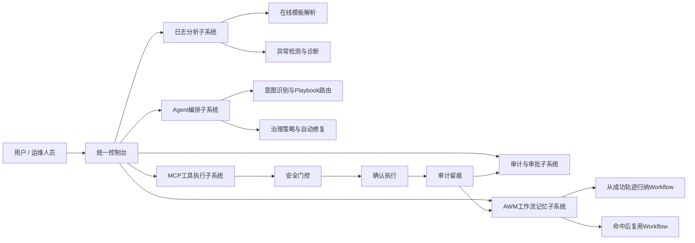
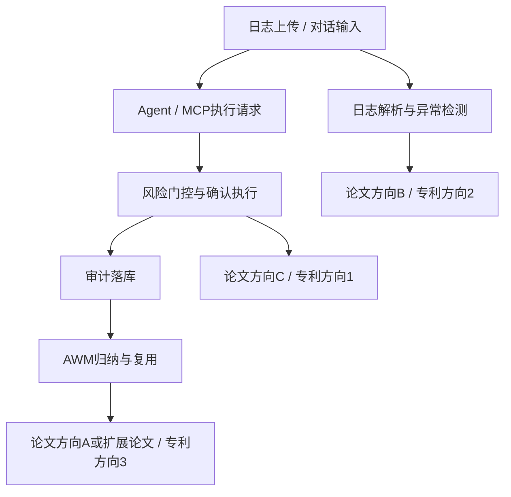

# 知识产权与论文申报评审材料

适用项目：`ThreshCore / award-log`  
评审目的：判断本项目可否用于 `软著 / 专利 / 论文 / 校内科研成果` 申报，并给出题目、依据、风险和评审要点。  
整理日期：2026-06-19

---

## 1. 先给结论

### 1.1 总体结论

这个项目 **可以作为成果申报基础**，但三类申报路径的把握程度不同：

- `软著`：**最稳**，建议优先做。
- `专利`：**可以做，但不能拿“整个项目”直接申请**，需要拆成具体技术方案。
- `论文`：**可以写，但必须补实验设计、对比基线和指标**，不能只写成功能介绍。

### 1.2 结论依据

#### 项目侧依据

- 项目定位明确为“日志分析、智能运维、巡检审计与可控 Agent 执行的 B/S 平台”。见 [README.md](../../README.md) 第 6、14、59、60 行。
- 项目能力不是单点 Demo，而是多个闭环能力组合：日志分析、MCP 工具执行、Agent 编排、AWM 记忆、安全审计、知识库 RAG、安全信号接入。见 [README.md](../../README.md) 第 14、65-70、118-125、145-150 行。
- 项目具备较强工程完整度：约 `385` 个 Java 文件、`170+` 测试类、`600+` 测试方法、`mvn verify` 与 JaCoCo 门禁。见 [README.md](../../README.md) 第 11-13 行。

#### 法规侧依据

- 软件著作权登记依据《计算机软件著作权登记办法》，核心是软件著作权登记、材料提交与权属证明，并不要求像发明专利那样证明“创造性高度”。  
  依据链接：
  - 国家版权局：《计算机软件著作权登记办法》  
    https://www.ncac.gov.cn/xxfb/flfg/bmgz/202410/t20241015_869486.html
- 发明专利的核心门槛是 `新颖性、创造性、实用性`。  
  依据链接：
  - 国家知识产权局：《中华人民共和国专利法》第二十二条、第二十四条  
    https://www.cnipa.gov.cn/art/2020/11/23/art_97_155167.html
- 涉及算法/人工智能的专利申请，不能只停留在“算法描述”或“业务规则”，需要落到解决技术问题的技术方案。  
  依据链接：
  - 国家知识产权局：《人工智能相关发明专利申请指引（试行）》  
    https://www.cnipa.gov.cn/art/2024/12/31/art_66_197429.html
  - 国家知识产权局：《专利审查指南修改解读》  
    https://www.cnipa.gov.cn/art/2024/1/30/art_75_190548.html

---

## 2. 软著：建议申请几个

### 2.1 最稳妥结论

如果以“成功率优先”为目标，建议先申 **1 件主软著**。

建议名称：

- `ThreshCore智能日志分析与可控运维平台软件`

### 2.2 可拆分结论

如果你们希望提高成果数量，并且愿意为每一件分别准备：

- 独立的软件名称
- 独立的功能说明
- 独立的使用手册
- 可支撑的软件源程序节选

那么当前项目 **较合理可拆成 3 件**；激进情况下可讨论第 4 件，但我 **不建议超过 3 件**。

### 2.3 为什么不是越多越好

#### 法规与实务依据

- 《计算机软件著作权登记办法》是按“软件”作为登记对象来处理的，并没有给出“一个仓库可以无限拆成多少件”的鼓励逻辑。法规关注的是：
  - 谁是著作权人
  - 登记的是哪一件软件
  - 该软件的程序与文档能否对应
- 所以从法理上看，**不是按仓库拆，而是按独立软件拆**。

#### 项目结构依据

- 该仓库是统一控制台与统一后端，不是天然独立的几个仓库。见 [README.md](../../README.md) 第 299-326、337-346、741-818 行。
- `Agent`、`MCP`、`安全`、`日志分析`、`AWM` 是可区分模块，但运行时又共用控制台、接口层、数据库和安全层。见 [README.md](../../README.md) 第 293-326、340-346、753-770、775-783 行。

结论就是：

- **能拆，但要按“独立软件能力包”拆**
- **不能为了数量硬拆**

### 2.4 推荐的软著拆分方案

#### 方案 A：稳妥型，1 件

| 推荐度 | 软件名称 | 为什么稳 |
|---|---|---|
| 高 | ThreshCore智能日志分析与可控运维平台软件 | 覆盖整个平台，不担心模块边界争议，最容易准备文档与代码材料 |

#### 方案 B：成果型，3 件

| 推荐度 | 软件名称 | 模块边界依据 | 为什么可以拆 |
|---|---|---|---|
| 高 | ThreshCore智能日志分析与诊断平台软件 | `日志分析`、`聊天式日志分析`、`AI诊断`、`告警/决策` 接口独立存在，见 [README.md](../../README.md) 第 775-783 行；实现见 [LogAnalysisController.java](../../src/main/java/com/award/log/controller/LogAnalysisController.java)、[AiDiagnosisController.java](../../src/main/java/com/award/log/controller/AiDiagnosisController.java) | 功能目标明确，适合做“日志分析类软著” |
| 高 | ThreshCore受控Agent运维编排与MCP执行平台软件 | `Agent`、`MCP`、`安全门控`、`确认执行`、`巡检自动化` 单独成体系，见 [README.md](../../README.md) 第 118-125、145-150、473-520、630-722 行 | 有独立的工具执行链路和安全控制链路 |
| 中高 | ThreshCore运维工作流记忆与审计平台软件 | `AWM`、`运维链路审计`、`Runbook审批` 独立接口和落库表存在，见 [README.md](../../README.md) 第 458-469、475-477、646、674 行；表见 [schema.sql](../../src/main/resources/schema.sql) | 适合作为“记忆+审计+审批”方向的成果 |

#### 方案 C：激进型，4 件

第 4 件可考虑：

- `ThreshCore安全信号接入与安全审计平台软件`

但我不建议优先申它，原因是：

- 当前 README 已明确：安全信号能力主要是“接入、归一化、关联与摘要层”，**不是完整独立 IDS 产品**。见 [README.md](../../README.md) 第 1272-1303 行。
- 也就是说它更像主平台的子系统，而不是非常强独立的软件。

### 2.5 我的最终建议

- 只求稳：`1 件`
- 既求稳又求成果数量：`3 件`
- 不建议：`4 件以上`

---

## 3. 专利：适合申请哪些技术和题目

### 3.1 先说申请原则

专利不能写成：

- “一个 AI 日志平台”
- “一个基于大模型的运维系统”
- “一个可视化平台”

因为这类表述太大、太泛，容易落到：

- 现有技术太多
- 技术特征不够具体
- 容易被认为只是业务流程拼接

更适合的做法是：

- 写成 `明确技术问题`
- 写成 `明确技术手段`
- 写成 `明确技术效果`

这与专利法第二十二条，以及人工智能相关专利申请指引的审查思路是一致的。  
依据链接：

- https://www.cnipa.gov.cn/art/2020/11/23/art_97_155167.html
- https://www.cnipa.gov.cn/art/2024/12/31/art_66_197429.html

### 3.2 最适合申请的 3 个专利方向

#### 专利方向 1

**题目建议：**  
`一种面向运维Agent工具调用的安全门控、确认执行与审计留痕方法、系统、设备及存储介质`

**为什么适合：**

这个方向最像“可专利技术方案”，因为它解决的是很明确的技术问题：

- 运维 Agent 调工具时容易越权、注入、误执行
- 尤其写操作不能直接放行

你们项目给出的技术手段不是一句“人工确认”，而是一整条技术链：

- 工具名合法性校验
- 工具是否在注册表中
- 只读工具面限制
- 参数个数/字符串长度限制
- prompt injection 检测
- 意图风险判断
- 路径敏感度评分
- 命令模式评分
- 运行时权限风险
- 中风险转确认执行
- 高风险直接阻断
- 确认执行时采用服务端快照，而不是相信前端回传
- 审计轨迹落库

**项目依据：**

- 安全门总入口见 [McpInvocationSecurityGate.java](../../src/main/java/com/award/log/security/McpInvocationSecurityGate.java) 第 13-80 行。
- 风险评分引擎见 [AgenticRiskScoreEngine.java](../../src/main/java/com/award/log/security/AgenticRiskScoreEngine.java) 第 10-83、92-132 行。
- 治理分级见 [OpsGovernanceService.java](../../src/main/java/com/award/log/governance/OpsGovernanceService.java) 第 11-103 行。
- 确认执行缓存与请求者绑定见 [McpPendingConfirmationService.java](../../src/main/java/com/award/log/service/mcp/McpPendingConfirmationService.java) 第 10-58 行。
- 审计落库见 [OpsAuditTraceService.java](../../src/main/java/com/award/log/service/OpsAuditTraceService.java) 第 17-52、94-129 行。
- Runbook 审批执行链路见 [RunbookApprovalService.java](../../src/main/java/com/award/log/service/impl/RunbookApprovalService.java) 第 27-92、135-180 行。

**测试依据：**

- 安全集成测试直接验证了：
  - 拦截 `rm -rf`
  - 拦截 prompt injection
  - 拦截高危路径参数
  - 只允许 dry-run 预览
  - 服务重启需要确认  
  见 [SecurityMcpIntegrationTest.java](../../src/test/java/com/award/log/integration/SecurityMcpIntegrationTest.java) 第 19-137 行。
- `confirmExecute` 使用服务端快照而不是客户端篡改数据，见 [McpExecuteControllerTest.java](../../src/test/java/com/award/log/controller/McpExecuteControllerTest.java) 第 68-117 行。

**为什么我认为它最强：**

- 技术问题明确
- 技术手段链条完整
- 代码和测试都很实
- 比“单纯日志分析”更容易讲出和现有系统的差异化

#### 专利方向 2

**题目建议：**  
`一种基于在线模板聚类与多维评分融合的日志异常检测方法、系统、设备及存储介质`

**为什么适合：**

这个方向解决的是海量异构日志里“如何高效归一、聚类、再做异常识别”的技术问题。

你们项目里不是简单关键词匹配，而是至少有两段技术过程：

- 第一段：在线模板解析
  - 变量脱敏
  - 按 token 长度分桶
  - 在 Trie 上按深度导航
  - 在叶子簇中按序列相似度匹配
  - 达阈值则合并，不一致位置泛化为参数占位符
- 第二段：异常判别
  - 关键词权重
  - 时间窗口内模板突发
  - 罕见但严重模板
  - 严重等级权重
  - 原因数与上下文权重
  - 综合评分

**项目依据：**

- 在线模板解析见 [DrainPlusParser.java](../../src/main/java/com/award/log/analyzer/DrainPlusParser.java) 第 18-29、37-58 行。
- 异常启发式评分见 [LogAnomalyHeuristics.java](../../src/main/java/com/award/log/analysis/LogAnomalyHeuristics.java) 第 11-20、38-80、86-140 行。
- 扩展特征向量见 [RfFeatureVectorExt.java](../../src/main/java/com/award/log/decision/RfFeatureVectorExt.java) 第 8-24、25-86 行。
- 决策融合见 [EnsembleService.java](../../src/main/java/com/award/log/decision/EnsembleService.java) 第 7-25 行。

**为什么适合专利：**

- 技术步骤清晰
- 可围绕“解析-聚类-异常评分-多源融合”来写权利要求
- 比纯 UI 或纯业务流程更符合“技术方案”要求

**风险提醒：**

- `Drain` 本身已有经典论文与现有技术，所以不能直接写“一个 Drain 日志模板方法”
- 必须强调你们的改进点，例如：
  - 在线长度分桶 + Trie 路由 + 相似度阈值控制
  - 与异常评分/风险权重联动
  - 与后续决策融合联动

#### 专利方向 3

**题目建议：**  
`一种基于审计轨迹归纳的运维工作流记忆构建、复用与在线更新方法、系统、设备及存储介质`

**为什么适合：**

它解决的是 Agent 每次重新规划、处置经验难沉淀的问题。

项目里的技术手段已经形成了可申请的链路：

- 从成功轨迹中抽取结构化步骤
- 将步骤抽象成 workflow
- 参数模板化，避免保留真实绝对路径
- 按 domain/findingKinds 做检索与复用
- 命中后回放 workflow
- 成功后增加 utility
- 不存在时从最近成功轨迹诱导新 workflow
- 记忆和审计分别落库

**项目依据：**

- AWM 说明见 [README.md](../../README.md) 第 458-469、490-509 行。
- AWM 持久化与缓存见 [WorkflowMemoryService.java](../../src/main/java/com/award/log/agent/awm/WorkflowMemoryService.java) 第 19-36、43-90、150-199 行。
- LLM 归纳器见 [LlmWorkflowInductor.java](../../src/main/java/com/award/log/agent/awm/LlmWorkflowInductor.java) 第 26-40、57-120 行。
- Assistant 命中 workflow 并回放见 [AssistantOrchestrator.java](../../src/main/java/com/award/log/agent/AssistantOrchestrator.java) 第 31-39、115-194 行。

**测试依据：**

- 已有测试验证：
  - 已有工具序列只记录 utility
  - 近期成功轨迹可诱导出新的 workflow
  - 参数会被模板化为占位符  
  见 [WorkflowInductionServiceTest.java](../../src/test/java/com/award/log/agent/awm/WorkflowInductionServiceTest.java) 第 33-76、79-120 行。

**为什么它比“RAG”更适合：**

- RAG 很常见，且项目中更多是已有能力集成
- AWM 这里有“轨迹抽取-工作流归纳-参数抽象-命中回放-utility 更新”的方法链，更像专利

### 3.3 专利优先级建议

| 优先级 | 题目方向 | 原因 |
|---|---|---|
| 1 | 运维Agent工具调用的安全门控、确认执行与审计方法 | 最完整、最差异化、最像真正技术方案 |
| 2 | 在线模板聚类与多维评分融合的日志异常检测方法 | 技术路径清晰，但要避开已有 Drain 现有技术 |
| 3 | 基于审计轨迹归纳的运维工作流记忆构建与复用方法 | 新颖、有特色，但撰写时要把“技术实现”写具体 |

### 3.4 专利风险提示

- 如果已经公开答辩、公开展示、公开上传仓库，必须立刻核查是否影响新颖性。
- 根据专利法第二十四条，只有法定例外情形才可能适用“六个月不丧失新颖性”，**不是所有公开都自动免责**。  
  依据链接：
  - https://www.cnipa.gov.cn/art/2020/11/23/art_97_155167.html

---

## 4. 论文：适合写什么题目

### 4.1 先说选题策略

如果你们现在就准备写论文，我建议不要把题目写成：

- “基于大模型的智能日志分析系统设计”
- “一个 AI 运维平台的设计与实现”

原因：

- 太泛
- 创新点容易飘
- 容易写成产品说明书

更好的做法是从项目中选一个“研究主线”。

### 4.2 最推荐的论文题目

#### 论文题目 A：工程系统型

**题目建议：**  
`面向可控执行的智能日志分析与运维协同平台设计与实现`

**适用场景：**

- 校内学报
- 高职高专、应用型本科、工程实践类期刊
- 竞赛成果转论文

**为什么适合：**

这个题目最贴合当前仓库现状，因为你们项目不是单算法，而是一个完整平台：

- 日志分析
- Agent 对话
- MCP 工具
- 安全门控
- 审计留痕
- AWM 记忆

**项目依据：**

- 平台定位与能力见 [README.md](../../README.md) 第 6、14、59-70、118-125 行。
- 系统架构与模块划分见 [README.md](../../README.md) 第 293-346、741-818 行。
- 主流程集成测试见 [MainFlowIntegrationTest.java](../../src/test/java/com/award/log/integration/MainFlowIntegrationTest.java) 第 37-117 行。

**论文创新点建议：**

- 可控 Agent 执行而不是自由 shell
- 工具调用安全门 + 确认执行 + 审计闭环
- AWM 对成功处置链路的沉淀与复用
- 日志分析与运维处置的统一闭环

#### 论文题目 B：技术方法型

**题目建议：**  
`基于在线日志模板解析与多源评分融合的异常检测方法研究`

**为什么适合：**

- 比平台型论文更“像研究”
- 更容易写实验、指标和对比

**项目依据：**

- 在线模板解析见 [DrainPlusParser.java](../../src/main/java/com/award/log/analyzer/DrainPlusParser.java)
- 启发式异常评分见 [LogAnomalyHeuristics.java](../../src/main/java/com/award/log/analysis/LogAnomalyHeuristics.java)
- 特征向量与融合决策见 [RfFeatureVectorExt.java](../../src/main/java/com/award/log/decision/RfFeatureVectorExt.java)、[EnsembleService.java](../../src/main/java/com/award/log/decision/EnsembleService.java)

**论文实验建议：**

- 数据集：项目日志样本 + Loghub/HDFS/BGL 等公开数据集
- 指标：Precision、Recall、F1、模板压缩率、吞吐量、平均分析延迟
- 对比：纯关键词法、原始 Drain、仅规则法、仅随机森林、你们的融合方法

#### 论文题目 C：安全机制型

**题目建议：**  
`面向自治运维Agent的工具调用风险门控与审计闭环机制研究`

**为什么适合：**

- 这个题目很新
- 与一般“AI 日志分析论文”差异大
- 很适合从安全治理角度写出特色

**项目依据：**

- 风险门控见 [McpInvocationSecurityGate.java](../../src/main/java/com/award/log/security/McpInvocationSecurityGate.java)
- 风险评分见 [AgenticRiskScoreEngine.java](../../src/main/java/com/award/log/security/AgenticRiskScoreEngine.java)
- 治理分级见 [OpsGovernanceService.java](../../src/main/java/com/award/log/governance/OpsGovernanceService.java)
- 审计落库见 [OpsAuditTraceService.java](../../src/main/java/com/award/log/service/OpsAuditTraceService.java)
- 安全集成测试见 [SecurityMcpIntegrationTest.java](../../src/test/java/com/award/log/integration/SecurityMcpIntegrationTest.java)

### 4.3 我最建议你先写哪一篇

如果你们现在还没有大量实验数据，我建议优先写：

- `题目 A：面向可控执行的智能日志分析与运维协同平台设计与实现`

原因是：

- 对实验要求相对温和
- 与当前代码最一致
- 更容易基于现有测试、模块、架构图和流程图成文

如果后续你们能补公开数据集实验，再写：

- `题目 B：基于在线日志模板解析与多源评分融合的异常检测方法研究`

---

## 5. 框架图

### 5.1 项目整体成果框架图

### 5.2 专利与论文映射图

---

## 6. 给评审看时最有用的“依据链”

建议你在评审时按下面这个顺序讲：

1. `项目是不是完整系统`
   - 依据：README 的定位、模块、接口、测试规模
2. `有没有独立成果点`
   - 依据：日志分析、安全门控、AWM 都能单独说明问题
3. `有没有真实工程闭环`
   - 依据：接口、数据库表、审批、审计、确认执行
4. `是不是只有概念，没有验证`
   - 依据：`MainFlowIntegrationTest`、`SecurityMcpIntegrationTest`、`WorkflowInductionServiceTest`
5. `能不能申专利`
   - 依据：能否说清技术问题、技术手段、技术效果
6. `能不能写论文`
   - 依据：能否补齐实验设计、对比基线、指标

---

## 7. 你现在就可以准备的申报材料清单

### 7.1 软著材料

- 软件名称最终版
- 开发完成日期、首次发表日期
- 功能简介
- 运行环境说明
- 软件使用说明书
- 关键流程截图
- 源程序节选
- 权属说明

### 7.2 专利材料

- 发明名称
- 要解决的技术问题
- 背景技术
- 技术方案
- 有益效果
- 系统框图 / 流程图
- 关键实施例
- 与现有技术的区别点

### 7.3 论文材料

- 题目
- 摘要
- 关键词
- 引言
- 系统或方法设计
- 实验设计
- 结果与分析
- 结论

---

## 8. 当前最大的三个风险

### 风险 1：权属必须先统一

仓库中已经明确写有版权和权利人信息，如果不是全部权利人一致同意，后续的软著、专利、论文署名和成果申报都可能出问题。  
依据见 [版权声明与使用限制声明.md](../../版权声明与使用限制声明.md) 第 11-13、19-31、60-62、79-91 行。

### 风险 2：专利要尽快判断是否已公开

如果已经公开答辩、上传公开仓库或对外展示，必须尽快让老师或代理人做新颖性判断。

### 风险 3：论文还缺“实验数据”

现有仓库的工程证据很强，但严格意义上的学术论文还需要：

- 对比基线
- 评价指标
- 数据集来源
- 消融实验或模块对比

---

## 9. 最终建议

### 9.1 如果你们只做一件事

先做：

- `1 件主软著`

### 9.2 如果你们要冲成果数量

建议顺序：

1. `3 件软著`
2. `1 件核心发明专利`：优先做“安全门控与确认执行”
3. `1 篇工程系统论文`

### 9.3 如果你们要冲质量而不是数量

建议顺序：

1. `1 件高质量软著`
2. `1 件高质量发明专利`
3. `1 篇平台型论文`
4. 后续再扩写成 `1 篇方法型论文`

---

## 10. 本材料引用的主要官方依据

1. 国家版权局：《计算机软件著作权登记办法》  
   https://www.ncac.gov.cn/xxfb/flfg/bmgz/202410/t20241015_869486.html
2. 国家知识产权局：《中华人民共和国专利法》  
   https://www.cnipa.gov.cn/art/2020/11/23/art_97_155167.html
3. 国家知识产权局：《人工智能相关发明专利申请指引（试行）》  
   https://www.cnipa.gov.cn/art/2024/12/31/art_66_197429.html
4. 国家知识产权局：《专利审查指南修改解读》  
   https://www.cnipa.gov.cn/art/2024/1/30/art_75_190548.html

