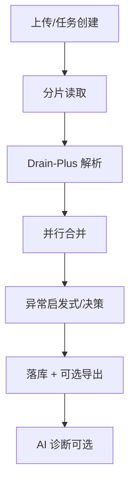
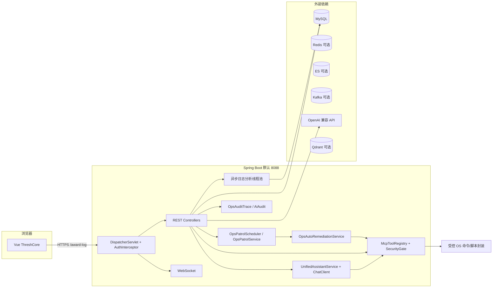

# ThreshCore（award-log）项目需求与设计规格说明书

| 项 | 说明 |
|----|------|
| **文档类型** | 技术类需求与设计规格（SRS/SDS 合订，面向研发、测试、部署与安全评审） |
| **系统名称** | ThreshCore 控制台 + award-log 后端服务 |
| **版本** | 与当前工程实现同步（2026）；接口以运行实例导出的 OpenAPI 为准 |
| **编制依据** | `docs/功能设计文档.md`、源代码树、`src/main/resources/schema.sql`、Knife4j/OpenAPI、部署配置模板 |

---

## ② 文档概述

### 文档目的

本文档在**需求与验收**视角下，对 **ThreshCore（award-log）** 智能日志分析与受控智能运维平台进行结构化说明，服务于：

- 需求评审与迭代时的**功能边界、优先级与验收口径**；
- 研发 / 测试 / 联调用的**一致需求基线与追溯**；
- 部署与运维的**能力清单、配置项与环境约束**；
- 安全评审的**权限模型、审计范围与信任边界**对照。

### 文档范围

| 范围内 | 范围外（需另行说明或环境证明） |
|--------|----------------------------------|
| 浏览器控制台（Vue 3）与 Spring Boot 后端的业务能力、接口分组、数据实体 | 第三方大模型服务商 SLA、具体模型幻觉率 |
| 日志批量分析（Drain-Plus）、告警、AI 诊断、统一助手、MCP 工具、主动巡检与有界自动修复 | 在 **LoongArch + 麒麟 V11** 等目标平台上的**实测兼容性报告**（代码为通用 Java/Vue，需部署侧验证） |
| 安全门控、风险分、双轨审计、RBAC 与配置项 | 客户内网零信任架构的全量对接方案 |

### 术语与缩写

| 术语/缩写 | 含义 |
|-----------|------|
| **ThreshCore** | 本项目前端控制台的产品化名称 |
| **award-log** | Maven 工程与 Context Path 所在的后端应用标识 |
| **Context Path** | 统一 URL 前缀 **`/award-log`** |
| **Drain / Drain-Plus** | 日志模板挖掘算法及本工程 Drain-Plus 实现，用于归纳日志模式 |
| **MCP** | 主机侧工具化封装在本工程中的实现形态：**可注册的 Spring Bean 工具**，经统一 HTTP 出口与安全门暴露（与业界 MCP 工具链概念对齐，以本实现为准） |
| **SSE** | Server-Sent Events，用于工作台统一助手等流式响应 |
| **CoT** | Chain of Thought，本项目中以 `ops_audit_trace.steps_json` 存储的**分阶段推理/安检摘要** |
| **RBAC** | 基于角色（`sys_role`）与权限点（`sys_permission`）的访问控制 |
| **ONNX / RF** | 导出的随机森林等模型文件，用于异常/告警相关打分（`resources/models`） |
| **Agentic 风险分** | `AgenticRiskScoreEngine` 对单次工具调用给出的 0–10 分，与自动执行/二次确认/拒绝阈值联动 |

### 参考资料

- 《功能设计文档》：`docs/功能设计文档.md`
- 数据模型与建表：`src/main/resources/schema.sql` 及环境所需增量 SQL
- 接口契约：**Knife4j / OpenAPI**（`knife4j.enable=true` 时，常见入口为 **`/award-log/doc.html`**，以 Springdoc 实际配置为准）
- 生产配置结构示例：`docs/deployment/prod-config-example.yml`（不含真实密钥）
- 工程内开发者说明（环境搭建、目录说明）：根目录 `README.md`（**仅作技术索引**，本规格书不替代接口与表结构正文）

---

## ③ 背景与目标

### 行业背景

企业 IT 运维长期面临：**日志体量大、格式异构、根因定位耗时**；同时 **AIOps / 智能助手** 引入后带来新的风险——模型可触发主机侧操作，若缺少白名单、最小权限与审计，将导致**误操作与不可追责**。行业趋势是「分析智能化」与「执行可治理」并重。

### 赛题背景

常见「智能运维 Agent / MCP / 安全护栏」类赛题通常考察：

- OS 深度感知（进程、磁盘、网络、日志、journal 等）；
- 工具化、可列举的 MCP 能力；
- 意图识别、提示注入防护、高危命令拦截、**人机协同二次确认**；
- **推理或执行链路可追溯**（审计表 + UI）；
- **有界自动化**（非任意 Shell 全自动），在策略内修复或生成待确认方案。

当前工程实现与上述维度逐项对齐；能力边界以本文 **⑦、⑨、⑪** 及 OpenAPI 为准。

### 项目背景

**ThreshCore（award-log）** 将 **(1) 可观测与根因**（日志 Drain-Plus 分析、告警、仪表盘、AI 诊断）、**(2) 受控智能运维**（工作台对话 + Spring AI 多步工具调用 + 统一安全门）、**(3) 主动闭环**（定时巡检、WebSocket 顶栏推送、巡检后 `OpsAutoRemediationService` 有界修复）整合为**单体可部署、前后端分离**的一体化技术方案。

### 目标（摘要）

| 类型 | 目标 |
|------|------|
| 业务 | 支持上传/异步分析/报告导出/告警/诊断/对话/MCP/巡检/修复提案与确认 |
| 安全 | 路径与服务白名单、风险分、只读工具面、生产空库密码禁止启动等 |
| 工程 | JDK 17 + Spring Boot 3.5 + Vue 3 + MySQL 必选；Kafka/Redis/ES/Qdrant 可选降级 |

---

## ④ 用户角色分析

### 运维管理员

- **典型诉求**：上传日志、看进度与报告、全盘/单行 AI 诊断、在工作台用自然语言排障、必要时打开工具台执行磁盘/进程/网络等检查；关注顶栏性能与巡检告警。
- **系统能力映射**：`/log/**`、`/log/diagnose`、`/api/assistant`、`/api/mcp`、`/api/ops/patrol/*`、WebSocket 顶栏。

### 系统管理员

- **典型诉求**：用户/角色/权限维护、告警与平台配置、生产密钥与中间件开关、限制 Knife4j/Actuator 暴露面。
- **系统能力映射**：`/admin/user`、`/admin/role`、`/admin/permission`、`/admin/statistics`、`/api/alarm*`、`ProductionProfileValidator`、`application.yml` / 环境变量。

### 审计员

- **典型诉求**：按时间、用户、工具名、traceId 追溯「谁发起了什么、安检结果如何、是否二次确认、执行摘要」；关注合规与不可抵赖。
- **系统能力映射**：`/admin/audit/ai`（执行审计）、`/api/ops-trace`（运维链路审计 + `steps_json` CoT）；生产环境要求 `app.security.ai-audit-relaxed-read=false`，避免普通用户随意浏览执行审计列表。

---

## ⑤ 业务场景

### ① 自然语言智能运维场景

**描述**：运维在「工作台对话」Tab 用中文描述问题（如磁盘是否告急、某服务是否异常），系统通过 **`POST /api/assistant/chat/stream`** 以 SSE 流式返回；在 **`useToolAgent=true`（默认）** 下，由 Spring AI `ChatClient` 多步调用与本机 **`McpToolRegistry`** 同源注册的工具，受 **`McpInvocationSecurityGate`**、`ToolSurfaceResolver`（`READ_ONLY` / `FULL`）约束；只读工具面下写类工具不会注入模型。

**价值**：降低 CLI/脚本门槛，且**真实执行**仍落在受控 MCP，而非模型直连 Shell。

**补充入口**：兼容路径 **`POST /api/chat`**（`ChatController`），与统一助手共用安全门与工具链思路。

---

### ② 日志智能分析诊断

**描述**：

1. **批量上传分析**：单/多文件上传 → 异步任务 → Drain-Plus 解析 → 启发式/决策融合异常检测 → 报告与图表 → CSV/HTML 导出（`LogAnalysisServiceImpl.startAnalysisAsync`）。
2. **AI 诊断**：全盘或单行上下文由 `AiDiagnosisContextBuilder` 等拼装后调用大模型（`/log/diagnose`）。
3. **聊天式日志分析**：`ChatAnalysisController` 下 `/api/chat/analyze`、`/api/chat/analyze/stream` 等，与上传页流程互补。

**价值**：从「打不开的大文件」到「可统计的模板与可点击的诊断」；多格式解析链（`LogLineParseSupport`、`ServerLogParseSupport`、`LinuxLogParseSupport`）减轻时间字段缺失问题。

**流水线示意（逻辑）**：



---

### ③ 系统主动巡检监控

**描述**：`OpsPatrolScheduler` 按 Cron 触发 **`OpsPatrolService`**，采集磁盘、告警、异常日志线索、僵尸进程、Drain 新模板等，生成**关联快照**；可通过 **`PerformanceWebSocketHandler`** 向 `channel=patrol_alert` 推送，与顶栏 `TopPerformanceBar.vue` 联动；HTTP 兜底：`GET /api/ops/patrol/alerts/recent`、`GET /api/ops/patrol/correlation/latest` 等。

**价值**：从「人主动上传」扩展到「系统主动发现异常线索」，缩短 MTTD。

---

### ④ 安全可控运维操作

**描述**：

- 工具在 `McpToolRegistry` 注册，HTTP 层由 **`McpExecuteController`**（`/api/mcp`）列出与执行；
- **`McpInvocationSecurityAspect`**、**`OpsPathPolicy`**、**`MinPrivilegeExecutor`** 实现路径白名单、禁止敏感路径、最小权限用户（`agent.*`）；
- **`McpInvocationSecurityGate`** 汇总：工具名允许列表、参数个数与长度、指令串长度、`PromptInjectionGuard`、`IntentRiskFilter`、`HighRiskCommandDetector`；
- **`AgenticRiskScoreEngine`**：低分倾向自动执行，中区间首次请求需前端二次确认，超上限拒绝。

**价值**：在「能干活」与「不能乱干活」之间可配置、可审计地平衡。

---

### ⑤ 运维操作合规审计

**描述**：

- **执行审计**：`AiAuditController` → `/admin/audit/ai`，记录 AI/MCP 相关敏感执行供列表查询（权限受 `app.security.ai-audit-relaxed-read` 影响）。
- **运维链路审计**：`OpsTraceController` → `/api/ops-trace`，落库表 **`ops_audit_trace`**，含 `trace_id`、`channel`（CHAT/MCP）、`security_outcome`、`tool_name`、`steps_json`（CoT 四步摘要：接收→感知→推理→校验与执行摘要）、`operator_user_id` 等。

**价值**：满足科长式追问「谁干的、系统当时如何判断、是否已确认」。

---

### ⑥ 权限与规则管理

**描述**：

- **登录拦截**：`AuthInterceptor` 拦截 `/admin/**`、`/log/**`、`/api/**`，排除登录注册等（见下文代码引用）。
- **RBAC**：`SysUserController`、`SysRoleController`、`SysPermissionController` 等；数据表 `sys_user`、`sys_role`、`sys_permission`、`sys_role_permission`。
- **规则与模板（REST v1）**：`/api/v1/rules`、`/api/v1/templates`、知识库 `/api/v1/knowledge`；告警规则另有 `alarm_rule` 表及兼容接口 `/api/alarm-rule`。
- **Runbook 审批**：`/api/runbook`（`RunbookApprovalController`），支撑变更类流程与人工把关。

**登录拦截配置（代码片段）**：

```52:66:src/main/java/com/award/log/config/WebMvcConfig.java
    @Override
    public void addInterceptors(InterceptorRegistry registry) {
        registry.addInterceptor(authInterceptor)
                .addPathPatterns("/admin/**", "/log/**", "/api/**")
                .excludePathPatterns(
                        "/admin/user/login",
                        "/admin/user/register",
                        "/admin/user/check-user",
                        "/admin/user/reset-password",
                        "/doc.html",
                        "/webjars/**",
                        "/v3/api-docs/**",
                        "/swagger-ui/**",
                        "/error"
                );
    }
```

---

## ⑥ 架构

### 逻辑架构图



### 技术架构分层

| 层 | 技术 |
|----|------|
| 展现层 | Vue 3、Vite、Element Plus、ECharts、Axios |
| 网关/接入 | Tomcat、同源或反代、`/award-log` Context Path |
| 应用层 | Spring MVC、Spring AI（ChatClient + Tool）、异步任务 |
| 领域层 | `service.impl.*`、`analyzer`、`analysis`、`decision`、`mcp`、`security` |
| 持久层 | MyBatis + MySQL |
| 可观测 | Actuator、Micrometer Prometheus（按配置暴露） |

### 前端信息架构（Tab 与快捷键）

登录后 **`App.vue`** 中 **1–8** 数字键（焦点非输入框时）对应：工作台对话、工具控制台、执行审计、运维链路审计、日志分析、任务记录、仪表盘、告警历史；顶栏 **`TopPerformanceBar.vue`** 展示本机性能并接收 `performance` / `patrol_alert` WebSocket 消息。

---

## ⑦ 核心功能需求

### F1 用户认证与 RBAC

- 用户注册、登录、校验、密码重置（拦截器排除路径见上）。
- 用户分页与维护、角色、权限点及角色-权限绑定。

### F2 日志上传与异步分析

- 单/多文件上传；任务状态查询、进度、取消、历史分页。
- Drain-Plus 解析、并行分片处理、异常检测、结果落库。
- 报告可视化、CSV/HTML 下载（输出目录 `{user.dir}/target/output/{taskId}/`）。

### F3 告警全链路

- 告警规则配置、历史查询、统计与生命周期（多控制器协同，部分规则兼容接口为内存存储，重启清空——以接口说明为准）。

### F4 AI 诊断与聊天分析

- 全盘/单行诊断；聊天式同步/流式分析（`ChatAnalysisController`）。

### F5 统一助手与 MCP

- `GET /api/assistant/context` 拉取上下文；`POST /api/assistant/chat/stream` 流式对话，支持 `useToolAgent`。
- `GET/POST /api/mcp/*` 工具列表、执行、确认流；与前端 `mcpToolsMeta.js`、`mcpRiskConfirm.js` 对齐展示。

### F6 主动巡检与有界自动修复

- 定时巡检、关联快照与最近告警 API。
- **`OpsAutoRemediationService`**：按 `ops.auto-remediation.*` 在 **HYBRID / CONFIRM_FIRST / IMMEDIATE** 等模式下，对低风险步骤自动执行或生成**待确认**方案；`GET/POST /api/ops/patrol/remediation/*` 查询摘要、待确认、确认执行（`confirmCode` 等护栏）。

### F7 延时运维任务

- `OpsScheduleController`：`/api/ops-schedule`，白名单工具调度（只读类为主，高风险写操作默认不进入延时列表）。

### F8 性能与其它

- `PerformanceAnalysisController` + `/ws/performance`；可选 `/ws/logs` 日志流；决策反馈与 ML 脚本入口、Runbook、知识库/模板/规则 v1、平台就绪检查等（**完整路径与请求体以 Knife4j/OpenAPI 为准**；上文 **⑨** 为业务分组索引）。

---

## ⑧ 非功能需求

| 类别 | 要求 |
|------|------|
| **性能** | 大文件分片与并行；Tomcat 连接超时可通过 `SERVER_TOMCAT_CONNECTION_TIMEOUT_MS` 调整；前端大上传可调 `VITE_API_TIMEOUT_MS`。 |
| **可用性** | MySQL 必选；Redis/Kafka/ES 未部署时对应能力降级或关闭自动配置（`award.middleware.*` 默认 `false`）。 |
| **安全** | 生产 `prod` 禁止空数据库密码启动；生产关闭 `app.security.ai-audit-relaxed-read`；收紧 WebSocket `AllowedOrigins`；密钥不入库。 |
| **可维护性** | Knife4j 文档、模块化包结构、`McpToolRegistry` 统一注册工具。 |
| **可观测性** | Actuator health/metrics/prometheus（生产需网络层收敛）。 |

---

## ⑨ 接口

### 约定

- **基路径**：所有下列路径前缀为 **`http(s)://host:port/award-log`**。
- **认证**：除登录注册等排除路径外，需登录会话；前端应 `credentials: 'include'`。
- **完整清单**：以 **Knife4j / OpenAPI** 为准（`/award-log/doc.html` 等）。

### 核心业务接口分组（节选）

| 前缀 | 说明 |
|------|------|
| `/log` | 上传、任务、报告、下载、取消删除 |
| `/log/diagnose` | AI 诊断 |
| `/admin/user`、`/admin/role`、`/admin/permission` | 用户与 RBAC |
| `/admin/audit/ai` | 执行审计 |
| `/api/assistant` | 统一助手 context + `chat/stream` |
| `/api/chat` | 兼容对话 + Agent |
| `/api/chat/analyze*` | 聊天式日志分析 |
| `/api/mcp` | MCP 工具列表与执行 |
| `/api/ops/patrol` | 巡检快照、告警、修复摘要与确认 |
| `/api/ops-trace` | 运维链路列表与详情（含 CoT） |
| `/api/ops-schedule` | 延时任务 |
| `/api/alarm*`、`/api/v1/alarm/lifecycle` | 告警 |
| `/api/performance` | 性能 REST |
| `/ws/performance`、`/ws/logs` | WebSocket |

### 主动巡检与修复（`OpsPatrolController` 摘录）

```1:83:src/main/java/com/award/log/controller/OpsPatrolController.java
package com.award.log.controller;

import com.award.log.common.Result;
import com.award.log.service.OpsAutoRemediationService;
import com.award.log.service.OpsPatrolService;
import io.swagger.v3.oas.annotations.Operation;
import io.swagger.v3.oas.annotations.tags.Tag;
import org.springframework.beans.factory.annotation.Autowired;
import org.springframework.web.bind.annotation.GetMapping;
import org.springframework.web.bind.annotation.PostMapping;
import org.springframework.web.bind.annotation.RequestBody;
import org.springframework.web.bind.annotation.RequestMapping;
import org.springframework.web.bind.annotation.RequestParam;
import org.springframework.web.bind.annotation.RestController;

import java.util.List;
import java.util.Map;

@Tag(name = "Ops Patrol")
@RestController
@RequestMapping("/api/ops/patrol")
public class OpsPatrolController {

    @Autowired
    private OpsPatrolService opsPatrolService;

    @Autowired(required = false)
    private OpsAutoRemediationService opsAutoRemediationService;

    @Operation(summary = "最近一次巡检生成的多维关联快照（每轮更新，无告警时亦有数据）")
    @GetMapping("/correlation/latest")
    public Result<Map<String, Object>> latestCorrelation() {
        return Result.success(opsPatrolService.getLastCorrelationSnapshot());
    }

    @Operation(summary = "最近主动巡检产生的告警条目（内存环形，登录后可读）")
    @GetMapping("/alerts/recent")
    public Result<List<Map<String, Object>>> recentAlerts(
            @RequestParam(name = "limit", defaultValue = "20") int limit) {
        int n = Math.min(50, Math.max(1, limit));
        return Result.success(opsPatrolService.getRecentAlerts(n));
    }

    @Operation(summary = "最近一次巡检触发的自动修复摘要（未启用或无动作时可能为空 Map）")
    @GetMapping("/remediation/last")
    public Result<Map<String, Object>> lastRemediation() {
        if (opsAutoRemediationService == null) {
            return Result.success(Map.of());
        }
        return Result.success(opsAutoRemediationService.getLastSummary());
    }

    @Operation(summary = "最近一轮巡检：各条线索的修复车道（AUTO/CONFIRM/MIXED/MANUAL/NONE）")
    @GetMapping("/remediation/coverage")
    public Result<List<Map<String, Object>>> remediationCoverage() {
        if (opsAutoRemediationService == null) {
            return Result.success(List.of());
        }
        return Result.success(opsAutoRemediationService.getRemediationCoverage());
    }

    @Operation(summary = "待确认的自动修复方案（安全护栏；无待确认时 hasPending=false）")
    @GetMapping("/remediation/pending")
    public Result<Map<String, Object>> remediationPending() {
        if (opsAutoRemediationService == null) {
            return Result.success(Map.of("hasPending", false));
        }
        return Result.success(opsAutoRemediationService.getPendingProposalView());
    }

    @Operation(summary = "确认并执行待处理修复方案，confirmCode 须为「确认执行」")
    @PostMapping("/remediation/confirm")
    public Result<Map<String, Object>> remediationConfirm(
            @RequestBody(required = false) Map<String, String> body) {
        if (opsAutoRemediationService == null) {
            return Result.success(Map.of("success", false, "error", "自动修复服务未启用"));
        }
        Map<String, String> b = body != null ? body : Map.of();
        String proposalId = b.get("proposalId");
        String confirmCode = b.get("confirmCode");
        return Result.success(opsAutoRemediationService.confirmPending(proposalId, confirmCode));
    }
}
```

---

## ⑩ 数据

### 持久化存储

- **主库**：MySQL 8，脚本以 **`src/main/resources/schema.sql`** 为准，根目录增量 SQL 按环境选用。

### 核心表（摘要）

| 表 | 用途 |
|----|------|
| `sys_user` | 用户、角色字段、联系方式 |
| `sys_role` / `sys_permission` / `sys_role_permission` | RBAC |
| `log_analysis_task` / `log_analysis_detail` | 分析任务与明细行 |
| `log_alarm` | 告警实例与生命周期字段 |
| `alarm_rule` | 告警规则 |
| `log_template` | 模板管理 |
| `ops_audit_trace` | 运维 Agent 全链路审计（含 `steps_json`） |
| `decision_log` / `decision_feedback` | 决策留痕与人工反馈 |
| `model_evaluation` / `engine_offline_metric` / `rule_hit_stat` | 模型与规则统计 |

### 审计表结构（代码片段）

```239:258:src/main/resources/schema.sql
CREATE TABLE IF NOT EXISTS `ops_audit_trace` (
  `id` bigint(20) NOT NULL AUTO_INCREMENT,
  `trace_id` varchar(64) NOT NULL COMMENT 'traceId',
  `channel` varchar(32) NOT NULL COMMENT 'CHAT | MCP',
  `user_input` text COMMENT '原始指令或构造指令',
  `risk_level` varchar(32) DEFAULT NULL,
  `security_outcome` varchar(64) DEFAULT NULL COMMENT 'PASS | REJECT_*',
  `tool_name` varchar(128) DEFAULT NULL,
  `execution_ok` tinyint(1) DEFAULT '0',
  `result_summary` text COMMENT '结果摘要',
  `steps_json` longtext COMMENT '阶段快照 JSON',
  `duration_ms` bigint(20) DEFAULT NULL,
  `operator_user_id` varchar(64) DEFAULT NULL COMMENT '登录用户ID',
  `policy_version` varchar(64) DEFAULT NULL COMMENT '路径策略版本',
  `created_at` datetime DEFAULT CURRENT_TIMESTAMP,
  PRIMARY KEY (`id`),
  KEY `idx_trace_id` (`trace_id`),
  KEY `idx_created_at` (`created_at`)
) ENGINE=InnoDB DEFAULT CHARSET=utf8mb4 COMMENT='运维 Agent 推理链路审计';
```

### 文件系统数据

- 分析导出：`target/output/<taskId>/`（工作目录相关，运维需监控磁盘）。

---

## ⑪ 约束条件

### 运行环境

- **JDK 17**；**Node 18+**（前端开发/构建）；**MySQL** 必选。
- 默认后端端口 **8088**；Context Path **`/award-log`**（若修改须同步前端 `VITE_AWARD_LOG_BASE_URL`）。

### 网络与安全

- 跨域当前对 `localhost:3000–3003` 等放开且 `allowCredentials(true)`，**生产必须改为真实前端域**并配合 HTTPS/WSS。
- MCP 依赖**应用进程对宿主 OS 的可访问性**；Docker 仅跑 JAR 时，路径与权限与宿主机挂载策略强相关。

### 密钥与配置

- `DB_PASSWORD`、`AI_API_KEY` 等**不得进入版本库明文**；使用环境变量或本地/生产专用配置文件（工程内已提供 `application-local.example.yml`、`.env.example` 等模板，按组织安全规范落盘）。

### 合规与产品约束（技术侧）

- 登录流程可集成 **`UserServiceAgreement.vue`** 类用户协议确认（展示文案与法律效力由业务/法务定义，本文仅标注入口组件）。
- 审计类数据（如 `ops_audit_trace`、执行审计表）的**留存周期、脱敏级别、导出权限**须按组织制度在运维层单独规定，不在本文展开。

---

## ⑫ 验收标准

### 功能验收（可勾选）

- [ ] 用户可注册登录，未登录访问 `/log`、`/api` 被拦截。
- [ ] 日志可上传，任务状态由进行中到完成/失败可查，可取消；报告页图表与导出可下载。
- [ ] AI 全盘/单行诊断在配置 `AI_API_KEY` 后可返回结构化建议（允许依赖外网 LLM）。
- [ ] 工作台 SSE 对话可用；`useToolAgent=true` 时可观察到工具调用结果或拦截原因。
- [ ] 工具控制台可拉取工具列表；中高风险出现**二次确认**交互；拒绝路径有明确错误码/文案。
- [ ] 运维链路审计可按 `traceId` 查看 `steps_json` 阶段信息。
- [ ] 主动巡检接口可返回快照/告警；WebSocket 顶栏在登录与反代正确时可收到 `performance` 或 `patrol_alert`。
- [ ] 若启用自动修复：`remediation/pending` 与 `remediation/confirm` 流程与配置一致。

### 安全与合规验收

- [ ] `prod` 下空数据库密码**启动失败**（`ProductionProfileValidator`）。
- [ ] 生产 `app.security.ai-audit-relaxed-read=false`，执行审计仅管理员可查。
- [ ] `agent.min-privilege.enabled=true`（Linux 生产建议）；路径与服务重启均在白名单内。

### 文档与交付

- [ ] 部署文档包含：数据库初始化、`VITE_AWARD_LOG_BASE_URL`、反代 `/award-log`、WSS Upgrade。
- [ ] 若赛题要求国产软硬件环境：附**实测报告**（与代码分离）。

---

## ⑬ 风险分析与应对措施

| 风险 | 影响 | 应对 |
|------|------|------|
| LLM 幻觉或越权叙述 | 误导排障 | 工具实际调用仍经 `McpInvocationSecurityGate`；提示词约束 + 只读工具面；审计留痕 |
| MCP 写工具误删/误重启 | 业务中断 | 白名单路径、默认预览、风险分确认、`OpsAutoRemediationService` 有界策略 |
| 大日志 OOM 或磁盘满 | 任务失败/节点不可用 | 分片与线程池、导出目录监控、上传大小上限配置 |
| 密钥泄露 | 数据与模型调用费用、越权风险 | 配置与密钥不入库、集中密钥管理、构建流水线注入 |
| 中间件未部署却开启配置 | 启动失败或接口报错 | 默认关闭 Kafka/Redis 自动配置；按需启用 |
| WebSocket 跨域/HTTPS 混用 | 顶栏无数据 | 配置 `VITE_AWARD_LOG_WS_URL` 为 `wss://` 且反代 Upgrade |

---

## ⑭ 附录

### A. 环境变量速查

工程模板见根目录 `.env.example`、`frontend/.env.example`；常见项包括：

- `DB_URL`、`DB_USERNAME`、`DB_PASSWORD`
- `AI_BASE_URL`、`AI_API_KEY`
- `APP_AI_AUDIT_RELAXED_READ`、`AGENT_MIN_PRIVILEGE`、`AGENT_ASSISTANT_USE_TOOLS`
- `AWARD_MIDDLEWARE_KAFKA`、`AWARD_MIDDLEWARE_REDIS`
- 前端构建与联调：`VITE_AWARD_LOG_BASE_URL`、`VITE_AWARD_LOG_WS_URL`、`VITE_API_TIMEOUT_MS`、`VITE_DEV_PROXY_TARGET`

### B. 构建命令摘要

```bash
# 后端
mvn -DskipTests package
java -jar target/award-log-*.jar --spring.profiles.active=prod

# 前端
cd frontend && npm ci && npm run build
```

### C. 代码树约定（节选）

| 路径 | 说明 |
|------|------|
| `frontend/` | Web 控制台（Vue 3 + Vite），生产构建输出 `frontend/dist/` |
| `src/main/java/com/award/log/` | 后端主代码（控制器、服务、MCP、安全、调度等） |
| `src/main/resources/` | `application*.yml`、`mapper/*.xml`、`schema.sql`、静态与模型资源 |

更细的模块划分见 **⑥ 架构** 与 OpenAPI 控制器分组。

### D. 文档维护

- **维护人**：项目组指定接口人；**变更方式**：需求变更须同步修订本规格书版本号与修订说明（可在表头增加「修订记录」小节扩展）。
- 与实现不一致时，以**已发布运行包 + 对应 OpenAPI 导出**为联调仲裁；本规格书描述目标行为与默认配置意图。

---

**文档结束**
